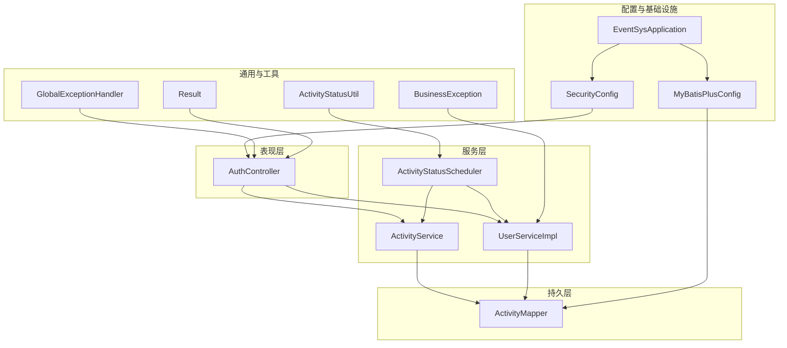
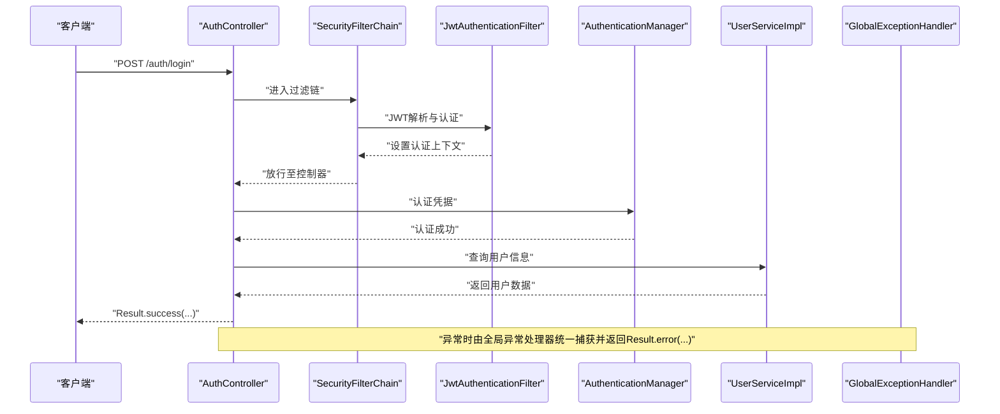
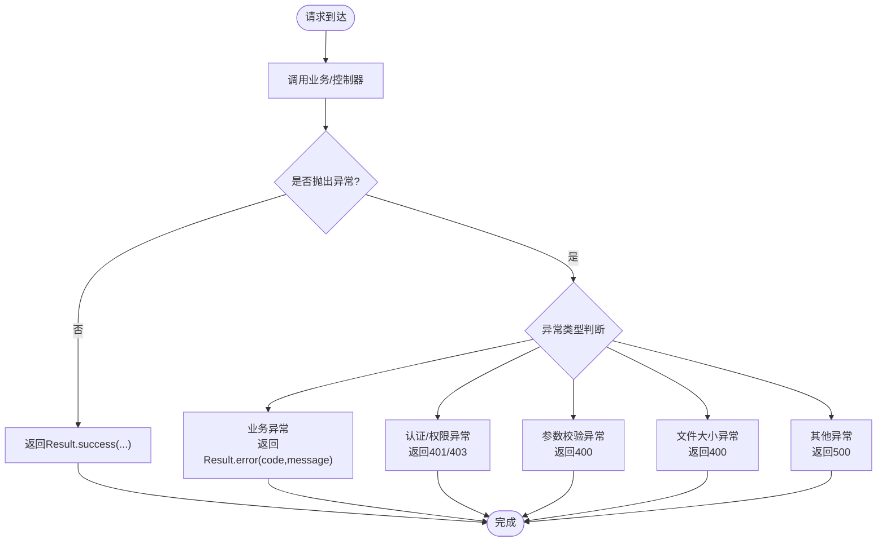
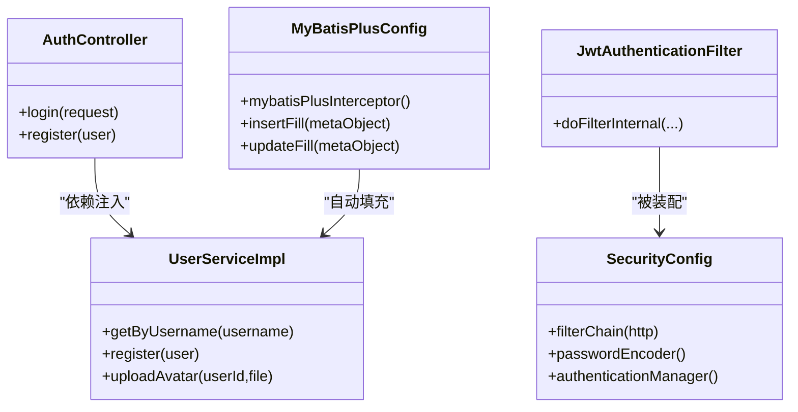
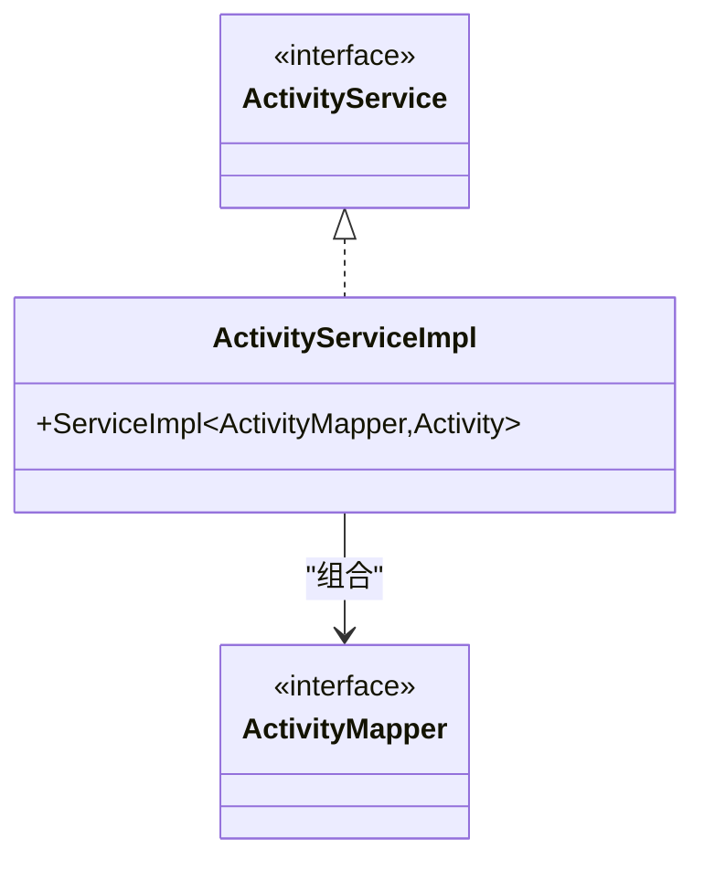
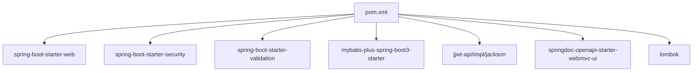

# 设计模式应用

<cite>
**本文引用的文件**
- [EventSysApplication.java](file://src/main/java/com/campus/eventsys/EventSysApplication.java)
- [GlobalExceptionHandler.java](file://src/main/java/com/campus/eventsys/common/GlobalExceptionHandler.java)
- [Result.java](file://src/main/java/com/campus/eventsys/common/Result.java)
- [BusinessException.java](file://src/main/java/com/campus/eventsys/common/BusinessException.java)
- [SecurityConfig.java](file://src/main/java/com/campus/eventsys/config/SecurityConfig.java)
- [MyBatisPlusConfig.java](file://src/main/java/com/campus/eventsys/config/MyBatisPlusConfig.java)
- [JwtAuthenticationFilter.java](file://src/main/java/com/campus/eventsys/security/JwtAuthenticationFilter.java)
- [ActivityServiceImpl.java](file://src/main/java/com/campus/eventsys/service/impl/ActivityServiceImpl.java)
- [ActivityService.java](file://src/main/java/com/campus/eventsys/service/ActivityService.java)
- [ActivityMapper.java](file://src/main/java/com/campus/eventsys/mapper/ActivityMapper.java)
- [AuthController.java](file://src/main/java/com/campus/eventsys/controller/AuthController.java)
- [UserServiceImpl.java](file://src/main/java/com/campus/eventsys/service/impl/UserServiceImpl.java)
- [ActivityStatusScheduler.java](file://src/main/java/com/campus/eventsys/scheduler/ActivityStatusScheduler.java)
- [ActivityStatusUtil.java](file://src/main/java/com/campus/eventsys/utils/ActivityStatusUtil.java)
- [application.yml](file://src/main/resources/application.yml)
- [pom.xml](file://pom.xml)
</cite>

## 目录
1. [引言](#引言)
2. [项目结构](#项目结构)
3. [核心组件](#核心组件)
4. [架构总览](#架构总览)
5. [详细组件分析](#详细组件分析)
6. [依赖分析](#依赖分析)
7. [性能考虑](#性能考虑)
8. [故障排查指南](#故障排查指南)
9. [结论](#结论)
10. [附录](#附录)

## 引言
本文件聚焦于校园活动管理系统中设计模式的应用与落地实践，围绕以下主题展开：统一异常处理的全局异常管理、基于Spring的依赖注入与AOP思想体现、Service层模板方法风格的实现、以及在Service与Mapper实例化中的“工厂”式使用方式。同时结合项目实际代码片段路径，帮助读者理解这些设计模式在真实业务场景中的价值与边界。

## 项目结构
项目采用典型的分层架构：控制器层、服务层、持久层、配置层与通用工具层。Spring Boot负责启动与依赖注入，MyBatis-Plus提供ORM能力，Spring Security提供认证与授权，OpenAPI提供接口文档，定时任务用于状态刷新。

图表来源
- [EventSysApplication.java:1-17](file://src/main/java/com/campus/eventsys/EventSysApplication.java#L1-L17)
- [SecurityConfig.java:1-100](file://src/main/java/com/campus/eventsys/config/SecurityConfig.java#L1-L100)
- [MyBatisPlusConfig.java:1-58](file://src/main/java/com/campus/eventsys/config/MyBatisPlusConfig.java#L1-L58)
- [ActivityService.java:1-8](file://src/main/java/com/campus/eventsys/service/ActivityService.java#L1-L8)
- [ActivityServiceImpl.java:1-12](file://src/main/java/com/campus/eventsys/service/impl/ActivityServiceImpl.java#L1-L12)
- [ActivityMapper.java:1-10](file://src/main/java/com/campus/eventsys/mapper/ActivityMapper.java#L1-L10)
- [AuthController.java:1-106](file://src/main/java/com/campus/eventsys/controller/AuthController.java#L1-L106)
- [UserServiceImpl.java:1-158](file://src/main/java/com/campus/eventsys/service/impl/UserServiceImpl.java#L1-L158)
- [ActivityStatusScheduler.java:1-42](file://src/main/java/com/campus/eventsys/scheduler/ActivityStatusScheduler.java#L1-L42)
- [GlobalExceptionHandler.java:1-108](file://src/main/java/com/campus/eventsys/common/GlobalExceptionHandler.java#L1-L108)
- [Result.java:1-55](file://src/main/java/com/campus/eventsys/common/Result.java#L1-L55)
- [BusinessException.java:1-20](file://src/main/java/com/campus/eventsys/common/BusinessException.java#L1-L20)
- [ActivityStatusUtil.java:1-46](file://src/main/java/com/campus/eventsys/utils/ActivityStatusUtil.java#L1-L46)

章节来源
- [EventSysApplication.java:1-17](file://src/main/java/com/campus/eventsys/EventSysApplication.java#L1-L17)
- [application.yml:1-76](file://src/main/resources/application.yml#L1-L76)

## 核心组件
- 统一响应包装与异常体系：通过统一响应包装类与全局异常处理器，形成一致的错误与业务异常处理机制，体现“外观模式”的思想（对外暴露统一接口，内部按类型分派处理）。
- 安全过滤链与认证流程：基于Spring Security的过滤器链与JWT认证，体现“责任链模式”的思想（多个过滤器串联处理请求）。
- ORM与自动填充：MyBatis-Plus配置体现“模板方法模式”的思想（在插入/更新时统一填充时间戳与逻辑删除字段）。
- 定时任务：通过调度器定期检查与更新活动状态，体现“模板方法模式”的思想（固定周期调用统一的检查与提醒流程）。
- 控制器与服务：控制器依赖服务接口，服务由Spring容器注入，体现“依赖注入”与“接口隔离”。

章节来源
- [Result.java:1-55](file://src/main/java/com/campus/eventsys/common/Result.java#L1-L55)
- [BusinessException.java:1-20](file://src/main/java/com/campus/eventsys/common/BusinessException.java#L1-L20)
- [GlobalExceptionHandler.java:1-108](file://src/main/java/com/campus/eventsys/common/GlobalExceptionHandler.java#L1-L108)
- [SecurityConfig.java:1-100](file://src/main/java/com/campus/eventsys/config/SecurityConfig.java#L1-L100)
- [JwtAuthenticationFilter.java:1-58](file://src/main/java/com/campus/eventsys/security/JwtAuthenticationFilter.java#L1-L58)
- [MyBatisPlusConfig.java:1-58](file://src/main/java/com/campus/eventsys/config/MyBatisPlusConfig.java#L1-L58)
- [ActivityStatusScheduler.java:1-42](file://src/main/java/com/campus/eventsys/scheduler/ActivityStatusScheduler.java#L1-L42)

## 架构总览
下图展示了认证、异常处理与服务调用的关键交互，体现了依赖注入与AOP思想在运行期的体现（异常处理作为横切关注点，认证作为前置处理）。

图表来源
- [AuthController.java:1-106](file://src/main/java/com/campus/eventsys/controller/AuthController.java#L1-L106)
- [SecurityConfig.java:1-100](file://src/main/java/com/campus/eventsys/config/SecurityConfig.java#L1-L100)
- [JwtAuthenticationFilter.java:1-58](file://src/main/java/com/campus/eventsys/security/JwtAuthenticationFilter.java#L1-L58)
- [UserServiceImpl.java:1-158](file://src/main/java/com/campus/eventsys/service/impl/UserServiceImpl.java#L1-L158)
- [GlobalExceptionHandler.java:1-108](file://src/main/java/com/campus/eventsys/common/GlobalExceptionHandler.java#L1-L108)
- [Result.java:1-55](file://src/main/java/com/campus/eventsys/common/Result.java#L1-L55)

## 详细组件分析

### 统一异常处理与全局异常管理（外观模式 + AOP思想）
- 外观模式体现：控制器与客户端仅需关心Result统一响应，异常处理细节被封装在全局异常处理器中，按异常类型分派处理。
- AOP思想体现：异常处理作为横切关注点，在控制器与服务层抛出异常时自动生效，无需在各处重复try-catch。
- 关键点：
  - 全局异常处理器对不同异常类型进行分类处理，并返回统一的Result结构。
  - 对业务异常使用业务码与消息；对认证异常返回标准HTTP语义码；对文件上传超限进行专门处理。
  - 结合日志记录，便于问题追踪与审计。

图表来源
- [GlobalExceptionHandler.java:1-108](file://src/main/java/com/campus/eventsys/common/GlobalExceptionHandler.java#L1-L108)
- [Result.java:1-55](file://src/main/java/com/campus/eventsys/common/Result.java#L1-L55)
- [BusinessException.java:1-20](file://src/main/java/com/campus/eventsys/common/BusinessException.java#L1-L20)

章节来源
- [GlobalExceptionHandler.java:1-108](file://src/main/java/com/campus/eventsys/common/GlobalExceptionHandler.java#L1-L108)
- [Result.java:1-55](file://src/main/java/com/campus/eventsys/common/Result.java#L1-L55)
- [BusinessException.java:1-20](file://src/main/java/com/campus/eventsys/common/BusinessException.java#L1-L20)

### 依赖注入与AOP思想在Spring中的应用
- 依赖注入：控制器、服务、过滤器、配置类均通过Spring容器管理，构造函数注入减少样板代码，提升可测试性。
- AOP思想体现：异常处理、安全过滤、自动填充等横切关注点在不侵入业务代码的情况下生效，符合AOP“关注点分离”的原则。
- 典型场景：
  - 控制器依赖AuthenticationManager、JwtUtil、UserService，均由容器注入。
  - 过滤器依赖JwtUtil与UserDetailsService，统一在SecurityConfig中装配。
  - MyBatis-Plus自动填充在插入/更新时统一执行，体现模板方法的固定流程。

图表来源
- [AuthController.java:1-106](file://src/main/java/com/campus/eventsys/controller/AuthController.java#L1-L106)
- [UserServiceImpl.java:1-158](file://src/main/java/com/campus/eventsys/service/impl/UserServiceImpl.java#L1-L158)
- [JwtAuthenticationFilter.java:1-58](file://src/main/java/com/campus/eventsys/security/JwtAuthenticationFilter.java#L1-L58)
- [SecurityConfig.java:1-100](file://src/main/java/com/campus/eventsys/config/SecurityConfig.java#L1-L100)
- [MyBatisPlusConfig.java:1-58](file://src/main/java/com/campus/eventsys/config/MyBatisPlusConfig.java#L1-L58)

章节来源
- [AuthController.java:1-106](file://src/main/java/com/campus/eventsys/controller/AuthController.java#L1-L106)
- [UserServiceImpl.java:1-158](file://src/main/java/com/campus/eventsys/service/impl/UserServiceImpl.java#L1-L158)
- [JwtAuthenticationFilter.java:1-58](file://src/main/java/com/campus/eventsys/security/JwtAuthenticationFilter.java#L1-L58)
- [SecurityConfig.java:1-100](file://src/main/java/com/campus/eventsys/config/SecurityConfig.java#L1-L100)
- [MyBatisPlusConfig.java:1-58](file://src/main/java/com/campus/eventsys/config/MyBatisPlusConfig.java#L1-L58)

### Service层模板方法风格实现
- ActivityServiceImpl继承MyBatis-Plus的IService实现类，直接获得CRUD能力，体现“模板方法模式”的思想：框架提供通用流程（如分页、条件构造、逻辑删除），业务只需声明实体与Mapper即可。
- UserServiceImpl在注册、头像上传等流程中，遵循固定步骤（参数校验、业务校验、持久化），也体现了模板化的处理流程。

图表来源
- [ActivityService.java:1-8](file://src/main/java/com/campus/eventsys/service/ActivityService.java#L1-L8)
- [ActivityServiceImpl.java:1-12](file://src/main/java/com/campus/eventsys/service/impl/ActivityServiceImpl.java#L1-L12)
- [ActivityMapper.java:1-10](file://src/main/java/com/campus/eventsys/mapper/ActivityMapper.java#L1-L10)

章节来源
- [ActivityServiceImpl.java:1-12](file://src/main/java/com/campus/eventsys/service/impl/ActivityServiceImpl.java#L1-L12)
- [ActivityService.java:1-8](file://src/main/java/com/campus/eventsys/service/ActivityService.java#L1-L8)
- [ActivityMapper.java:1-10](file://src/main/java/com/campus/eventsys/mapper/ActivityMapper.java#L1-L10)

### 工厂模式在Service与Mapper实例化中的使用
- 说明：项目中未显式定义“工厂类”，但Spring容器天然承担了“对象工厂”的职责。通过注解驱动的组件扫描与依赖注入，实现了Service与Mapper的自动实例化与装配。
- 实践要点：
  - Service层通过@Service注解被容器管理，具体实现类由容器实例化并注入到控制器或其他服务中。
  - Mapper层通过@Mapper注解与@MapperScan扫描，容器自动创建代理实例。
  - 若需扩展复杂创建逻辑（如多实现选择），可在Spring中引入FactoryBean或@Primary/@Qualifier等机制，以实现“工厂模式”的扩展。

章节来源
- [EventSysApplication.java:1-17](file://src/main/java/com/campus/eventsys/EventSysApplication.java#L1-L17)
- [ActivityMapper.java:1-10](file://src/main/java/com/campus/eventsys/mapper/ActivityMapper.java#L1-L10)
- [ActivityServiceImpl.java:1-12](file://src/main/java/com/campus/eventsys/service/impl/ActivityServiceImpl.java#L1-L12)

### 观察者模式在活动状态流转中的应用
- 说明：项目中通过定时任务调度器定期检查并更新活动状态，可视为一种“轮询观察者”。虽然不是事件驱动的典型观察者模式，但其效果是对活动状态变化进行持续监控与触发相应动作（如发送提醒）。
- 实践要点：
  - 调度器在固定周期内调用状态检查与提醒服务，体现“观察-决策-行动”的闭环。
  - 可在需要时引入事件发布/订阅机制（如Spring Events），以更优雅地实现松耦合的状态变更通知。

章节来源
- [ActivityStatusScheduler.java:1-42](file://src/main/java/com/campus/eventsys/scheduler/ActivityStatusScheduler.java#L1-L42)
- [ActivityStatusUtil.java:1-46](file://src/main/java/com/campus/eventsys/utils/ActivityStatusUtil.java#L1-L46)

### 单例模式与工具类
- 说明：项目中存在纯工具类（如状态名称映射工具），通过静态方法提供服务，天然具备“单例”特性（类加载即唯一实例）。该设计简单直接，适合无状态的纯函数式工具。
- 注意事项：避免在工具类中引入可变共享状态，确保线程安全与幂等性。

章节来源
- [ActivityStatusUtil.java:1-46](file://src/main/java/com/campus/eventsys/utils/ActivityStatusUtil.java#L1-L46)

## 依赖分析
- Spring生态：Web、Security、Validation、Test等Starter提供开箱即用的能力。
- ORM与安全：MyBatis-Plus与JWT分别负责数据持久化与认证。
- 文档与工具：OpenAPI/Swagger提供接口文档；Lombok简化POJO。

图表来源
- [pom.xml:1-131](file://pom.xml#L1-L131)

章节来源
- [pom.xml:1-131](file://pom.xml#L1-L131)

## 性能考虑
- 定时任务频率：当前调度周期为固定速率，建议根据业务量与数据库压力动态调整，避免频繁扫描导致的资源竞争。
- 自动填充字段：统一在插入/更新时填充时间戳与逻辑删除字段，减少业务代码重复，同时保证一致性。
- 分页插件：MyBatis-Plus分页插件限制最大每页条数，防止大页查询造成内存压力。

章节来源
- [MyBatisPlusConfig.java:1-58](file://src/main/java/com/campus/eventsys/config/MyBatisPlusConfig.java#L1-L58)
- [ActivityStatusScheduler.java:1-42](file://src/main/java/com/campus/eventsys/scheduler/ActivityStatusScheduler.java#L1-L42)

## 故障排查指南
- 统一异常处理：
  - 业务异常：通过业务异常类携带业务码与消息，便于前端识别与提示。
  - 认证异常：针对未登录、权限不足、凭证过期等场景，返回标准化错误码与提示。
  - 参数校验：对字段缺失或格式错误进行聚合提示，提升调试效率。
  - 文件上传：对超限与类型不符进行明确提示。
- 日志记录：异常处理器与服务层均包含日志输出，便于定位问题根因。
- 配置核对：确认认证过滤器链、跨域配置、文件上传大小限制、数据库连接与MyBatis-Plus配置是否正确。

章节来源
- [GlobalExceptionHandler.java:1-108](file://src/main/java/com/campus/eventsys/common/GlobalExceptionHandler.java#L1-L108)
- [Result.java:1-55](file://src/main/java/com/campus/eventsys/common/Result.java#L1-L55)
- [BusinessException.java:1-20](file://src/main/java/com/campus/eventsys/common/BusinessException.java#L1-L20)
- [application.yml:1-76](file://src/main/resources/application.yml#L1-L76)

## 结论
本项目在Spring生态下，通过依赖注入与AOP思想（异常处理、安全过滤、自动填充）实现了横切关注点的统一管理；Service层采用模板方法风格，借助MyBatis-Plus快速构建业务能力；定时任务与工具类分别体现了轮询观察与纯工具的简洁设计。整体架构清晰、职责分明，便于扩展与维护。

## 附录
- 代码片段路径参考：
  - 统一响应包装：[Result.java:1-55](file://src/main/java/com/campus/eventsys/common/Result.java#L1-L55)
  - 业务异常类：[BusinessException.java:1-20](file://src/main/java/com/campus/eventsys/common/BusinessException.java#L1-L20)
  - 全局异常处理器：[GlobalExceptionHandler.java:1-108](file://src/main/java/com/campus/eventsys/common/GlobalExceptionHandler.java#L1-L108)
  - 安全配置与过滤器：[SecurityConfig.java:1-100](file://src/main/java/com/campus/eventsys/config/SecurityConfig.java#L1-L100)、[JwtAuthenticationFilter.java:1-58](file://src/main/java/com/campus/eventsys/security/JwtAuthenticationFilter.java#L1-L58)
  - ORM与自动填充：[MyBatisPlusConfig.java:1-58](file://src/main/java/com/campus/eventsys/config/MyBatisPlusConfig.java#L1-L58)
  - Service与Mapper：[ActivityService.java:1-8](file://src/main/java/com/campus/eventsys/service/ActivityService.java#L1-L8)、[ActivityServiceImpl.java:1-12](file://src/main/java/com/campus/eventsys/service/impl/ActivityServiceImpl.java#L1-L12)、[ActivityMapper.java:1-10](file://src/main/java/com/campus/eventsys/mapper/ActivityMapper.java#L1-L10)
  - 控制器示例：[AuthController.java:1-106](file://src/main/java/com/campus/eventsys/controller/AuthController.java#L1-L106)
  - 服务实现示例：[UserServiceImpl.java:1-158](file://src/main/java/com/campus/eventsys/service/impl/UserServiceImpl.java#L1-L158)
  - 定时任务：[ActivityStatusScheduler.java:1-42](file://src/main/java/com/campus/eventsys/scheduler/ActivityStatusScheduler.java#L1-L42)
  - 工具类：[ActivityStatusUtil.java:1-46](file://src/main/java/com/campus/eventsys/utils/ActivityStatusUtil.java#L1-L46)
  - 应用配置：[application.yml:1-76](file://src/main/resources/application.yml#L1-L76)
  - 项目依赖：[pom.xml:1-131](file://pom.xml#L1-L131)