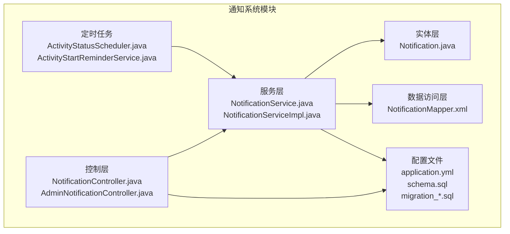
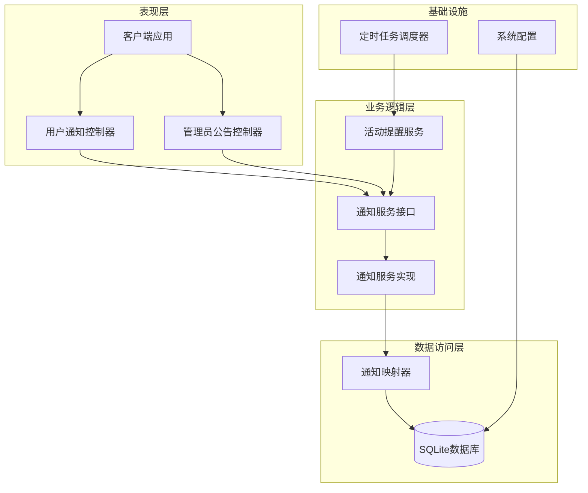
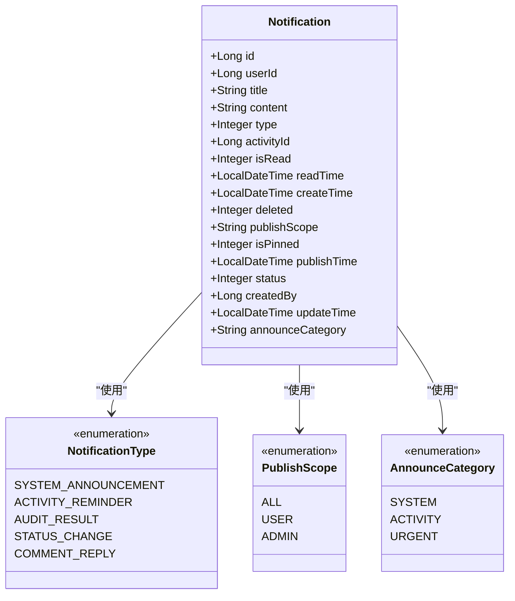
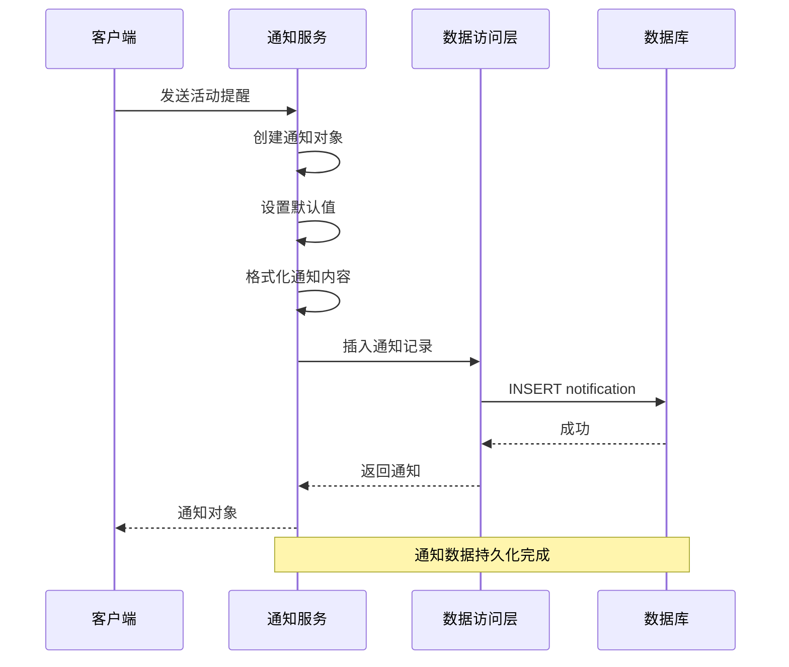
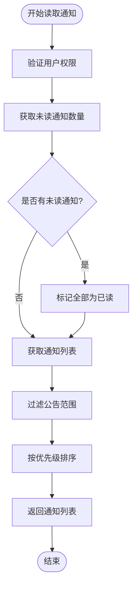
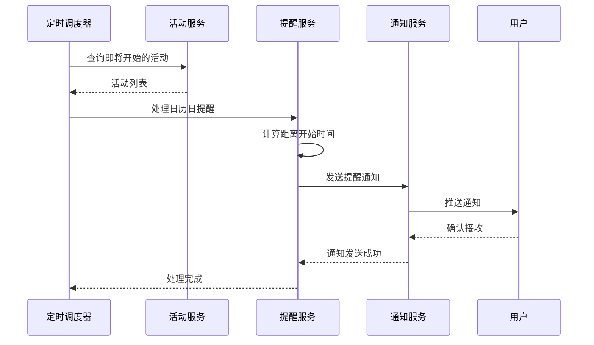
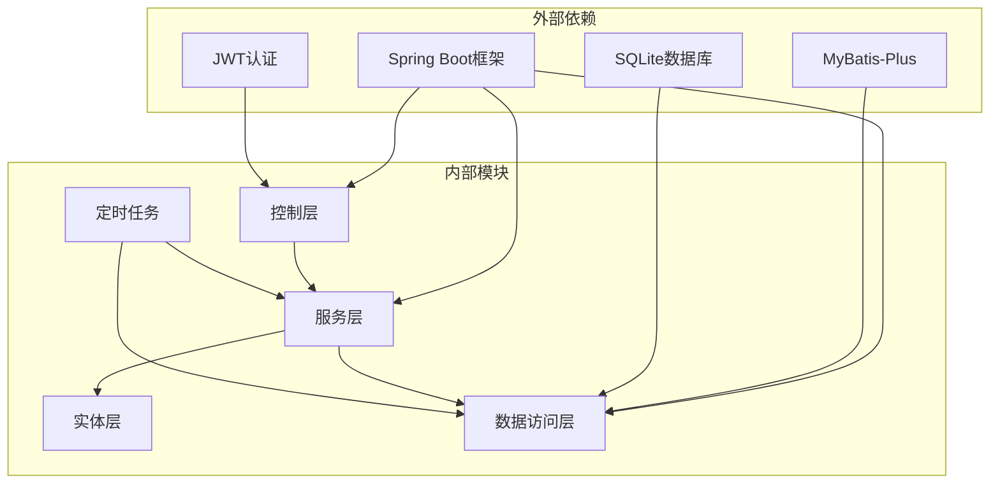

# 通知系统模块

<cite>
**本文档引用的文件**
- [Notification.java](file://src/main/java/com/campus/eventsys/entity/Notification.java)
- [NotificationService.java](file://src/main/java/com/campus/eventsys/service/NotificationService.java)
- [NotificationServiceImpl.java](file://src/main/java/com/campus/eventsys/service/impl/NotificationServiceImpl.java)
- [NotificationController.java](file://src/main/java/com/campus/eventsys/controller/NotificationController.java)
- [AdminNotificationController.java](file://src/main/java/com/campus/eventsys/controller/AdminNotificationController.java)
- [NotificationMapper.xml](file://src/main/resources/mapper/NotificationMapper.xml)
- [ActivityStartReminderService.java](file://src/main/java/com/campus/eventsys/service/ActivityStartReminderService.java)
- [ActivityStatusScheduler.java](file://src/main/java/com/campus/eventsys/scheduler/ActivityStatusScheduler.java)
- [application.yml](file://src/main/resources/application.yml)
- [schema.sql](file://src/main/resources/db/schema.sql)
- [migration_notification_announcement_fields.sql](file://src/main/resources/db/migration_notification_announcement_fields.sql)
- [NotificationControllerTest.java](file://src/test/java/com/campus/eventsys/controller/NotificationControllerTest.java)
</cite>

## 目录
1. [简介](#简介)
2. [项目结构](#项目结构)
3. [核心组件](#核心组件)
4. [架构概览](#架构概览)
5. [详细组件分析](#详细组件分析)
6. [依赖关系分析](#依赖关系分析)
7. [性能考虑](#性能考虑)
8. [故障排除指南](#故障排除指南)
9. [结论](#结论)
10. [附录](#附录)

## 简介

通知系统模块是校园活动综合管理系统的重要组成部分，负责生成、分发和管理各类系统通知。该模块实现了完整的通知生命周期管理，包括系统公告、活动提醒、审核结果通知、状态变更通知和评论回复通知等多种通知类型。

系统采用基于SQLite的关系型数据库存储通知数据，通过MyBatis-Plus进行数据持久化操作。通知系统支持定时任务自动发送活动提醒，具备完善的权限控制和通知状态管理功能。

## 项目结构

通知系统模块在项目中的组织结构如下：



**图表来源**
- [Notification.java:1-81](file://src/main/java/com/campus/eventsys/entity/Notification.java#L1-L81)
- [NotificationService.java:1-192](file://src/main/java/com/campus/eventsys/service/NotificationService.java#L1-L192)
- [NotificationController.java:1-235](file://src/main/java/com/campus/eventsys/controller/NotificationController.java#L1-L235)

**章节来源**
- [Notification.java:1-81](file://src/main/java/com/campus/eventsys/entity/Notification.java#L1-L81)
- [NotificationService.java:1-192](file://src/main/java/com/campus/eventsys/service/NotificationService.java#L1-L192)
- [NotificationController.java:1-235](file://src/main/java/com/campus/eventsys/controller/NotificationController.java#L1-L235)

## 核心组件

通知系统由以下核心组件构成：

### 数据模型组件
- **Notification实体类**：定义通知的基本属性和业务字段
- **通知类型枚举**：支持系统公告、活动提醒、审核结果、状态变更、评论回复五种类型
- **发布范围控制**：支持ALL、USER、ADMIN三种发布范围

### 服务组件
- **NotificationService接口**：定义通知服务的业务方法
- **NotificationServiceImpl实现类**：提供具体的通知生成和管理逻辑
- **ActivityStartReminderService**：处理活动开始前的日历日提醒

### 控制器组件
- **NotificationController**：用户通知管理接口
- **AdminNotificationController**：管理员公告管理接口

### 数据访问组件
- **NotificationMapper.xml**：定义通知查询的SQL语句
- **数据库模式**：完整的SQLite数据库结构定义

**章节来源**
- [Notification.java:28-80](file://src/main/java/com/campus/eventsys/entity/Notification.java#L28-L80)
- [NotificationService.java:15-191](file://src/main/java/com/campus/eventsys/service/NotificationService.java#L15-L191)
- [NotificationServiceImpl.java:27-455](file://src/main/java/com/campus/eventsys/service/impl/NotificationServiceImpl.java#L27-L455)

## 架构概览

通知系统的整体架构采用分层设计，确保了良好的可维护性和扩展性：



**图表来源**
- [NotificationController.java:36-235](file://src/main/java/com/campus/eventsys/controller/NotificationController.java#L36-L235)
- [AdminNotificationController.java:53-219](file://src/main/java/com/campus/eventsys/controller/AdminNotificationController.java#L53-L219)
- [NotificationServiceImpl.java:27-455](file://src/main/java/com/campus/eventsys/service/impl/NotificationServiceImpl.java#L27-L455)

## 详细组件分析

### 通知实体模型

通知实体类定义了完整的通知数据结构，支持多种通知类型和业务场景：



**图表来源**
- [Notification.java:13-80](file://src/main/java/com/campus/eventsys/entity/Notification.java#L13-L80)

#### 通知类型详解

系统支持五种不同类型的业务通知：

1. **系统公告 (type=1)**：管理员发布的全局公告
2. **活动提醒 (type=2)**：活动开始前的自动提醒
3. **审核结果 (type=3)**：活动审核通过/拒绝通知
4. **状态变更 (type=4)**：活动状态变化通知
5. **评论回复 (type=5)**：用户评论回复通知

**章节来源**
- [Notification.java:28-36](file://src/main/java/com/campus/eventsys/entity/Notification.java#L28-L36)
- [NotificationService.java:15-191](file://src/main/java/com/campus/eventsys/service/NotificationService.java#L15-L191)

### 通知服务实现

通知服务实现了完整的业务逻辑处理：



**图表来源**
- [NotificationServiceImpl.java:204-240](file://src/main/java/com/campus/eventsys/service/impl/NotificationServiceImpl.java#L204-L240)

#### 通知生成流程

通知生成过程包含以下关键步骤：

1. **参数验证**：检查输入参数的有效性
2. **默认值填充**：设置通知的默认属性值
3. **内容格式化**：根据业务类型生成通知内容
4. **数据持久化**：将通知信息保存到数据库
5. **日志记录**：记录通知生成的详细信息

**章节来源**
- [NotificationServiceImpl.java:44-72](file://src/main/java/com/campus/eventsys/service/impl/NotificationServiceImpl.java#L44-L72)
- [NotificationServiceImpl.java:160-202](file://src/main/java/com/campus/eventsys/service/impl/NotificationServiceImpl.java#L160-L202)

### 通知存储策略

通知系统采用SQLite作为数据存储，具有以下特点：

#### 数据库设计
- **主键策略**：使用INPUT模式，手动设置通知ID
- **逻辑删除**：通过deleted字段实现软删除
- **索引优化**：为常用查询字段建立索引
- **外键约束**：维护通知与活动的关联关系

#### 存储优化
- **分区策略**：按通知类型和用户ID进行数据分区
- **缓存机制**：利用MyBatis二级缓存提升查询性能
- **批量操作**：支持批量插入和更新操作

**章节来源**
- [schema.sql:178-197](file://src/main/resources/db/schema.sql#L178-L197)
- [application.yml:42-47](file://src/main/resources/application.yml#L42-L47)

### 通知读取状态管理

系统提供了完整的通知状态管理功能：



**图表来源**
- [NotificationServiceImpl.java:396-411](file://src/main/java/com/campus/eventsys/service/impl/NotificationServiceImpl.java#L396-L411)

#### 状态管理特性
- **实时统计**：动态计算未读通知数量
- **权限控制**：确保用户只能访问自己的通知
- **范围过滤**：根据发布范围过滤公告内容
- **排序规则**：支持置顶公告优先显示

**章节来源**
- [NotificationServiceImpl.java:396-453](file://src/main/java/com/campus/eventsys/service/impl/NotificationServiceImpl.java#L396-L453)
- [NotificationMapper.xml:18-49](file://src/main/resources/mapper/NotificationMapper.xml#L18-L49)

### 批量处理功能

系统支持高效的批量通知处理：

#### 批量标记已读
- **批量操作**：支持一次性标记多个通知为已读
- **事务保证**：使用数据库事务确保操作的原子性
- **权限验证**：验证用户对通知的访问权限

#### 批量删除通知
- **逻辑删除**：通过更新deleted字段实现软删除
- **级联处理**：删除相关联的数据记录
- **审计追踪**：记录删除操作的详细信息

**章节来源**
- [NotificationServiceImpl.java:428-453](file://src/main/java/com/campus/eventsys/service/impl/NotificationServiceImpl.java#L428-L453)

### 通知推送实现

通知推送采用异步处理机制：



**图表来源**
- [ActivityStatusScheduler.java:32-40](file://src/main/java/com/campus/eventsys/scheduler/ActivityStatusScheduler.java#L32-L40)
- [ActivityStartReminderService.java:34-84](file://src/main/java/com/campus/eventsys/service/ActivityStartReminderService.java#L34-L84)

#### 推送机制特点
- **定时执行**：每30秒检查一次活动状态
- **去重处理**：防止重复发送相同类型的提醒
- **范围控制**：根据用户角色发送相应通知
- **异常处理**：捕获并记录推送过程中的错误

**章节来源**
- [ActivityStatusScheduler.java:19-40](file://src/main/java/com/campus/eventsys/scheduler/ActivityStatusScheduler.java#L19-L40)
- [ActivityStartReminderService.java:34-91](file://src/main/java/com/campus/eventsys/service/ActivityStartReminderService.java#L34-L91)

### API接口设计

通知系统提供RESTful API接口：

#### 用户通知接口
- **获取通知列表**：GET `/notifications/list`
- **获取未读数量**：GET `/notifications/unread-count`
- **标记已读**：POST `/notifications/read/{id}`
- **全部已读**：POST `/notifications/read-all`
- **删除通知**：DELETE `/notifications/delete/{id}`

#### 管理员公告接口
- **创建公告**：POST `/admin/notifications/announcement`
- **公告列表**：GET `/admin/notifications/announcements`
- **公告详情**：GET `/admin/notifications/announcement/{id}`
- **更新公告**：PUT `/admin/notifications/announcement/{id}`
- **撤回公告**：POST `/admin/notifications/announcement/{id}/recall`

**章节来源**
- [NotificationController.java:44-180](file://src/main/java/com/campus/eventsys/controller/NotificationController.java#L44-L180)
- [AdminNotificationController.java:61-184](file://src/main/java/com/campus/eventsys/controller/AdminNotificationController.java#L61-L184)

## 依赖关系分析

通知系统的依赖关系体现了清晰的分层架构：



**图表来源**
- [application.yml:10-47](file://src/main/resources/application.yml#L10-L47)
- [NotificationServiceImpl.java:34-34](file://src/main/java/com/campus/eventsys/service/impl/NotificationServiceImpl.java#L34-L34)

### 核心依赖关系

1. **框架依赖**：Spring Boot提供基础框架支持
2. **ORM依赖**：MyBatis-Plus简化数据访问层开发
3. **数据库依赖**：SQLite提供轻量级数据存储
4. **安全依赖**：JWT实现用户认证和授权

**章节来源**
- [application.yml:10-47](file://src/main/resources/application.yml#L10-L47)

## 性能考虑

通知系统在设计时充分考虑了性能优化：

### 查询优化
- **索引策略**：为user_id、type、is_read字段建立复合索引
- **查询优化**：使用原生SQL语句优化复杂查询
- **分页处理**：支持大数据量的通知列表分页

### 缓存策略
- **二级缓存**：利用MyBatis二级缓存提升查询性能
- **内存缓存**：缓存常用的配置和字典数据
- **连接池**：使用数据库连接池提高并发性能

### 异步处理
- **定时任务**：使用@Scheduled注解实现异步通知发送
- **批量操作**：支持批量插入和更新操作
- **非阻塞I/O**：采用异步处理减少请求等待时间

## 故障排除指南

### 常见问题及解决方案

#### 通知未显示问题
1. **检查发布范围**：确认公告的发布范围设置是否正确
2. **验证时间条件**：检查publish_time是否早于当前时间
3. **确认用户权限**：验证用户角色是否符合发布范围要求

#### 通知重复发送问题
1. **检查去重逻辑**：验证titleMarker参数是否正确传递
2. **查看数据库状态**：确认通知是否已存在
3. **调试日志输出**：查看服务层的日志信息

#### 定时任务异常
1. **检查调度配置**：验证@Scheduled注解的时间间隔设置
2. **监控任务执行**：查看日志中任务执行状态
3. **异常处理机制**：确保异常被捕获并记录

**章节来源**
- [NotificationServiceImpl.java:246-258](file://src/main/java/com/campus/eventsys/service/impl/NotificationServiceImpl.java#L246-L258)
- [ActivityStartReminderService.java:42-47](file://src/main/java/com/campus/eventsys/service/ActivityStartReminderService.java#L42-L47)

### 调试工具和方法

1. **日志分析**：通过DEBUG级别日志跟踪通知处理流程
2. **数据库查询**：直接查询数据库验证数据状态
3. **API测试**：使用Swagger UI测试各接口功能
4. **单元测试**：运行测试用例验证业务逻辑正确性

**章节来源**
- [NotificationControllerTest.java:63-242](file://src/test/java/com/campus/eventsys/controller/NotificationControllerTest.java#L63-L242)

## 结论

通知系统模块通过合理的架构设计和完善的业务实现，为校园活动综合管理系统提供了可靠的通知服务。系统支持多种通知类型，具备完整的生命周期管理功能，并采用了异步处理机制确保系统的高性能和高可用性。

模块的主要优势包括：
- 清晰的分层架构便于维护和扩展
- 完善的权限控制确保数据安全
- 高效的查询优化提升用户体验
- 异步处理机制保证系统性能

未来可以考虑的功能增强包括：消息队列集成、通知模板管理、多语言支持等。

## 附录

### 配置示例

#### 数据库配置
```yaml
spring:
  datasource:
    driver-class-name: org.sqlite.JDBC
    url: jdbc:sqlite:${user.dir}/event_database.db
    username:
    password:
  mybatis-plus:
    mapper-locations: classpath*:/mapper/**/*.xml
    global-config:
      db-config:
        id-type: input
        logic-delete-field: deleted
        logic-delete-value: 1
        logic-not-delete-value: 0
```

#### 定时任务配置
```yaml
spring:
  task:
    scheduling:
      pool:
        size: 5
  scheduled:
    tasks:
      fixed-rate: 30000
```

### API调用示例

#### 获取用户通知列表
```
GET /api/notifications/list?page=1&size=10
Authorization: Bearer {token}
```

#### 发送系统公告
```
POST /api/admin/notifications/announcement
Authorization: Bearer {admin_token}
Content-Type: application/x-www-form-urlencoded

title=系统维护通知&content=系统将于今晚进行维护升级&publishScope=ALL&status=1
```

### 扩展开发指南

#### 自定义通知类型开发步骤
1. **定义通知类型**：在Notification实体中添加新的类型常量
2. **实现业务逻辑**：在NotificationServiceImpl中添加对应的发送方法
3. **更新数据库**：修改schema.sql添加必要的字段
4. **编写测试用例**：在NotificationControllerTest中添加单元测试
5. **更新API文档**：在控制器中添加相应的接口注释

#### 通知模板管理
系统支持通过配置文件管理通知模板，便于统一管理通知内容格式。