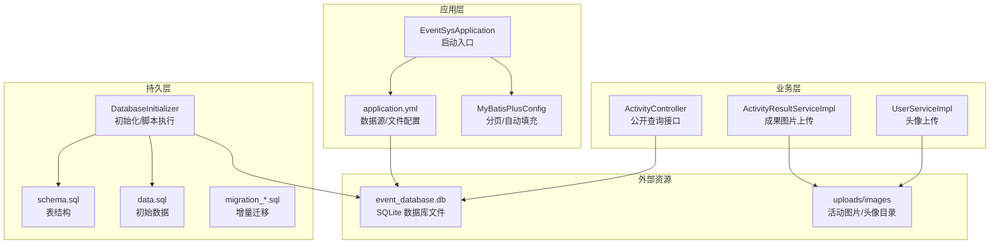
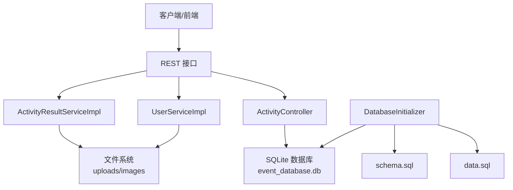
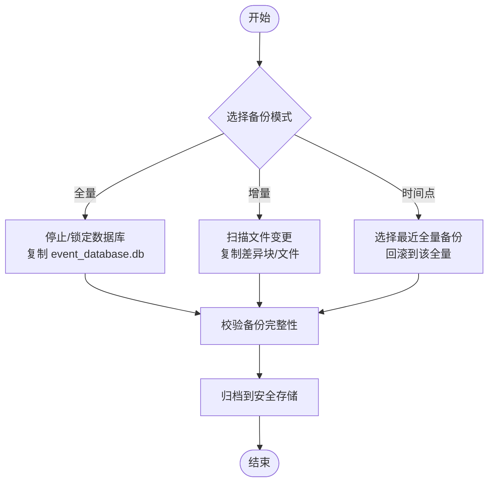
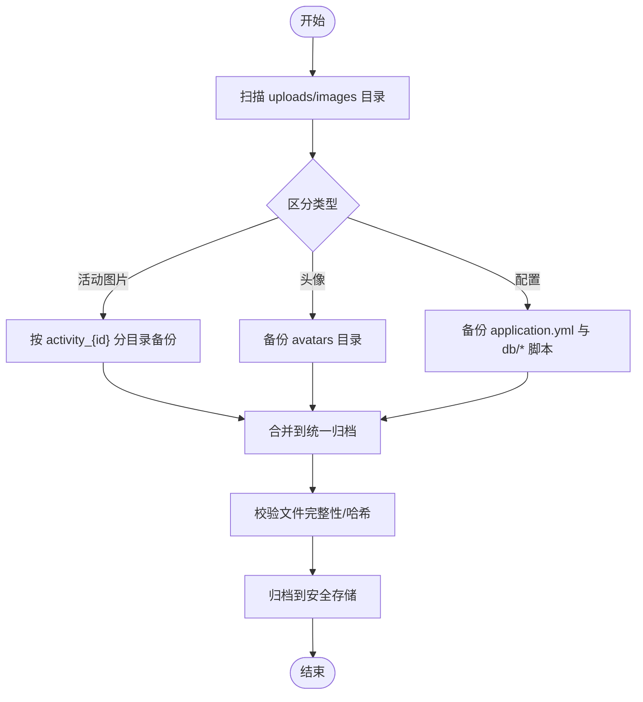
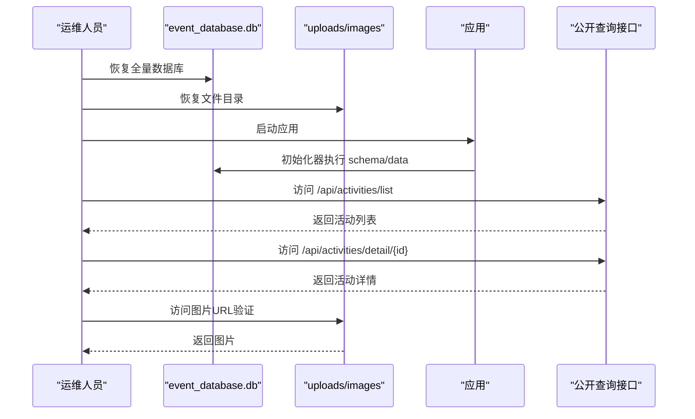
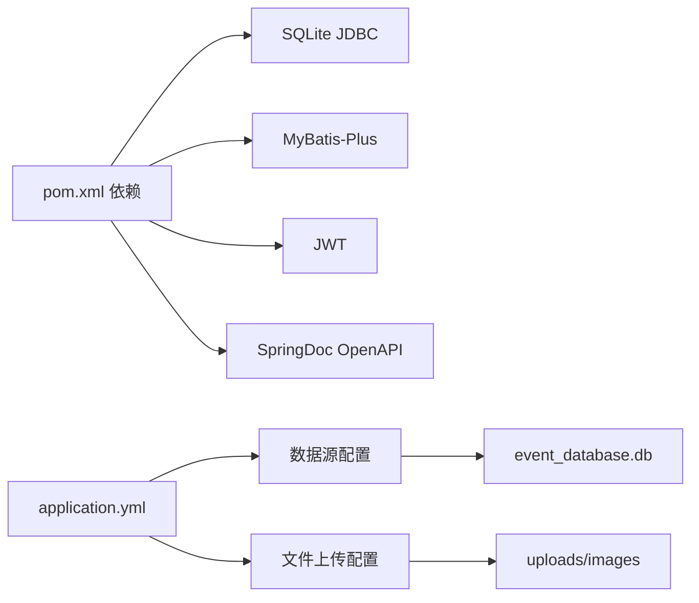

# 备份恢复

<cite>
**本文引用的文件**   
- [application.yml](file://src/main/resources/application.yml)
- [pom.xml](file://pom.xml)
- [EventSysApplication.java](file://src/main/java/com/campus/eventsys/EventSysApplication.java)
- [DatabaseInitializer.java](file://src/main/java/com/campus/eventsys/config/DatabaseInitializer.java)
- [MyBatisPlusConfig.java](file://src/main/java/com/campus/eventsys/config/MyBatisPlusConfig.java)
- [schema.sql](file://src/main/resources/db/schema.sql)
- [data.sql](file://src/main/resources/db/data.sql)
- [migration_notification_announcement_fields.sql](file://src/main/resources/db/migration_notification_announcement_fields.sql)
- [ActivityController.java](file://src/main/java/com/campus/eventsys/controller/ActivityController.java)
- [ActivityResultServiceImpl.java](file://src/main/java/com/campus/eventsys/service/impl/ActivityResultServiceImpl.java)
- [UserServiceImpl.java](file://src/main/java/com/campus/eventsys/service/impl/UserServiceImpl.java)
- [url.txt](file://url.txt)
</cite>

## 目录
1. [简介](#简介)
2. [项目结构](#项目结构)
3. [核心组件](#核心组件)
4. [架构总览](#架构总览)
5. [详细组件分析](#详细组件分析)
6. [依赖分析](#依赖分析)
7. [性能考虑](#性能考虑)
8. [故障排查指南](#故障排查指南)
9. [结论](#结论)
10. [附录](#附录)

## 简介
本文件面向“校园活动管理系统”的备份与恢复，围绕数据库与文件系统两类数据源制定策略，覆盖全量/增量/时间点恢复思路、文件备份策略、验证与演练流程、自动化脚本与存储管理、数据加密方案、监控告警与业务连续性保障。系统采用 SQLite 本地数据库与本地文件系统存储图片与头像，因此备份重点在于数据库文件与上传目录的同步备份与一致性校验。

## 项目结构
系统采用 Spring Boot + MyBatis-Plus 架构，数据库为 SQLite，文件上传路径与访问 URL 在配置文件中集中定义。数据库初始化脚本与测试数据位于资源目录，服务层负责图片与头像的上传与目录管理。

**图表来源** 
- [EventSysApplication.java:1-17](file://src/main/java/com/campus/eventsys/EventSysApplication.java#L1-L17)
- [application.yml:10-15](file://src/main/resources/application.yml#L10-L15)
- [application.yml:65-69](file://src/main/resources/application.yml#L65-L69)
- [DatabaseInitializer.java:34-53](file://src/main/java/com/campus/eventsys/config/DatabaseInitializer.java#L34-L53)
- [schema.sql:1-295](file://src/main/resources/db/schema.sql#L1-L295)
- [data.sql:1-335](file://src/main/resources/db/data.sql#L1-L335)
- [migration_notification_announcement_fields.sql:1-22](file://src/main/resources/db/migration_notification_announcement_fields.sql#L1-L22)
- [ActivityResultServiceImpl.java:28-29](file://src/main/java/com/campus/eventsys/service/impl/ActivityResultServiceImpl.java#L28-L29)
- [UserServiceImpl.java:28-32](file://src/main/java/com/campus/eventsys/service/impl/UserServiceImpl.java#L28-L32)

**章节来源**
- [application.yml:10-15](file://src/main/resources/application.yml#L10-L15)
- [application.yml:65-69](file://src/main/resources/application.yml#L65-L69)
- [EventSysApplication.java:1-17](file://src/main/java/com/campus/eventsys/EventSysApplication.java#L1-L17)
- [DatabaseInitializer.java:34-53](file://src/main/java/com/campus/eventsys/config/DatabaseInitializer.java#L34-L53)
- [schema.sql:1-295](file://src/main/resources/db/schema.sql#L1-L295)
- [data.sql:1-335](file://src/main/resources/db/data.sql#L1-L335)
- [migration_notification_announcement_fields.sql:1-22](file://src/main/resources/db/migration_notification_announcement_fields.sql#L1-L22)
- [ActivityResultServiceImpl.java:28-29](file://src/main/java/com/campus/eventsys/service/impl/ActivityResultServiceImpl.java#L28-L29)
- [UserServiceImpl.java:28-32](file://src/main/java/com/campus/eventsys/service/impl/UserServiceImpl.java#L28-L32)

## 核心组件
- 数据库与初始化
  - 数据源指向本地 SQLite 文件，初始化器在应用启动时自动执行 schema.sql 与 data.sql，并对初始用户密码进行加密。
- 文件系统与上传
  - 图片与头像上传路径与访问 URL 在配置文件中定义，服务层按活动 ID 分目录存储成果图片，头像单独目录并支持旧头像清理。
- 配置与依赖
  - pom.xml 引入 SQLite JDBC、MyBatis-Plus、JWT、Swagger 等依赖，application.yml 定义数据源、文件上传、日志与 OpenAPI 路径。

**章节来源**
- [DatabaseInitializer.java:34-53](file://src/main/java/com/campus/eventsys/config/DatabaseInitializer.java#L34-L53)
- [schema.sql:1-295](file://src/main/resources/db/schema.sql#L1-L295)
- [data.sql:1-335](file://src/main/resources/db/data.sql#L1-L335)
- [application.yml:10-15](file://src/main/resources/application.yml#L10-L15)
- [application.yml:65-69](file://src/main/resources/application.yml#L65-L69)
- [pom.xml:46-51](file://pom.xml#L46-L51)
- [pom.xml:53-58](file://pom.xml#L53-L58)
- [pom.xml:60-77](file://pom.xml#L60-L77)
- [pom.xml:86-91](file://pom.xml#L86-L91)

## 架构总览
系统采用本地 SQLite 数据库存储业务数据，上传的图片与头像存放在本地文件系统。应用启动时通过初始化器加载表结构与初始数据，服务层负责文件写入与目录管理。

**图表来源** 
- [application.yml:10-15](file://src/main/resources/application.yml#L10-L15)
- [application.yml:65-69](file://src/main/resources/application.yml#L65-L69)
- [DatabaseInitializer.java:34-53](file://src/main/java/com/campus/eventsys/config/DatabaseInitializer.java#L34-L53)
- [schema.sql:1-295](file://src/main/resources/db/schema.sql#L1-L295)
- [data.sql:1-335](file://src/main/resources/db/data.sql#L1-L335)
- [ActivityResultServiceImpl.java:124-146](file://src/main/java/com/campus/eventsys/service/impl/ActivityResultServiceImpl.java#L124-L146)
- [UserServiceImpl.java:79-110](file://src/main/java/com/campus/eventsys/service/impl/UserServiceImpl.java#L79-L110)

## 详细组件分析

### 数据库备份策略
- 全量备份
  - 停机或锁定数据库后复制 event_database.db 文件；或在应用关闭状态下复制，确保文件级一致性。
  - 备份文件命名建议包含时间戳与版本信息，便于检索与恢复。
- 增量备份
  - SQLite 不具备原生命日志/归档日志，无法实现传统 RDBMS 的事务日志增量。可采用“基于文件变更”的策略：定期扫描 event_database.db 的修改时间，仅复制变更文件或差异块（需结合外部工具）。
- 时间点恢复（PoP）
  - 由于 SQLite 缺少内置的 WAL/ArcLog，无法实现精确时间点恢复。可通过“全量+多次全量”的方式近似实现：在关键节点（如重大功能上线前后）执行全量备份，恢复时选择最接近目标时间的全量备份。
- 初始化脚本与迁移
  - schema.sql 与 data.sql 用于首次初始化；migration_notification_announcement_fields.sql 用于历史库的字段扩展。迁移脚本应按顺序执行，确保数据库结构演进的可追踪性。

**图表来源** 
- [application.yml:10-15](file://src/main/resources/application.yml#L10-L15)
- [schema.sql:1-295](file://src/main/resources/db/schema.sql#L1-L295)
- [data.sql:1-335](file://src/main/resources/db/data.sql#L1-L335)
- [migration_notification_announcement_fields.sql:1-22](file://src/main/resources/db/migration_notification_announcement_fields.sql#L1-L22)

**章节来源**
- [application.yml:10-15](file://src/main/resources/application.yml#L10-L15)
- [schema.sql:1-295](file://src/main/resources/db/schema.sql#L1-L295)
- [data.sql:1-335](file://src/main/resources/db/data.sql#L1-L335)
- [migration_notification_announcement_fields.sql:1-22](file://src/main/resources/db/migration_notification_announcement_fields.sql#L1-L22)

### 文件系统备份策略
- 目标范围
  - 活动图片：按活动 ID 分目录，如 uploads/images/activity_{id}/
  - 用户头像：独立 uploads/images/avatars/ 目录
  - 系统配置：application.yml 与数据库迁移脚本
- 备份方法
  - 全量：对 uploads/images 与 application.yml 所在目录执行整目录复制/快照。
  - 增量：基于文件修改时间或校验和差异检测，仅同步变更文件。
  - 归档：按日期/版本打包，保留多代副本。
- 一致性
  - 上传过程中可能产生临时文件，应在备份窗口或锁定写入后再执行备份，避免不一致快照。
  - 头像上传涉及旧文件清理，备份前需确认最终文件集合。

**图表来源** 
- [application.yml:65-69](file://src/main/resources/application.yml#L65-L69)
- [ActivityResultServiceImpl.java:124-146](file://src/main/java/com/campus/eventsys/service/impl/ActivityResultServiceImpl.java#L124-L146)
- [UserServiceImpl.java:79-110](file://src/main/java/com/campus/eventsys/service/impl/UserServiceImpl.java#L79-L110)

**章节来源**
- [application.yml:65-69](file://src/main/resources/application.yml#L65-L69)
- [ActivityResultServiceImpl.java:124-146](file://src/main/java/com/campus/eventsys/service/impl/ActivityResultServiceImpl.java#L124-L146)
- [UserServiceImpl.java:79-110](file://src/main/java/com/campus/eventsys/service/impl/UserServiceImpl.java#L79-L110)

### 备份验证流程与恢复测试
- 验证清单
  - 数据库：核对 event_database.db 的校验和；执行 schema.sql 与 data.sql 的初始化流程，验证表结构与初始数据存在。
  - 文件系统：核对 uploads/images 下各活动目录与 avatars 目录的文件数量与代表性文件；验证访问 URL 可正常访问。
  - 配置：核对 application.yml 的关键项（数据源、文件上传路径、访问 URL）。
- 恢复测试
  - 在隔离环境中恢复全量备份，启动应用，验证 Swagger UI 与公开查询接口可用；检查活动列表与详情接口返回正常。
  - 验证图片上传与头像上传接口，确认文件写入与访问 URL 正常。

**图表来源** 
- [application.yml:10-15](file://src/main/resources/application.yml#L10-L15)
- [application.yml:65-69](file://src/main/resources/application.yml#L65-L69)
- [DatabaseInitializer.java:34-53](file://src/main/java/com/campus/eventsys/config/DatabaseInitializer.java#L34-L53)
- [ActivityController.java:54-87](file://src/main/java/com/campus/eventsys/controller/ActivityController.java#L54-L87)

**章节来源**
- [application.yml:10-15](file://src/main/resources/application.yml#L10-L15)
- [application.yml:65-69](file://src/main/resources/application.yml#L65-L69)
- [DatabaseInitializer.java:34-53](file://src/main/java/com/campus/eventsys/config/DatabaseInitializer.java#L34-L53)
- [ActivityController.java:54-87](file://src/main/java/com/campus/eventsys/controller/ActivityController.java#L54-L87)

### 自动化备份脚本与存储管理
- 脚本建议
  - 数据库：在应用关闭时复制 event_database.db；或在应用运行时使用文件系统快照（如支持）。
  - 文件系统：rsync 或 tar/zip 打包 uploads/images 与配置目录；按日期命名归档。
  - 迁移脚本：按顺序执行 schema.sql 与 migration_* 脚本，记录执行日志。
- 存储管理
  - 本地磁盘与远程对象存储（如 S3 兼容）双写；保留 N 代全量与周期性增量；设置生命周期策略。
  - 对备份文件进行压缩与分卷，降低存储成本。

[本节为通用实践建议，不直接分析具体文件，故无章节来源]

### 备份数据加密方案
- 传输加密：使用 HTTPS 与 SFTP/HTTPS 下载。
- 静态加密：对备份文件进行 AES 加密，密钥由密管系统轮换管理；避免将密钥与备份文件同库存放。
- 访问控制：最小权限原则，仅授权人员可解密与恢复。

[本节为通用实践建议，不直接分析具体文件，故无章节来源]

### 备份监控告警与恢复演练
- 监控指标
  - 备份任务执行状态、文件校验和、文件数量、存储容量、解压/解密成功率。
- 告警策略
  - 失败即告警；延迟阈值触发预警；定期巡检异常。
- 恢复演练
  - 每季度至少一次“全量恢复+验证”演练；每年一次“时间点近似恢复”演练；记录演练结果与改进项。

[本节为通用实践建议，不直接分析具体文件，故无章节来源]

## 依赖分析
- 数据库依赖
  - SQLite JDBC 与 MyBatis-Plus 提供 ORM 与分页能力；SQLite 不支持 getGeneratedKeys，使用 INPUT 模式。
- 安全与文档
  - JWT 用于鉴权；SpringDoc 提供 OpenAPI/Swagger 文档。
- 上传与文件
  - Spring MVC 的文件上传配置与服务层的文件写入逻辑共同构成文件系统访问链路。

**图表来源** 
- [pom.xml:46-51](file://pom.xml#L46-L51)
- [pom.xml:53-58](file://pom.xml#L53-L58)
- [pom.xml:60-77](file://pom.xml#L60-L77)
- [pom.xml:86-91](file://pom.xml#L86-L91)
- [application.yml:10-15](file://src/main/resources/application.yml#L10-L15)
- [application.yml:65-69](file://src/main/resources/application.yml#L65-L69)

**章节来源**
- [pom.xml:46-51](file://pom.xml#L46-L51)
- [pom.xml:53-58](file://pom.xml#L53-L58)
- [pom.xml:60-77](file://pom.xml#L60-L77)
- [pom.xml:86-91](file://pom.xml#L86-L91)
- [application.yml:10-15](file://src/main/resources/application.yml#L10-L15)
- [application.yml:65-69](file://src/main/resources/application.yml#L65-L69)

## 性能考虑
- 备份窗口
  - SQLite 在写入频繁时建议停机备份；若必须在线，优先使用文件系统快照。
- 并发写入
  - 文件上传与备份并发可能导致不一致，建议在备份窗口内暂停上传或采用只读快照。
- 校验效率
  - 使用增量校验与并行传输，缩短备份与恢复时间。

[本节为通用指导，不直接分析具体文件，故无章节来源]

## 故障排查指南
- 数据库初始化失败
  - 检查 schema.sql 与 data.sql 是否存在；确认 isTableExists 判断逻辑；查看日志定位 SQL 执行错误。
- 文件上传失败
  - 检查上传目录是否存在与权限；确认 UUID 命名与扩展名处理；查看 transferTo 写入异常。
- Swagger 与接口不可用
  - 核对 application.yml 中的端口、上下文路径与 OpenAPI 路径；确认应用已启动。

**章节来源**
- [DatabaseInitializer.java:99-113](file://src/main/java/com/campus/eventsys/config/DatabaseInitializer.java#L99-L113)
- [ActivityResultServiceImpl.java:142-146](file://src/main/java/com/campus/eventsys/service/impl/ActivityResultServiceImpl.java#L142-L146)
- [UserServiceImpl.java:108-110](file://src/main/java/com/campus/eventsys/service/impl/UserServiceImpl.java#L108-L110)
- [url.txt:3-6](file://url.txt#L3-L6)

## 结论
本系统以 SQLite 与本地文件系统为核心，备份策略应聚焦于数据库文件与上传目录的一致性备份与验证。由于 SQLite 缺少事务日志，时间点恢复需通过“全量+全量”的方式近似实现。通过自动化脚本、加密与监控告警体系，以及定期恢复演练，可有效保障业务连续性。

## 附录
- 快速参考
  - 数据库文件：event_database.db
  - 图片与头像目录：uploads/images
  - Swagger UI：/api/swagger-ui.html
  - OpenAPI 文档：/api/v3/api-docs
  - 公开查询接口：/api/activities/list 与 /api/activities/detail/{id}

**章节来源**
- [application.yml:10-15](file://src/main/resources/application.yml#L10-L15)
- [application.yml:65-69](file://src/main/resources/application.yml#L65-L69)
- [url.txt:3-6](file://url.txt#L3-L6)