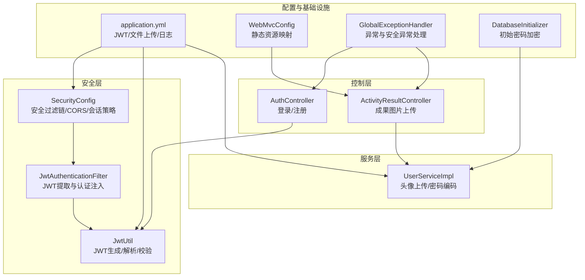
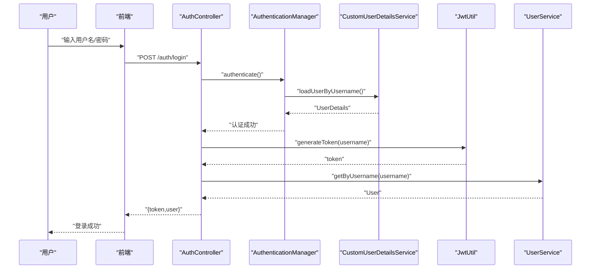
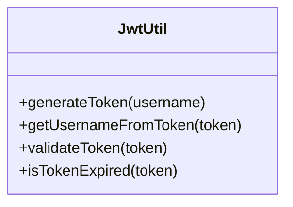
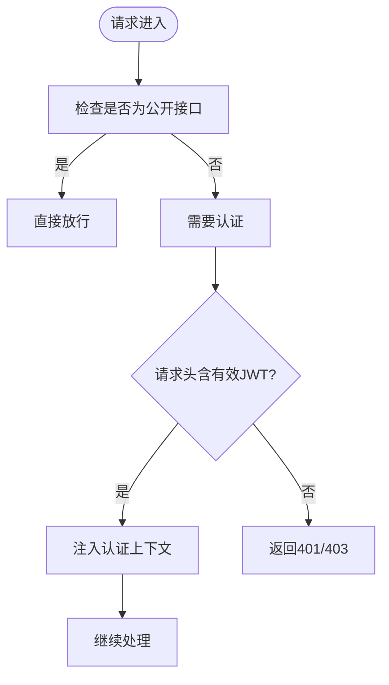
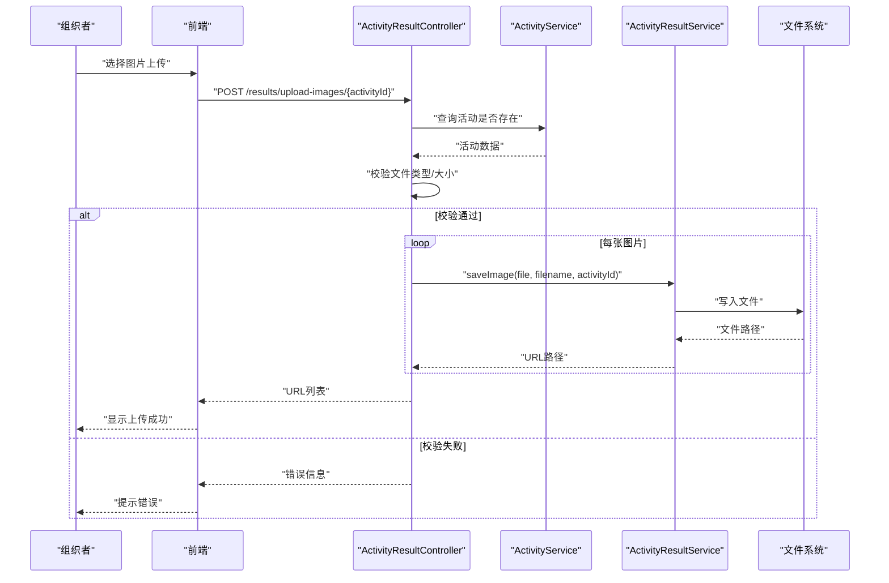
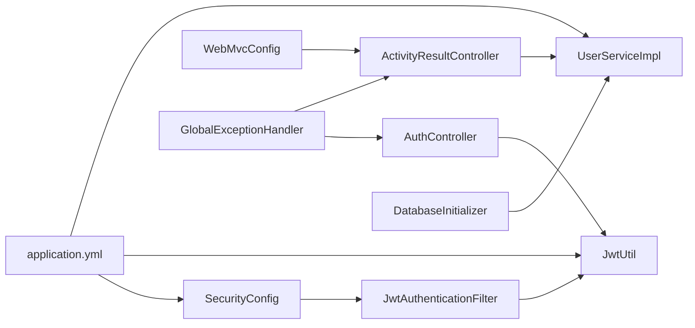

# 安全加固

<cite>
**本文引用的文件**
- [SecurityConfig.java](file://src/main/java/com/campus/eventsys/config/SecurityConfig.java)
- [JwtUtil.java](file://src/main/java/com/campus/eventsys/security/JwtUtil.java)
- [JwtAuthenticationFilter.java](file://src/main/java/com/campus/eventsys/security/JwtAuthenticationFilter.java)
- [WebMvcConfig.java](file://src/main/java/com/campus/eventsys/config/WebMvcConfig.java)
- [application.yml](file://src/main/resources/application.yml)
- [AuthController.java](file://src/main/java/com/campus/eventsys/controller/AuthController.java)
- [User.java](file://src/main/java/com/campus/eventsys/entity/User.java)
- [GlobalExceptionHandler.java](file://src/main/java/com/campus/eventsys/common/GlobalExceptionHandler.java)
- [UserServiceImpl.java](file://src/main/java/com/campus/eventsys/service/impl/UserServiceImpl.java)
- [ActivityResultController.java](file://src/main/java/com/campus/eventsys/controller/ActivityResultController.java)
- [DatabaseInitializer.java](file://src/main/java/com/campus/eventsys/config/DatabaseInitializer.java)
- [Result.java](file://src/main/java/com/campus/eventsys/common/Result.java)
- [时序图1_用户登录.plantuml](file://picture/时序图1_用户登录.plantuml)
- [时序图4_安全认证.plantuml](file://picture/时序图4_安全认证.plantuml)
- [时序图5_图片上传.plantuml](file://picture/时序图5_图片上传.plantuml)
</cite>

## 目录
1. [引言](#引言)
2. [项目结构](#项目结构)
3. [核心组件](#核心组件)
4. [架构总览](#架构总览)
5. [详细组件分析](#详细组件分析)
6. [依赖分析](#依赖分析)
7. [性能考虑](#性能考虑)
8. [故障排查指南](#故障排查指南)
9. [结论](#结论)
10. [附录](#附录)

## 引言
本文件面向校园活动管理系统，聚焦于应用安全加固与最佳实践，覆盖以下方面：
- 应用安全配置：CORS策略、CSRF防护现状与建议、XSS防护现状与建议
- JWT安全配置：令牌过期时间、签名算法、令牌刷新机制现状与建议
- 文件上传安全策略：类型验证、大小限制、恶意文件检测现状与建议
- 数据库安全配置、密码加密存储与敏感数据保护
- 安全审计日志、入侵检测与安全事件响应流程

本文件在不泄露具体代码内容的前提下，基于仓库现有实现进行深入分析，并提出可落地的加固建议。

## 项目结构
系统采用Spring Boot + Spring Security + MyBatis-Plus架构，安全相关的关键模块分布如下：
- 安全配置与过滤器：SecurityConfig、JwtAuthenticationFilter、JwtUtil
- 控制器：AuthController、ActivityResultController、UserController等
- 服务层：UserServiceImpl、各类Service实现
- 配置：application.yml、WebMvcConfig
- 统一响应与异常处理：Result、GlobalExceptionHandler
- 数据库初始化与密码加密：DatabaseInitializer

图表来源
- [SecurityConfig.java:35-71](file://src/main/java/com/campus/eventsys/config/SecurityConfig.java#L35-L71)
- [JwtAuthenticationFilter.java:26-48](file://src/main/java/com/campus/eventsys/security/JwtAuthenticationFilter.java#L26-L48)
- [JwtUtil.java:25-56](file://src/main/java/com/campus/eventsys/security/JwtUtil.java#L25-L56)
- [AuthController.java:57-73](file://src/main/java/com/campus/eventsys/controller/AuthController.java#L57-L73)
- [ActivityResultController.java:294-347](file://src/main/java/com/campus/eventsys/controller/ActivityResultController.java#L294-L347)
- [UserServiceImpl.java:60-126](file://src/main/java/com/campus/eventsys/service/impl/UserServiceImpl.java#L60-L126)
- [WebMvcConfig.java:21-36](file://src/main/java/com/campus/eventsys/config/WebMvcConfig.java#L21-L36)
- [application.yml:49-76](file://src/main/resources/application.yml#L49-L76)
- [GlobalExceptionHandler.java:20-107](file://src/main/java/com/campus/eventsys/common/GlobalExceptionHandler.java#L20-L107)
- [DatabaseInitializer.java:58-78](file://src/main/java/com/campus/eventsys/config/DatabaseInitializer.java#L58-L78)

章节来源
- [SecurityConfig.java:35-71](file://src/main/java/com/campus/eventsys/config/SecurityConfig.java#L35-L71)
- [application.yml:49-76](file://src/main/resources/application.yml#L49-L76)

## 核心组件
- 安全过滤链与CORS
  - 禁用传统CSRF保护，启用CORS并允许凭据，对所有路径生效
  - 公开接口放行：认证、活动公开查询、分类公开查询、成果/评论/收藏公开查询、Swagger、上传图片静态资源
  - 管理员接口统一拦截，其余接口需认证
- JWT认证过滤器
  - 从Authorization头提取Bearer Token，校验有效性后注入SecurityContext
- JWT工具
  - 基于HS256签名，支持生成、解析、校验与过期判断
- 文件上传与静态资源
  - Spring多部分上传限制与静态资源映射；控制器内对图片类型与大小进行二次校验
- 异常处理
  - 统一封装安全异常（认证失败、权限不足、Token过期、未登录等），并记录日志

章节来源
- [SecurityConfig.java:35-71](file://src/main/java/com/campus/eventsys/config/SecurityConfig.java#L35-L71)
- [JwtAuthenticationFilter.java:26-48](file://src/main/java/com/campus/eventsys/security/JwtAuthenticationFilter.java#L26-L48)
- [JwtUtil.java:25-56](file://src/main/java/com/campus/eventsys/security/JwtUtil.java#L25-L56)
- [WebMvcConfig.java:21-36](file://src/main/java/com/campus/eventsys/config/WebMvcConfig.java#L21-L36)
- [GlobalExceptionHandler.java:20-107](file://src/main/java/com/campus/eventsys/common/GlobalExceptionHandler.java#L20-L107)

## 架构总览
下图展示了登录与认证流程，体现JWT在系统中的关键作用。

图表来源
- [AuthController.java:57-73](file://src/main/java/com/campus/eventsys/controller/AuthController.java#L57-L73)
- [JwtUtil.java:25-35](file://src/main/java/com/campus/eventsys/security/JwtUtil.java#L25-L35)
- [时序图1_用户登录.plantuml:11-26](file://picture/时序图1_用户登录.plantuml#L11-L26)

## 详细组件分析

### CORS策略
- 当前配置
  - 允许所有来源、所有方法、所有头，允许凭据
  - 对所有路径生效
- 风险与建议
  - 在生产环境建议收窄来源白名单，避免“*”来源
  - 明确暴露的头与预检缓存策略，减少不必要的OPTIONS请求
  - 对关键接口开启同源策略或更严格的CORS约束

章节来源
- [SecurityConfig.java:86-98](file://src/main/java/com/campus/eventsys/config/SecurityConfig.java#L86-L98)

### CSRF防护
- 当前配置
  - 显式禁用CSRF保护
- 风险与建议
  - 本项目为前后端分离的无状态API，禁用CSRF是常见做法
  - 建议通过CORS与严格的来源控制、Token校验、接口幂等性等手段替代CSRF防护
  - 若未来引入Cookie会话，需重新评估CSRF风险并启用相应防护

章节来源
- [SecurityConfig.java:38](file://src/main/java/com/campus/eventsys/config/SecurityConfig.java#L38)

### XSS防护
- 当前配置
  - 未发现专门的XSS防护中间件或输出编码配置
- 建议
  - 启用HTTP头部安全策略（如X-Content-Type-Options、X-Frame-Options、Content-Security-Policy）
  - 对富文本输出进行HTML转义或使用白名单的富文本渲染库
  - 对用户输入进行严格校验与最小权限原则输出

章节来源
- [SecurityConfig.java:35-71](file://src/main/java/com/campus/eventsys/config/SecurityConfig.java#L35-L71)

### JWT安全配置
- 令牌过期时间
  - 默认24小时（毫秒级配置）
- 签名算法
  - HS256（基于对称密钥）
- 令牌刷新机制
  - 当前未实现刷新接口，登录即发放新令牌
- 风险与建议
  - 缩短过期时间或引入刷新令牌机制，降低长期有效令牌的风险
  - 生产环境建议使用RSA/ECDSA等非对称签名算法，配合密钥轮换
  - 将密钥存储在安全位置（如环境变量或密钥管理服务），避免硬编码

图表来源
- [JwtUtil.java:15-56](file://src/main/java/com/campus/eventsys/security/JwtUtil.java#L15-L56)

章节来源
- [application.yml:50-52](file://src/main/resources/application.yml#L50-L52)
- [JwtUtil.java:25-56](file://src/main/java/com/campus/eventsys/security/JwtUtil.java#L25-L56)

### 认证过滤与放行规则
- 过滤器链
  - 禁用CSRF，启用CORS，无状态会话
  - 公开接口放行，管理员接口拦截，其余接口需认证
- 放行路径
  - 认证、活动/分类/成果/评论/收藏公开查询、Swagger、上传图片静态资源
- 风险与建议
  - 对公开接口进行输入校验与频率限制
  - 对管理员接口增加更细粒度的权限控制与审计

图表来源
- [SecurityConfig.java:41-68](file://src/main/java/com/campus/eventsys/config/SecurityConfig.java#L41-L68)
- [JwtAuthenticationFilter.java:30-42](file://src/main/java/com/campus/eventsys/security/JwtAuthenticationFilter.java#L30-L42)

章节来源
- [SecurityConfig.java:35-71](file://src/main/java/com/campus/eventsys/config/SecurityConfig.java#L35-L71)
- [JwtAuthenticationFilter.java:26-48](file://src/main/java/com/campus/eventsys/security/JwtAuthenticationFilter.java#L26-L48)

### 文件上传安全策略
- 类型验证
  - 控制器与服务层均对文件类型进行校验（仅允许image/*）
- 大小限制
  - Spring全局限制：单文件10MB，总请求20MB
  - 控制器与服务层对单张图片再次限制为10MB
- 命名与存储
  - 使用UUID生成唯一文件名，按活动ID分目录存储
  - 头像上传支持旧文件清理
- 恶意文件检测
  - 当前未实现扩展名白名单、MIME探测、病毒扫描、内容分析等
- 建议
  - 引入MIME类型与文件头双重校验
  - 实施扩展名白名单（如jpg、jpeg、png、gif）
  - 集成轻量病毒扫描或第三方安全网关
  - 对上传目录设置不可执行权限与访问控制

图表来源
- [ActivityResultController.java:294-347](file://src/main/java/com/campus/eventsys/controller/ActivityResultController.java#L294-L347)
- [UserServiceImpl.java:60-126](file://src/main/java/com/campus/eventsys/service/impl/UserServiceImpl.java#L60-L126)
- [WebMvcConfig.java:21-36](file://src/main/java/com/campus/eventsys/config/WebMvcConfig.java#L21-L36)
- [时序图5_图片上传.plantuml:10-32](file://picture/时序图5_图片上传.plantuml#L10-L32)

章节来源
- [application.yml:21-26](file://src/main/resources/application.yml#L21-L26)
- [ActivityResultController.java:314-326](file://src/main/java/com/campus/eventsys/controller/ActivityResultController.java#L314-L326)
- [UserServiceImpl.java:68-77](file://src/main/java/com/campus/eventsys/service/impl/UserServiceImpl.java#L68-L77)

### 数据库安全配置与密码加密存储
- 数据库连接
  - 使用SQLite，本地文件数据库，无需用户名/密码
- 初始密码加密
  - 初始化时对明文密码进行BCrypt加密并回写
- 敏感数据保护
  - 用户实体中密码字段在序列化时被隐藏（由Result封装与日志策略共同保障）
- 建议
  - 生产环境迁移至受管数据库（MySQL/PostgreSQL），启用SSL/TLS
  - 对数据库连接使用强凭据与网络隔离
  - 对日志输出进行脱敏，避免敏感字段落盘

章节来源
- [application.yml:10-16](file://src/main/resources/application.yml#L10-L16)
- [DatabaseInitializer.java:58-78](file://src/main/java/com/campus/eventsys/config/DatabaseInitializer.java#L58-L78)
- [User.java:24](file://src/main/java/com/campus/eventsys/entity/User.java#L24)

### 安全审计日志、入侵检测与事件响应
- 审计与日志
  - 全局异常处理器记录认证/授权/业务异常
  - application.yml开启调试级别日志
- 入侵检测
  - 建议引入限流、WAF、IP黑名单、异常行为检测
- 事件响应
  - 建议制定事件分级、处置流程、恢复预案与演练计划

章节来源
- [GlobalExceptionHandler.java:20-107](file://src/main/java/com/campus/eventsys/common/GlobalExceptionHandler.java#L20-L107)
- [application.yml:71-76](file://src/main/resources/application.yml#L71-L76)

## 依赖分析
- 组件耦合
  - SecurityConfig与JwtAuthenticationFilter、JwtUtil形成认证闭环
  - 控制器依赖服务层与JWT工具，服务层依赖文件系统与配置
- 外部依赖
  - Spring Security、Spring MVC、MyBatis-Plus、SQLite、Jackson、OpenAPI/Swagger
- 潜在风险
  - CORS过于宽松、CSRF禁用带来的跨域风险
  - 文件上传缺少深层安全检测
  - JWT密钥硬编码，建议迁移到密钥管理服务

图表来源
- [SecurityConfig.java:32-33](file://src/main/java/com/campus/eventsys/config/SecurityConfig.java#L32-L33)
- [JwtAuthenticationFilter.java:23-24](file://src/main/java/com/campus/eventsys/security/JwtAuthenticationFilter.java#L23-L24)
- [JwtUtil.java:15-19](file://src/main/java/com/campus/eventsys/security/JwtUtil.java#L15-L19)
- [AuthController.java:38-40](file://src/main/java/com/campus/eventsys/controller/AuthController.java#L38-L40)
- [ActivityResultController.java:294-347](file://src/main/java/com/campus/eventsys/controller/ActivityResultController.java#L294-L347)
- [UserServiceImpl.java:60-126](file://src/main/java/com/campus/eventsys/service/impl/UserServiceImpl.java#L60-L126)
- [WebMvcConfig.java:21-36](file://src/main/java/com/campus/eventsys/config/WebMvcConfig.java#L21-L36)
- [application.yml:49-76](file://src/main/resources/application.yml#L49-L76)
- [GlobalExceptionHandler.java:20-107](file://src/main/java/com/campus/eventsys/common/GlobalExceptionHandler.java#L20-L107)
- [DatabaseInitializer.java:58-78](file://src/main/java/com/campus/eventsys/config/DatabaseInitializer.java#L58-L78)

## 性能考虑
- JWT无状态认证减少数据库会话压力，适合高并发场景
- 静态资源映射设置缓存，提升图片加载性能
- 建议对热点接口增加限流与缓存，避免上传高峰导致磁盘IO瓶颈

## 故障排查指南
- 认证失败/权限不足
  - 检查请求头是否包含有效的Bearer Token
  - 确认用户角色与接口权限匹配
- Token过期/无效
  - 重新登录获取新Token
  - 检查服务器时间同步与签名密钥一致性
- 文件上传失败
  - 确认文件类型为图片、大小不超过10MB
  - 检查上传目录权限与磁盘空间
- 全局异常
  - 查看日志定位具体异常类型（认证、授权、业务、上传大小超限）

章节来源
- [GlobalExceptionHandler.java:32-106](file://src/main/java/com/campus/eventsys/common/GlobalExceptionHandler.java#L32-L106)
- [Result.java:14-21](file://src/main/java/com/campus/eventsys/common/Result.java#L14-L21)

## 结论
本系统在无状态认证与静态资源访问方面具备良好基础，但在CORS策略、XSS防护、文件上传深度安全检测、JWT刷新机制与密钥管理等方面仍有改进空间。建议优先落实来源白名单、XSS头部与输出编码、MIME与扩展名校验、刷新令牌与密钥管理，逐步完善入侵检测与事件响应体系，以满足生产环境的安全要求。

## 附录
- 关键流程时序参考
  - 登录与认证：见“时序图1_用户登录.plantuml”
  - 安全认证链路：见“时序图4_安全认证.plantuml”
  - 图片上传流程：见“时序图5_图片上传.plantuml”