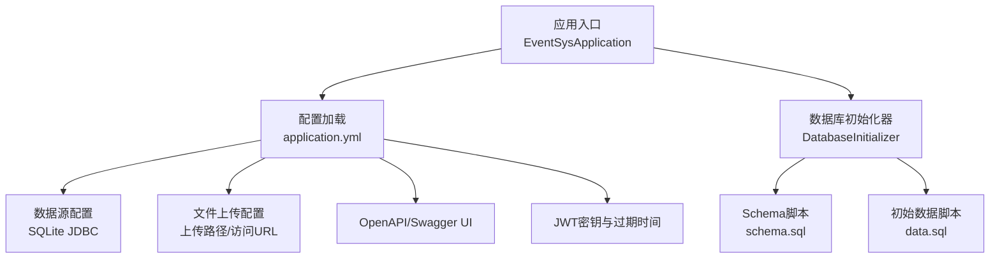
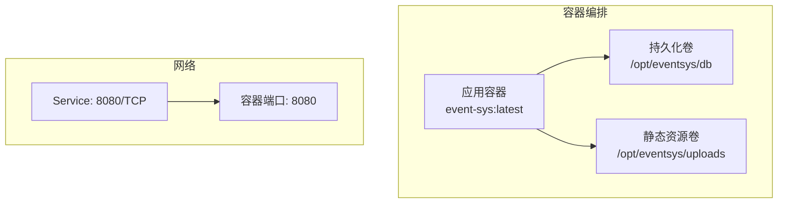
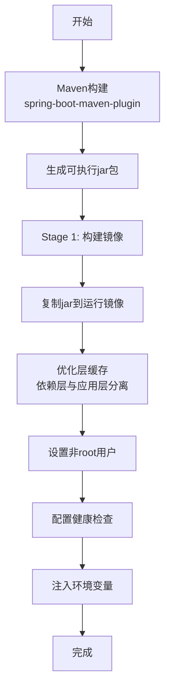
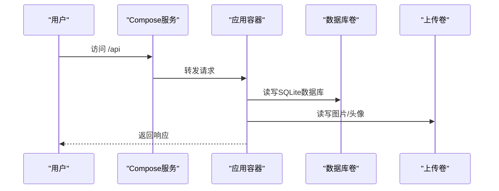
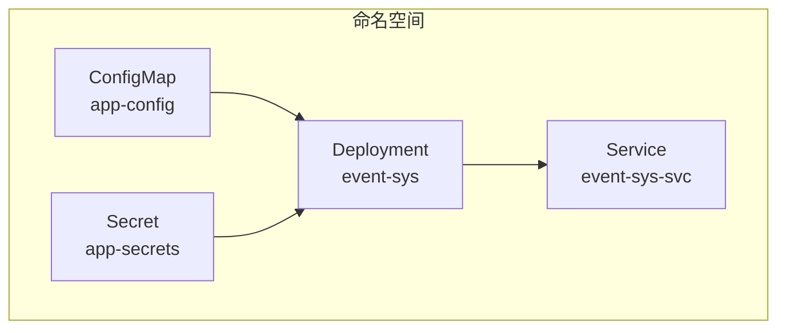
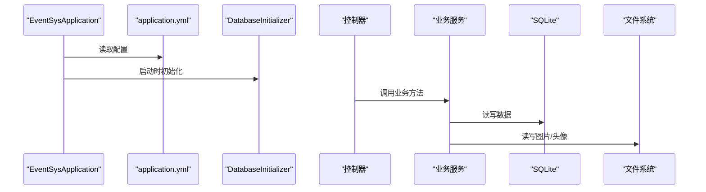

# 容器化部署

<cite>
**本文引用的文件**
- [pom.xml](file://pom.xml)
- [application.yml](file://src/main/resources/application.yml)
- [EventSysApplication.java](file://src/main/java/com/campus/eventsys/EventSysApplication.java)
- [DatabaseInitializer.java](file://src/main/java/com/campus/eventsys/config/DatabaseInitializer.java)
- [schema.sql](file://src/main/resources/db/schema.sql)
- [data.sql](file://src/main/resources/db/data.sql)
- [TimeZoneConfig.java](file://src/main/java/com/campus/eventsys/config/TimeZoneConfig.java)
- [OpenApiConfig.java](file://src/main/java/com/campus/eventsys/config/OpenApiConfig.java)
- [SecurityConfig.java](file://src/main/java/com/campus/eventsys/config/SecurityConfig.java)
- [JwtUtil.java](file://src/main/java/com/campus/eventsys/security/JwtUtil.java)
- [UserServiceImpl.java](file://src/main/java/com/campus/eventsys/service/impl/UserServiceImpl.java)
- [ActivityResultServiceImpl.java](file://src/main/java/com/campus/eventsys/service/impl/ActivityResultServiceImpl.java)
- [ActivityManageController.java](file://src/main/java/com/campus/eventsys/controller/ActivityManageController.java)
</cite>

## 目录
1. [简介](#简介)
2. [项目结构](#项目结构)
3. [核心组件](#核心组件)
4. [架构总览](#架构总览)
5. [详细组件分析](#详细组件分析)
6. [依赖关系分析](#依赖关系分析)
7. [性能考虑](#性能考虑)
8. [故障排查指南](#故障排查指南)
9. [结论](#结论)
10. [附录](#附录)

## 简介
本文件面向“校园活动管理系统”的容器化部署，围绕以下目标展开：
- Docker镜像构建：Dockerfile编写、多阶段构建与镜像优化策略
- Docker Compose编排：服务定义、网络、卷挂载与环境变量传递
- Kubernetes部署：Deployment、Service、ConfigMap、Secret的YAML配置要点
- 运行期保障：健康检查、资源限制、滚动更新策略
- 运维实践：监控、日志收集与故障排查

本项目基于Spring Boot 3 + Java 17，使用SQLite作为本地数据库，内置文件上传与图片存储，具备JWT鉴权与OpenAPI文档能力。

## 项目结构
项目采用Spring Boot标准布局，核心运行参数与配置集中在application.yml中；数据库初始化逻辑在启动时自动执行SQL脚本，确保首次运行可用。

图表来源
- [EventSysApplication.java:1-17](file://src/main/java/com/campus/eventsys/EventSysApplication.java#L1-L17)
- [application.yml:1-76](file://src/main/resources/application.yml#L1-L76)
- [DatabaseInitializer.java:1-115](file://src/main/java/com/campus/eventsys/config/DatabaseInitializer.java#L1-L115)
- [schema.sql:1-295](file://src/main/resources/db/schema.sql#L1-L295)
- [data.sql:1-335](file://src/main/resources/db/data.sql#L1-L335)

章节来源
- [pom.xml:1-131](file://pom.xml#L1-L131)
- [application.yml:1-76](file://src/main/resources/application.yml#L1-L76)
- [EventSysApplication.java:1-17](file://src/main/java/com/campus/eventsys/EventSysApplication.java#L1-L17)
- [DatabaseInitializer.java:1-115](file://src/main/java/com/campus/eventsys/config/DatabaseInitializer.java#L1-L115)
- [schema.sql:1-295](file://src/main/resources/db/schema.sql#L1-L295)
- [data.sql:1-335](file://src/main/resources/db/data.sql#L1-L335)

## 核心组件
- 应用入口与扫描
  - Spring Boot启动类负责扫描Mapper与启用调度
- 配置中心
  - server.port、context-path、datasource、文件上传、Jackson时区与日期格式、MyBatis-Plus全局配置、JWT、OpenAPI、文件上传路径与访问URL、日志级别
- 数据库初始化
  - 启动时检测表是否存在，不存在则执行schema.sql与data.sql，并对初始用户密码进行BCrypt加密
- 安全与鉴权
  - 基于JWT的过滤链与BCrypt密码编码器
- 文件上传与访问
  - 用户头像与活动图片按活动ID分目录存储，支持统一上传目录与访问URL配置

章节来源
- [EventSysApplication.java:1-17](file://src/main/java/com/campus/eventsys/EventSysApplication.java#L1-L17)
- [application.yml:1-76](file://src/main/resources/application.yml#L1-L76)
- [DatabaseInitializer.java:1-115](file://src/main/java/com/campus/eventsys/config/DatabaseInitializer.java#L1-L115)
- [SecurityConfig.java:1-33](file://src/main/java/com/campus/eventsys/config/SecurityConfig.java#L1-L33)
- [JwtUtil.java:1-44](file://src/main/java/com/campus/eventsys/security/JwtUtil.java#L1-L44)
- [UserServiceImpl.java:1-110](file://src/main/java/com/campus/eventsys/service/impl/UserServiceImpl.java#L1-L110)
- [ActivityResultServiceImpl.java:1-156](file://src/main/java/com/campus/eventsys/service/impl/ActivityResultServiceImpl.java#L1-L156)
- [ActivityManageController.java:67-76](file://src/main/java/com/campus/eventsys/controller/ActivityManageController.java#L67-L76)

## 架构总览
下图展示了容器化部署的高层视图：应用容器、数据库卷、静态资源卷与外部网络交互。

图表来源
- [application.yml:1-76](file://src/main/resources/application.yml#L1-L76)
- [EventSysApplication.java:1-17](file://src/main/java/com/campus/eventsys/EventSysApplication.java#L1-L17)

## 详细组件分析

### Docker镜像构建
- 基础镜像选择
  - 推荐使用官方OpenJDK 17镜像作为基础镜像，确保与项目Java版本一致
- 多阶段构建
  - 阶段1：使用Maven构建生产包，启用spring-boot-maven-plugin排除Lombok，减少运行时依赖
  - 阶段2：复制构建产物至精简运行镜像，仅保留JRE与应用产物，降低镜像体积与攻击面
- 运行用户与权限
  - 在镜像内创建非root用户并切换，限制容器权限
- 健康检查
  - 使用HTTP GET探测/actuator/health（如启用），或应用内部健康端点
- 环境变量
  - 通过环境变量传递数据库路径、JWT密钥与过期时间、文件上传路径与访问URL、时区等

图表来源
- [pom.xml:106-129](file://pom.xml#L106-L129)
- [application.yml:1-76](file://src/main/resources/application.yml#L1-L76)

章节来源
- [pom.xml:1-131](file://pom.xml#L1-L131)
- [application.yml:1-76](file://src/main/resources/application.yml#L1-L76)

### Docker Compose编排
- 服务定义
  - event-sys：映射宿主机端口到容器8080，挂载数据库与上传目录卷
- 网络配置
  - 自定义bridge网络，便于服务间通信与隔离
- 卷挂载
  - 数据库卷：持久化SQLite数据库文件
  - 上传卷：持久化图片与头像目录
- 环境变量传递
  - 通过env_file或environment字段传入数据库路径、JWT密钥、文件上传路径与访问URL、时区等

图表来源
- [application.yml:1-76](file://src/main/resources/application.yml#L1-L76)

章节来源
- [application.yml:1-76](file://src/main/resources/application.yml#L1-L76)

### Kubernetes部署方案
- Deployment
  - 设置副本数、滚动更新策略（maxUnavailable与maxSurge）、探针（liveness/readiness）
  - 挂载ConfigMap与Secret，暴露环境变量
- Service
  - ClusterIP或LoadBalancer，端口8080
- ConfigMap
  - 存放application.yml中的非敏感配置项（如server.port、datasource.url、文件上传路径、OpenAPI路径等）
- Secret
  - 存放JWT密钥、数据库连接凭证（如需外部DB）

图表来源
- [application.yml:1-76](file://src/main/resources/application.yml#L1-L76)

章节来源
- [application.yml:1-76](file://src/main/resources/application.yml#L1-L76)

### 健康检查、资源限制与滚动更新
- 健康检查
  - HTTP GET /actuator/health（如启用Actuator），或应用内部健康端点
- 资源限制
  - CPU与内存requests/limits，结合实际负载压测结果调整
- 滚动更新
  - maxUnavailable=25%，maxSurge=25%，确保平滑升级

章节来源
- [application.yml:1-76](file://src/main/resources/application.yml#L1-L76)

### 监控、日志与故障排查
- 监控
  - Prometheus指标导出（如启用Actuator），结合Grafana可视化
- 日志
  - stdout/stderr输出，配合集中式日志（如ELK/Fluent Bit）采集
- 故障排查
  - 关注数据库初始化日志、文件上传目录权限、JWT密钥一致性、时区配置

章节来源
- [application.yml:71-76](file://src/main/resources/application.yml#L71-L76)
- [DatabaseInitializer.java:34-53](file://src/main/java/com/campus/eventsys/config/DatabaseInitializer.java#L34-L53)
- [TimeZoneConfig.java:18-25](file://src/main/java/com/campus/eventsys/config/TimeZoneConfig.java#L18-L25)

## 依赖关系分析
- 应用启动流程
  - EventSysApplication启动 -> 加载application.yml -> 初始化数据库 -> 启动Web容器
- 数据流
  - 控制器接收请求 -> 业务服务处理 -> Mapper访问SQLite -> 文件系统读写上传目录
- 安全流
  - SecurityConfig配置JWT过滤链 -> JwtUtil生成/解析令牌

图表来源
- [EventSysApplication.java:1-17](file://src/main/java/com/campus/eventsys/EventSysApplication.java#L1-L17)
- [application.yml:1-76](file://src/main/resources/application.yml#L1-L76)
- [DatabaseInitializer.java:1-115](file://src/main/java/com/campus/eventsys/config/DatabaseInitializer.java#L1-L115)
- [UserServiceImpl.java:1-110](file://src/main/java/com/campus/eventsys/service/impl/UserServiceImpl.java#L1-L110)
- [ActivityResultServiceImpl.java:1-156](file://src/main/java/com/campus/eventsys/service/impl/ActivityResultServiceImpl.java#L1-L156)

章节来源
- [EventSysApplication.java:1-17](file://src/main/java/com/campus/eventsys/EventSysApplication.java#L1-L17)
- [application.yml:1-76](file://src/main/resources/application.yml#L1-L76)
- [DatabaseInitializer.java:1-115](file://src/main/java/com/campus/eventsys/config/DatabaseInitializer.java#L1-L115)
- [UserServiceImpl.java:1-110](file://src/main/java/com/campus/eventsys/service/impl/UserServiceImpl.java#L1-L110)
- [ActivityResultServiceImpl.java:1-156](file://src/main/java/com/campus/eventsys/service/impl/ActivityResultServiceImpl.java#L1-L156)

## 性能考虑
- 镜像优化
  - 多阶段构建，最小化运行时镜像；合理分层缓存，加速CI构建
- 数据库
  - SQLite适合开发/小规模场景；生产建议迁移到外部数据库并配置连接池
- 文件存储
  - 上传目录建议使用持久化卷，避免容器重启丢失
- JVM调优
  - 根据容器CPU/内存限制设置JVM参数，避免GC抖动

## 故障排查指南
- 启动失败
  - 检查数据库初始化日志，确认schema.sql与data.sql执行成功
- 文件上传异常
  - 检查上传目录权限与磁盘空间，确认application.yml中的上传路径与访问URL配置
- JWT鉴权失败
  - 确认JWT密钥一致，过期时间合理，客户端携带正确的Authorization头
- 时区问题
  - 确认应用时区配置与期望一致，避免时间显示偏差

章节来源
- [DatabaseInitializer.java:34-53](file://src/main/java/com/campus/eventsys/config/DatabaseInitializer.java#L34-L53)
- [UserServiceImpl.java:79-110](file://src/main/java/com/campus/eventsys/service/impl/UserServiceImpl.java#L79-L110)
- [JwtUtil.java:15-44](file://src/main/java/com/campus/eventsys/security/JwtUtil.java#L15-L44)
- [TimeZoneConfig.java:18-25](file://src/main/java/com/campus/eventsys/config/TimeZoneConfig.java#L18-L25)

## 结论
通过多阶段构建与合理的容器编排，校园活动管理系统可在Docker与Kubernetes环境中实现高效、稳定与可观测的交付。建议在生产环境中引入外部数据库、持久化存储与完善的监控告警体系，并持续优化JVM与容器资源配额以获得最佳性能。

## 附录
- 关键配置项参考
  - 服务器端口与上下文路径、数据源URL、文件上传大小限制、Jackson日期与时区、MyBatis-Plus配置、JWT密钥与过期时间、OpenAPI路径、文件上传路径与访问URL、日志级别

章节来源
- [application.yml:1-76](file://src/main/resources/application.yml#L1-L76)