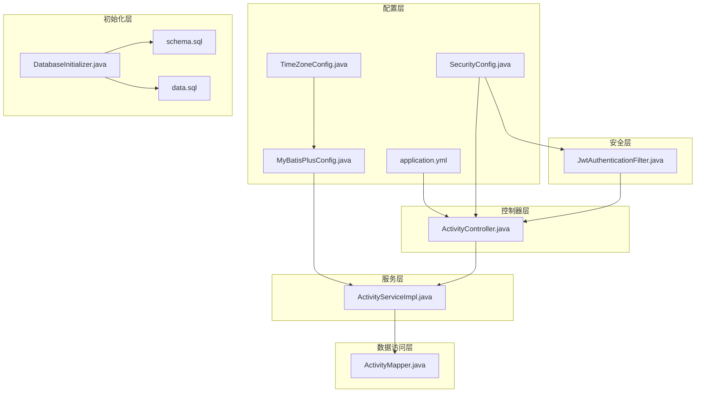
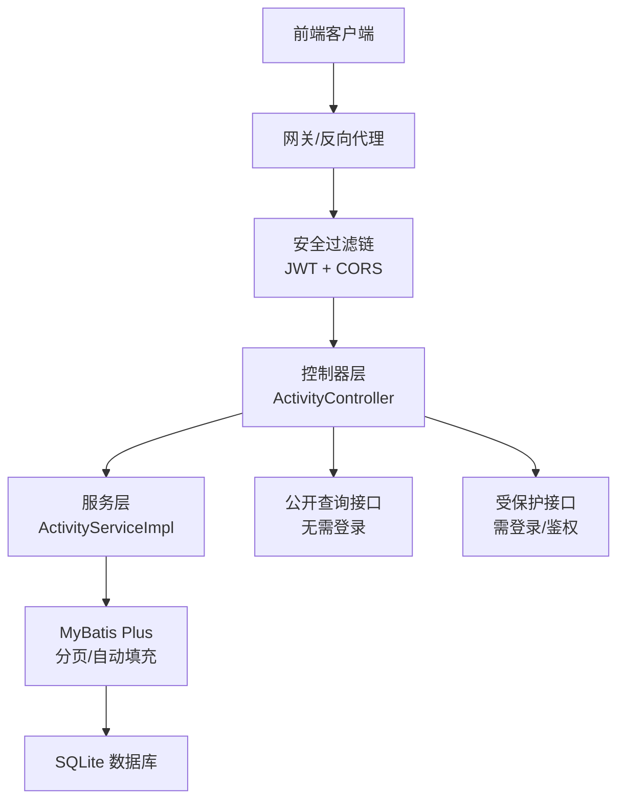
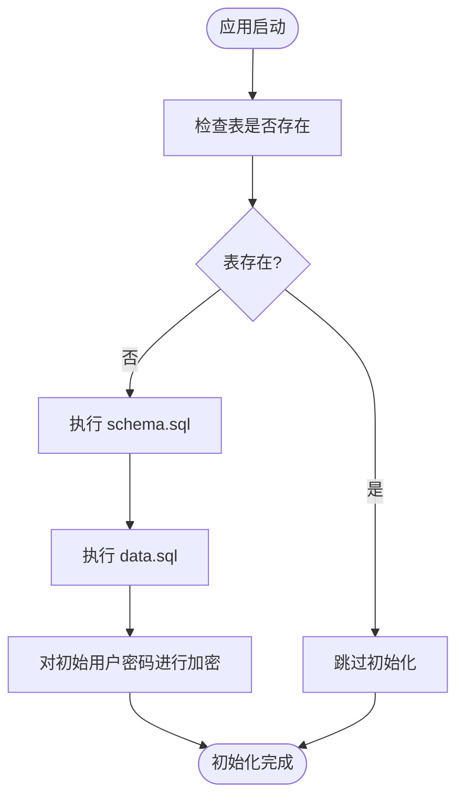
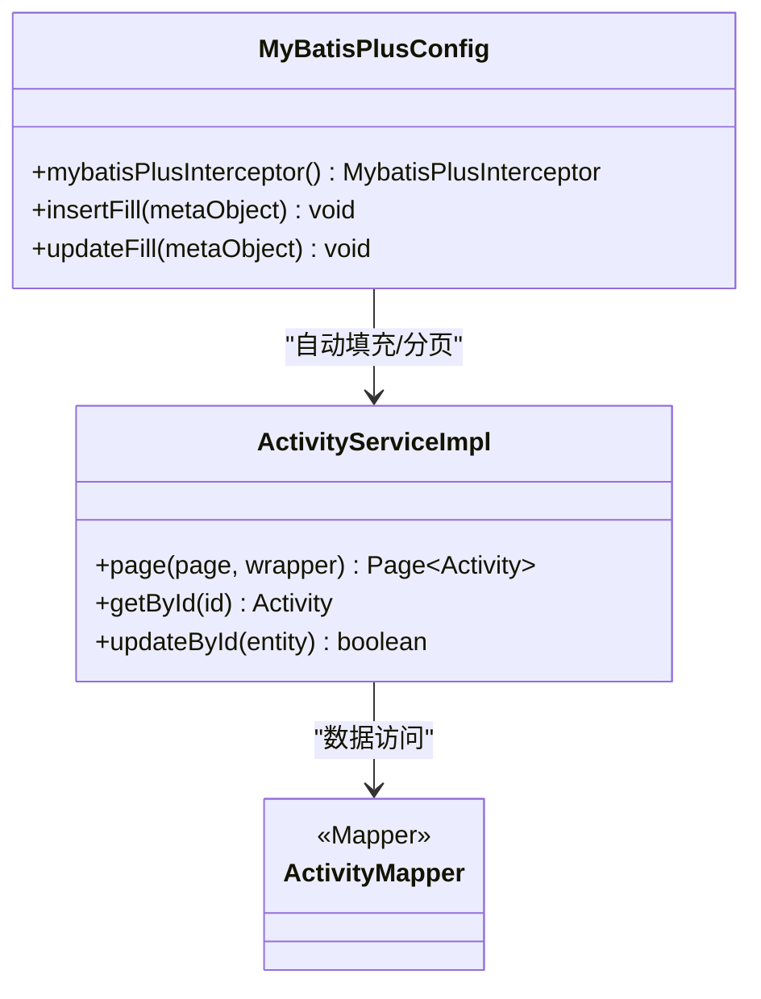
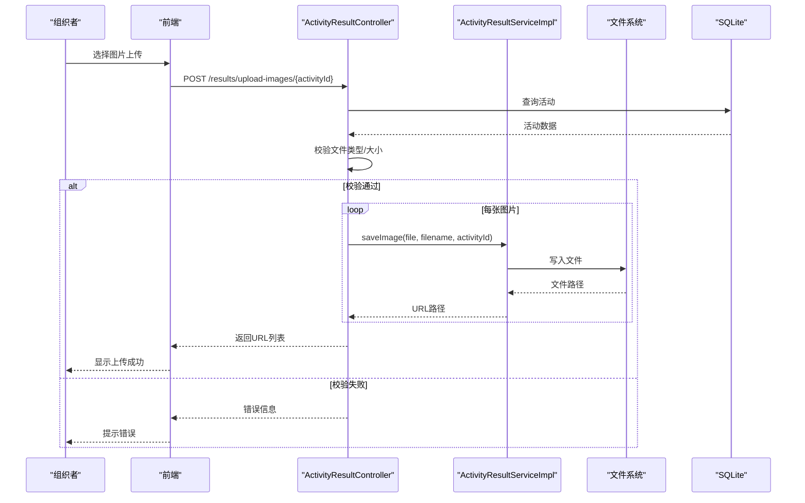
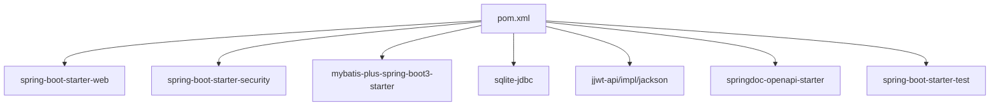

# 性能优化

<cite>
**本文引用的文件**
- [application.yml](file://src/main/resources/application.yml)
- [MyBatisPlusConfig.java](file://src/main/java/com/campus/eventsys/config/MyBatisPlusConfig.java)
- [DatabaseInitializer.java](file://src/main/java/com/campus/eventsys/config/DatabaseInitializer.java)
- [schema.sql](file://src/main/resources/db/schema.sql)
- [data.sql](file://src/main/resources/db/data.sql)
- [ActivityController.java](file://src/main/java/com/campus/eventsys/controller/ActivityController.java)
- [ActivityMapper.java](file://src/main/java/com/campus/eventsys/mapper/ActivityMapper.java)
- [ActivityServiceImpl.java](file://src/main/java/com/campus/eventsys/service/impl/ActivityServiceImpl.java)
- [SecurityConfig.java](file://src/main/java/com/campus/eventsys/config/SecurityConfig.java)
- [JwtAuthenticationFilter.java](file://src/main/java/com/campus/eventsys/security/JwtAuthenticationFilter.java)
- [TimeZoneConfig.java](file://src/main/java/com/campus/eventsys/config/TimeZoneConfig.java)
- [pom.xml](file://pom.xml)
- [ActivityResultServiceImpl.java](file://src/main/java/com/campus/eventsys/service/impl/ActivityResultServiceImpl.java)
- [ActivityControllerTest.java](file://src/test/java/com/campus/eventsys/controller/ActivityControllerTest.java)
</cite>

## 目录
1. [简介](#简介)
2. [项目结构](#项目结构)
3. [核心组件](#核心组件)
4. [架构总览](#架构总览)
5. [详细组件分析](#详细组件分析)
6. [依赖分析](#依赖分析)
7. [性能考虑](#性能考虑)
8. [故障排查指南](#故障排查指南)
9. [结论](#结论)
10. [附录](#附录)

## 简介
本文件面向校园活动管理系统，聚焦于数据库连接池配置、查询优化与索引设计最佳实践；Spring Boot 应用的 JVM 调优参数（堆内存、GC 选择、性能监控）；MyBatis Plus 的性能优化策略（批量操作、缓存配置、SQL 优化技巧）；文件上传性能优化（并发控制、存储策略、CDN 集成）；以及性能测试方法、基准测试工具与性能瓶颈分析指南。文档基于仓库现有配置与代码进行分析，并提供可落地的优化建议。

## 项目结构
系统采用 Spring Boot + MyBatis Plus + SQLite 的轻量级架构，核心模块包括：
- 配置层：数据库、MyBatis Plus、安全、时区、文件上传等配置
- 控制器层：对外暴露 REST 接口，如活动公开查询、分类查询、评论与通知等
- 服务层：业务逻辑封装，基于 MyBatis Plus 的通用 Service 实现
- 数据访问层：Mapper 接口与 XML 映射
- 初始化层：应用启动时执行 SQL 脚本初始化表结构与基础数据
- 安全层：基于 JWT 的无状态认证过滤链

**图表来源**
- [application.yml:1-76](file://src/main/resources/application.yml#L1-L76)
- [MyBatisPlusConfig.java:1-58](file://src/main/java/com/campus/eventsys/config/MyBatisPlusConfig.java#L1-L58)
- [SecurityConfig.java:1-100](file://src/main/java/com/campus/eventsys/config/SecurityConfig.java#L1-L100)
- [TimeZoneConfig.java:1-33](file://src/main/java/com/campus/eventsys/config/TimeZoneConfig.java#L1-L33)
- [ActivityController.java:1-111](file://src/main/java/com/campus/eventsys/controller/ActivityController.java#L1-L111)
- [ActivityServiceImpl.java:1-12](file://src/main/java/com/campus/eventsys/service/impl/ActivityServiceImpl.java#L1-L12)
- [ActivityMapper.java:1-10](file://src/main/java/com/campus/eventsys/mapper/ActivityMapper.java#L1-L10)
- [DatabaseInitializer.java:1-115](file://src/main/java/com/campus/eventsys/config/DatabaseInitializer.java#L1-L115)
- [schema.sql:1-295](file://src/main/resources/db/schema.sql#L1-L295)
- [data.sql:1-335](file://src/main/resources/db/data.sql#L1-L335)
- [JwtAuthenticationFilter.java:1-58](file://src/main/java/com/campus/eventsys/security/JwtAuthenticationFilter.java#L1-L58)

**章节来源**
- [application.yml:1-76](file://src/main/resources/application.yml#L1-L76)
- [MyBatisPlusConfig.java:1-58](file://src/main/java/com/campus/eventsys/config/MyBatisPlusConfig.java#L1-L58)
- [SecurityConfig.java:1-100](file://src/main/java/com/campus/eventsys/config/SecurityConfig.java#L1-L100)
- [TimeZoneConfig.java:1-33](file://src/main/java/com/campus/eventsys/config/TimeZoneConfig.java#L1-L33)
- [ActivityController.java:1-111](file://src/main/java/com/campus/eventsys/controller/ActivityController.java#L1-L111)
- [ActivityServiceImpl.java:1-12](file://src/main/java/com/campus/eventsys/service/impl/ActivityServiceImpl.java#L1-L12)
- [ActivityMapper.java:1-10](file://src/main/java/com/campus/eventsys/mapper/ActivityMapper.java#L1-L10)
- [DatabaseInitializer.java:1-115](file://src/main/java/com/campus/eventsys/config/DatabaseInitializer.java#L1-L115)
- [schema.sql:1-295](file://src/main/resources/db/schema.sql#L1-L295)
- [data.sql:1-335](file://src/main/resources/db/data.sql#L1-L335)
- [JwtAuthenticationFilter.java:1-58](file://src/main/java/com/campus/eventsys/security/JwtAuthenticationFilter.java#L1-L58)

## 核心组件
- 数据库与连接池：当前使用 SQLite JDBC，未显式配置连接池参数。生产环境建议引入 HikariCP 并设置连接池大小、超时与健康检查参数。
- ORM 与分页：MyBatis Plus 已启用分页插件，针对 SQLite 的分页拦截器已配置，避免溢出与最大限制。
- 自动填充：全局自动填充 createTime/updateTime/deleted 字段，统一时区为 UTC。
- 安全与认证：JWT 无状态过滤链，CORS 放行公开资源路径，认证接口与公开查询接口明确分离。
- 文件上传：基于 Servlet 多部分上传，限制单文件与请求总大小；图片按活动 ID 分目录存储，便于清理与 CDN 映射。

**章节来源**
- [application.yml:10-27](file://src/main/resources/application.yml#L10-L27)
- [MyBatisPlusConfig.java:25-34](file://src/main/java/com/campus/eventsys/config/MyBatisPlusConfig.java#L25-L34)
- [TimeZoneConfig.java:18-25](file://src/main/java/com/campus/eventsys/config/TimeZoneConfig.java#L18-L25)
- [SecurityConfig.java:35-71](file://src/main/java/com/campus/eventsys/config/SecurityConfig.java#L35-L71)
- [application.yml:21-27](file://src/main/resources/application.yml#L21-L27)

## 架构总览
系统采用前后端分离的无状态架构，控制器层负责请求接入与参数校验，服务层承载业务逻辑，数据访问层通过 MyBatis Plus 与 SQLite 交互。安全层通过 JWT 过滤器实现无状态认证，公开查询接口无需登录即可访问。

**图表来源**
- [SecurityConfig.java:35-71](file://src/main/java/com/campus/eventsys/config/SecurityConfig.java#L35-L71)
- [ActivityController.java:37-87](file://src/main/java/com/campus/eventsys/controller/ActivityController.java#L37-L87)
- [MyBatisPlusConfig.java:25-34](file://src/main/java/com/campus/eventsys/config/MyBatisPlusConfig.java#L25-L34)
- [JwtAuthenticationFilter.java:26-48](file://src/main/java/com/campus/eventsys/security/JwtAuthenticationFilter.java#L26-L48)

## 详细组件分析

### 数据库连接池与初始化
- 连接池现状：未显式配置连接池，使用默认实现；SQLite 适合开发/小规模场景，生产建议使用 HikariCP 并设置连接池大小、空闲超时、连接生命周期等。
- 初始化策略：应用启动时检测表是否存在，不存在则执行 schema.sql 与 data.sql，随后对初始用户密码进行 BCrypt 加密。
- 索引设计：schema.sql 中为高频查询字段建立复合与单列索引，覆盖用户、活动、报名、评论、收藏、签到、通知、审核、评价等表的关键查询维度。

**图表来源**
- [DatabaseInitializer.java:34-53](file://src/main/java/com/campus/eventsys/config/DatabaseInitializer.java#L34-L53)
- [schema.sql:240-295](file://src/main/resources/db/schema.sql#L240-L295)
- [data.sql:1-335](file://src/main/resources/db/data.sql#L1-L335)

**章节来源**
- [DatabaseInitializer.java:34-115](file://src/main/java/com/campus/eventsys/config/DatabaseInitializer.java#L34-L115)
- [schema.sql:240-295](file://src/main/resources/db/schema.sql#L240-L295)
- [data.sql:1-335](file://src/main/resources/db/data.sql#L1-L335)

### 查询优化与索引设计最佳实践
- 现状：schema.sql 已为多表关键字段建立索引，如用户表的 username/student_id/college/role/status，活动表的 organizer_id/category_id/status/start_time，报名表的 activity_id/user_id/status，评论表的 target_id/target_type/user_id/parent_id，收藏表的 activity_id/user_id，签到表的 activity_id/user_id/registration_id，通知表的 user_id/type/is_read，审核表的 activity_id/status/submitter_id，评价表的 activity_id/user_id。
- 建议：
  - 为热点查询添加复合索引，例如活动列表按状态+创建时间排序的组合索引。
  - 定期分析慢查询日志（SQLite 可通过日志实现或外部工具），结合 EXPLAIN QUERY PLAN 分析执行计划。
  - 避免 SELECT *，仅查询必要字段；对大字段（如文本描述）分页或延迟加载。
  - 使用 LIMIT 与分页，避免一次性返回大量数据。

**章节来源**
- [schema.sql:240-295](file://src/main/resources/db/schema.sql#L240-L295)

### MyBatis Plus 性能优化策略
- 分页插件：已配置 SQLite 分页拦截器，设置溢出处理与最大限制，避免超大分页导致性能问题。
- 自动填充：统一填充创建/更新时间与逻辑删除字段，减少重复代码与潜在错误。
- 批量操作：建议使用批量插入/更新（如 saveBatch/insertBatchSomeColumn/updateBatchById），降低往返次数与锁竞争。
- SQL 优化技巧：
  - 使用 LambdaQueryWrapper 精准拼装条件，避免 N+1 查询。
  - 合理使用 select 与 orderBy，减少不必要的排序与投影。
  - 对频繁条件组合建立合适索引，确保查询走索引而非全表扫描。
- 缓存配置：可结合 Redis 或本地缓存（如 Caffeine）缓存热点数据（如分类、热门活动），注意缓存失效策略与一致性。

**图表来源**
- [MyBatisPlusConfig.java:25-56](file://src/main/java/com/campus/eventsys/config/MyBatisPlusConfig.java#L25-L56)
- [ActivityServiceImpl.java:9-11](file://src/main/java/com/campus/eventsys/service/impl/ActivityServiceImpl.java#L9-L11)
- [ActivityMapper.java:7-9](file://src/main/java/com/campus/eventsys/mapper/ActivityMapper.java#L7-L9)

**章节来源**
- [MyBatisPlusConfig.java:25-56](file://src/main/java/com/campus/eventsys/config/MyBatisPlusConfig.java#L25-L56)
- [ActivityServiceImpl.java:9-11](file://src/main/java/com/campus/eventsys/service/impl/ActivityServiceImpl.java#L9-L11)
- [ActivityMapper.java:7-9](file://src/main/java/com/campus/eventsys/mapper/ActivityMapper.java#L7-L9)

### Spring Boot 应用的 JVM 调优参数
- 堆内存设置：建议在生产环境设置合理的 Xms/Xmx，避免频繁 GC；对于中小规模应用，可参考 1G-2G 初值，结合实际负载调整。
- 垃圾回收器选择：优先选择 G1GC 或 ZGC（JDK 11+），降低停顿时间；对低延迟要求高的场景可评估 ZGC。
- 性能监控配置：启用 JVM 监控（JMX/Micrometer），采集 GC、堆栈、线程、类加载等指标；结合 APM 工具（如 Micrometer + Prometheus/Grafana）进行可视化监控。
- 参数示例（概念性说明，非仓库配置）：
  - -XX:+UseG1GC
  - -XX:MaxGCPauseMillis=200
  - -XX:+PrintGC
  - -XX:+HeapDumpOnOutOfMemoryError
  - -Dcom.sun.management.jmxremote
  - -Dcom.sun.management.jmxremote.authenticate=false
  - -Dcom.sun.management.jmxremote.ssl=false

[本节为通用指导，不直接分析具体文件]

### 文件上传性能优化
- 并发控制：限制单次请求文件数量与总大小，避免内存峰值过高；对上传接口进行限流（令牌桶/漏桶算法）。
- 存储策略：按活动 ID 分目录存储，便于清理与 CDN 映射；对缩略图与原图分离存储，减少带宽占用。
- CDN 集成：将静态资源映射至 CDN，结合缓存头与压缩策略（Gzip/Brotli）提升加载速度。
- 时序示意：

**图表来源**
- [ActivityResultServiceImpl.java:124-146](file://src/main/java/com/campus/eventsys/service/impl/ActivityResultServiceImpl.java#L124-L146)

**章节来源**
- [application.yml:64-70](file://src/main/resources/application.yml#L64-L70)
- [ActivityResultServiceImpl.java:124-146](file://src/main/java/com/campus/eventsys/service/impl/ActivityResultServiceImpl.java#L124-L146)

### 性能测试方法与基准测试工具
- 埋点与采样：在关键路径（控制器、服务、Mapper）埋点，记录耗时、QPS、P95/P99 延迟。
- 基准测试工具：使用 JMeter/Locust 进行接口压测；使用 wrk/ab 进行简单场景压测；对数据库查询使用 EXPLAIN 分析执行计划。
- 指标采集：Prometheus + Grafana 监控 JVM 与应用指标；结合 APM（如 SkyWalking/OpenTelemetry）进行分布式追踪。
- 瓶颈分析：CPU 占用高（GC/锁竞争）、IO 瓶颈（磁盘/网络）、数据库慢查询（索引缺失/锁等待）。

[本节为通用指导，不直接分析具体文件]

## 依赖分析
- 依赖关系：项目基于 Spring Boot 3 + MyBatis Plus 3.5.5 + SQLite JDBC；未发现循环依赖。
- 外部依赖：JWT 用于认证；OpenAPI 用于接口文档；测试框架为 JUnit + Mockito。

**图表来源**
- [pom.xml:27-104](file://pom.xml#L27-L104)

**章节来源**
- [pom.xml:27-104](file://pom.xml#L27-L104)

## 性能考虑
- 数据库层面：
  - 使用合适的索引覆盖高频查询；定期重建统计信息（SQLite 通过 ANALYZE 或外部工具）。
  - 将热点数据与冷数据分离，必要时采用分区或归档策略。
  - 控制事务粒度，避免长事务与死锁。
- 应用层面：
  - 合理使用分页与缓存，避免一次性加载过多数据。
  - 对热点接口进行限流与熔断，防止雪崩。
  - 使用异步任务处理非关键路径（如发送通知、生成缩略图）。
- 文件上传：
  - 限制并发与大小，使用流式写入避免 OOM。
  - CDN 缓存与压缩策略提升加载速度。
- JVM 层面：
  - 选择合适的 GC 策略与堆大小，开启 JIT 优化与逃逸分析。
  - 使用监控工具持续观察 GC 与内存分配。

[本节为通用指导，不直接分析具体文件]

## 故障排查指南
- 启动阶段：
  - 若初始化失败，检查 schema.sql 与 data.sql 是否存在、权限是否足够；确认数据库文件路径与权限。
- 运行阶段：
  - 活动列表为空或异常：检查控制器参数（keyword/status/categoryId）与分页插件配置；确认索引是否生效。
  - JWT 认证失败：检查请求头 Authorization 是否携带 Bearer Token；核对签名与过期时间。
  - 文件上传失败：检查上传路径权限、磁盘空间、文件大小限制；查看服务端日志定位异常。
- 单元测试验证：
  - 使用 ActivityControllerTest 验证列表查询、详情查询、浏览数更新等行为，确保边界条件与错误处理正确。

**章节来源**
- [DatabaseInitializer.java:96-113](file://src/main/java/com/campus/eventsys/config/DatabaseInitializer.java#L96-L113)
- [ActivityController.java:54-109](file://src/main/java/com/campus/eventsys/controller/ActivityController.java#L54-L109)
- [ActivityControllerTest.java:55-230](file://src/test/java/com/campus/eventsys/controller/ActivityControllerTest.java#L55-L230)
- [JwtAuthenticationFilter.java:26-48](file://src/main/java/com/campus/eventsys/security/JwtAuthenticationFilter.java#L26-L48)

## 结论
本系统在开发/小规模场景下具备良好可扩展性，建议在生产环境中完善以下方面：引入 HikariCP 连接池、优化索引与 SQL、启用缓存与限流、完善 JVM 监控与 GC 调优、强化文件上传与 CDN 策略，并建立完善的性能测试与基准测试体系，持续迭代性能指标。

## 附录
- 时区配置：统一使用 UTC，自动填充字段基于时区转换，确保跨时区一致性。
- 公开接口：活动列表与详情、分类查询、评论与通知公开查询等无需登录，提升用户体验与性能。

**章节来源**
- [TimeZoneConfig.java:18-32](file://src/main/java/com/campus/eventsys/config/TimeZoneConfig.java#L18-L32)
- [SecurityConfig.java:44-62](file://src/main/java/com/campus/eventsys/config/SecurityConfig.java#L44-L62)