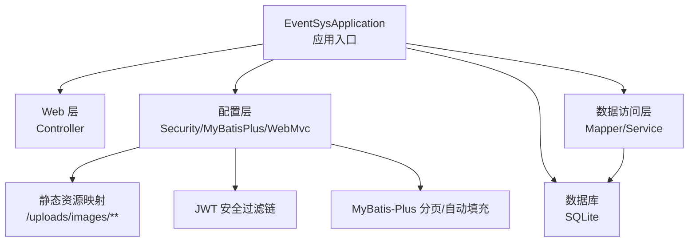
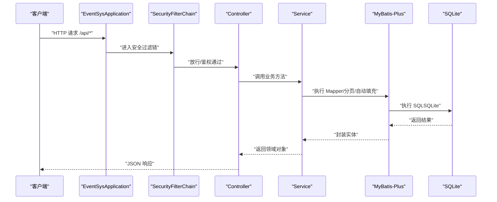
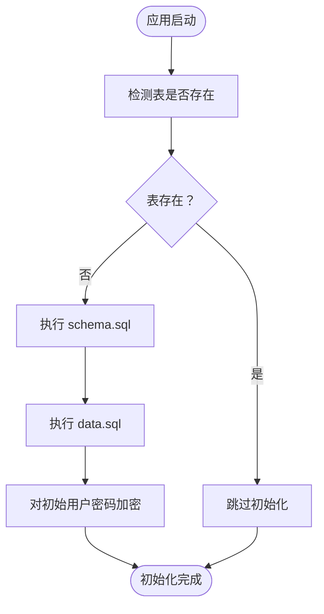
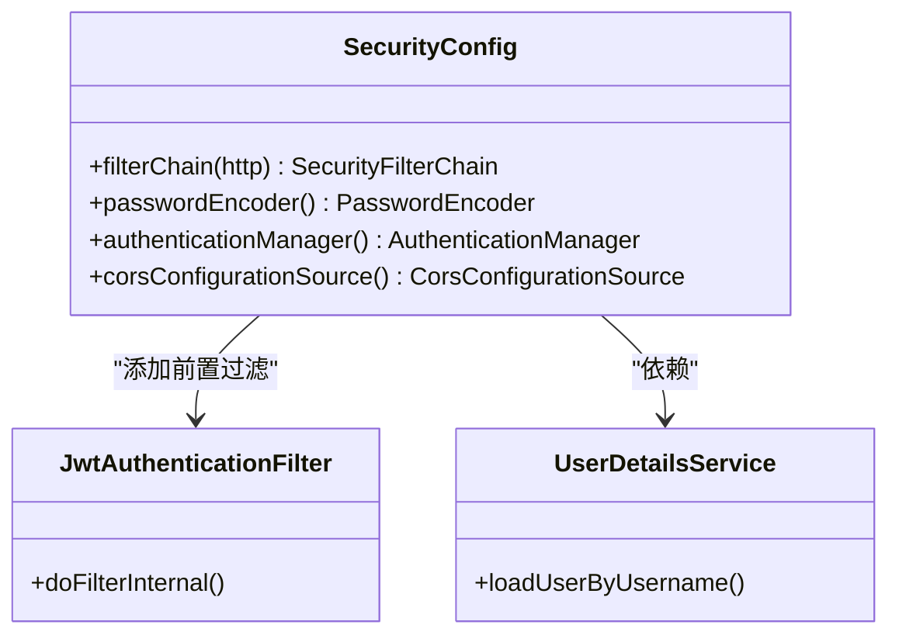
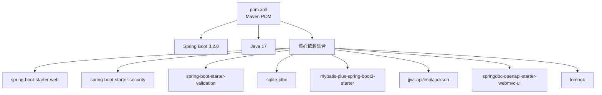

# 环境准备

<cite>
**本文引用的文件**
- [pom.xml](file://pom.xml)
- [application.yml](file://src/main/resources/application.yml)
- [EventSysApplication.java](file://src/main/java/com/campus/eventsys/EventSysApplication.java)
- [MyBatisPlusConfig.java](file://src/main/java/com/campus/eventsys/config/MyBatisPlusConfig.java)
- [SecurityConfig.java](file://src/main/java/com/campus/eventsys/config/SecurityConfig.java)
- [DatabaseInitializer.java](file://src/main/java/com/campus/eventsys/config/DatabaseInitializer.java)
- [schema.sql](file://src/main/resources/db/schema.sql)
- [data.sql](file://src/main/resources/db/data.sql)
- [TimeZoneConfig.java](file://src/main/java/com/campus/eventsys/config/TimeZoneConfig.java)
- [WebMvcConfig.java](file://src/main/java/com/campus/eventsys/config/WebMvcConfig.java)
- [url.txt](file://url.txt)
</cite>

## 目录
1. [简介](#简介)
2. [项目结构](#项目结构)
3. [核心组件](#核心组件)
4. [架构总览](#架构总览)
5. [详细组件分析](#详细组件分析)
6. [依赖分析](#依赖分析)
7. [性能考虑](#性能考虑)
8. [故障排查指南](#故障排查指南)
9. [结论](#结论)
10. [附录](#附录)

## 简介
本文件面向“校园活动管理系统”的部署与运维团队，提供从硬件、操作系统、JDK、数据库到构建与运行环境的完整准备指南。文档同时覆盖开发与生产环境差异、JVM参数调优、内存与线程池配置、环境变量与系统服务配置、网络端口规划、环境验证清单以及常见问题处理方案。

## 项目结构
该系统采用 Spring Boot 3.x + MyBatis-Plus + SQLite 的轻量级架构，核心特性包括：
- 使用 SQLite 本地数据库，无需独立数据库服务器，便于快速部署与迁移
- 基于 Spring Security + JWT 实现无状态鉴权
- 自定义数据库初始化器，启动时自动创建表与插入测试数据
- 静态资源映射支持图片上传访问
- 开放 API 文档（SpringDoc OpenAPI）

图表来源
- [EventSysApplication.java:1-17](file://src/main/java/com/campus/eventsys/EventSysApplication.java#L1-L17)
- [SecurityConfig.java:1-100](file://src/main/java/com/campus/eventsys/config/SecurityConfig.java#L1-L100)
- [MyBatisPlusConfig.java:1-58](file://src/main/java/com/campus/eventsys/config/MyBatisPlusConfig.java#L1-L58)
- [WebMvcConfig.java:1-38](file://src/main/java/com/campus/eventsys/config/WebMvcConfig.java#L1-L38)

章节来源
- [EventSysApplication.java:1-17](file://src/main/java/com/campus/eventsys/EventSysApplication.java#L1-L17)
- [application.yml:1-76](file://src/main/resources/application.yml#L1-L76)

## 核心组件
- 应用入口与扫描
  - 启动类启用 Mapper 扫描与定时任务，确保 MyBatis-Plus 与调度功能可用
- 安全与鉴权
  - 基于 JWT 的无状态过滤链，开放部分公开接口，其余接口需登录
- 数据访问与 ORM
  - MyBatis-Plus 分页插件针对 SQLite 进行适配；自动填充 createTime/updateTime/deleted 字段
- 数据库初始化
  - 应用启动时检测表是否存在，不存在则执行 schema.sql 与 data.sql 初始化
- 静态资源与文件上传
  - 配置静态资源映射与上传目录，支持 /uploads/images/** 与 /images/**
- 时区与日志
  - 统一时区为 UTC，Jackson 时间格式与日志级别按需配置

章节来源
- [EventSysApplication.java:8-16](file://src/main/java/com/campus/eventsys/EventSysApplication.java#L8-L16)
- [SecurityConfig.java:35-71](file://src/main/java/com/campus/eventsys/config/SecurityConfig.java#L35-L71)
- [MyBatisPlusConfig.java:25-56](file://src/main/java/com/campus/eventsys/config/MyBatisPlusConfig.java#L25-L56)
- [DatabaseInitializer.java:34-53](file://src/main/java/com/campus/eventsys/config/DatabaseInitializer.java#L34-L53)
- [WebMvcConfig.java:21-36](file://src/main/java/com/campus/eventsys/config/WebMvcConfig.java#L21-L36)
- [TimeZoneConfig.java:20-25](file://src/main/java/com/campus/eventsys/config/TimeZoneConfig.java#L20-L25)

## 架构总览
系统运行时的关键交互如下：

图表来源
- [SecurityConfig.java:35-71](file://src/main/java/com/campus/eventsys/config/SecurityConfig.java#L35-L71)
- [MyBatisPlusConfig.java:25-34](file://src/main/java/com/campus/eventsys/config/MyBatisPlusConfig.java#L25-L34)
- [DatabaseInitializer.java:34-53](file://src/main/java/com/campus/eventsys/config/DatabaseInitializer.java#L34-L53)

## 详细组件分析

### 数据库与初始化流程
- 数据源与驱动
  - 使用 org.sqlite.JDBC 与 jdbc:sqlite: 协议，数据库文件位于 ${user.dir}/event_database.db
- 初始化策略
  - 启动时检测 user 表是否存在，不存在则执行 schema.sql 与 data.sql，并对初始用户密码进行加密
- MyBatis-Plus 适配
  - 分页插件针对 SQLite 配置；id-type 设为 input 以避免自增主键问题；逻辑删除字段 deleted 配置为 1/0

图表来源
- [DatabaseInitializer.java:34-53](file://src/main/java/com/campus/eventsys/config/DatabaseInitializer.java#L34-L53)
- [schema.sql:1-295](file://src/main/resources/db/schema.sql#L1-L295)
- [data.sql:1-335](file://src/main/resources/db/data.sql#L1-L335)
- [MyBatisPlusConfig.java:25-34](file://src/main/java/com/campus/eventsys/config/MyBatisPlusConfig.java#L25-L34)

章节来源
- [application.yml:10-16](file://src/main/resources/application.yml#L10-L16)
- [DatabaseInitializer.java:34-113](file://src/main/java/com/campus/eventsys/config/DatabaseInitializer.java#L34-L113)
- [schema.sql:6-28](file://src/main/resources/db/schema.sql#L6-L28)
- [MyBatisPlusConfig.java:25-46](file://src/main/java/com/campus/eventsys/config/MyBatisPlusConfig.java#L25-L46)

### 安全与鉴权
- 无状态会话
  - SessionCreationPolicy.STATELESS，基于 JWT 的 Token 认证
- 接口放行策略
  - 认证接口、公开查询接口、Swagger UI、上传图片等路径放行
- CORS 配置
  - 允许任意来源、允许凭证、支持常用方法与头部

图表来源
- [SecurityConfig.java:35-98](file://src/main/java/com/campus/eventsys/config/SecurityConfig.java#L35-L98)

章节来源
- [SecurityConfig.java:35-98](file://src/main/java/com/campus/eventsys/config/SecurityConfig.java#L35-L98)

### 静态资源与文件上传
- 上传目录与访问路径
  - 上传根目录由配置项 file.upload.path 决定，默认 uploads/images
  - 提供 /uploads/images/** 与 /images/** 两条访问路径
- 上传限制
  - 单文件最大 10MB，请求总大小 20MB

章节来源
- [WebMvcConfig.java:18-36](file://src/main/java/com/campus/eventsys/config/WebMvcConfig.java#L18-L36)
- [application.yml:21-26](file://src/main/resources/application.yml#L21-L26)
- [application.yml:65-69](file://src/main/resources/application.yml#L65-L69)

### 时区与日志
- 时区
  - 默认时区设置为 UTC，自动填充使用该时区生成时间戳
- 日志
  - 控制台输出 debug 级别日志，便于定位问题

章节来源
- [TimeZoneConfig.java:20-25](file://src/main/java/com/campus/eventsys/config/TimeZoneConfig.java#L20-L25)
- [application.yml:72-76](file://src/main/resources/application.yml#L72-L76)

## 依赖分析
- 构建工具与版本
  - Maven 项目，父 POM 为 Spring Boot 3.2.0
  - Java 版本属性为 17
- 关键依赖
  - Spring Boot Starter Web、Security、Validation
  - SQLite JDBC
  - MyBatis-Plus Spring Boot Starter
  - JWT（jjwt-api/impl/jackson）
  - SpringDoc OpenAPI
  - Lombok
- 编译与测试
  - spring-boot-maven-plugin 排除 Lombok
  - maven-surefire-plugin 默认启用测试

图表来源
- [pom.xml:8-104](file://pom.xml#L8-L104)

章节来源
- [pom.xml:21-25](file://pom.xml#L21-L25)
- [pom.xml:27-104](file://pom.xml#L27-L104)

## 性能考虑
- 数据库层面
  - SQLite 适合中小规模数据与单机部署；若并发较高，建议评估迁移到关系型数据库并启用连接池
  - 已在 schema 中建立多处索引，注意避免全表扫描
- ORM 与分页
  - MyBatis-Plus 分页插件已针对 SQLite 配置，最大限制为 1000 条
- 时区与序列化
  - 统一 UTC 时区，避免跨时区导致的时间计算偏差；Jackson 禁止时间戳输出，便于前端解析
- 文件上传
  - 合理设置上传大小与缓存策略，避免内存压力过大

章节来源
- [MyBatisPlusConfig.java:25-34](file://src/main/java/com/campus/eventsys/config/MyBatisPlusConfig.java#L25-L34)
- [schema.sql:240-295](file://src/main/resources/db/schema.sql#L240-L295)
- [application.yml:28-32](file://src/main/resources/application.yml#L28-L32)
- [application.yml:21-26](file://src/main/resources/application.yml#L21-L26)

## 故障排查指南
- 启动失败（数据库初始化异常）
  - 现象：启动时报错，无法执行 SQL 脚本
  - 排查：确认 classpath 下 db/schema.sql 与 db/data.sql 存在；检查数据库文件写权限；查看日志中 SQL 状态码
  - 参考
    - [DatabaseInitializer.java:99-113](file://src/main/java/com/campus/eventsys/config/DatabaseInitializer.java#L99-L113)
    - [schema.sql:1-295](file://src/main/resources/db/schema.sql#L1-L295)
    - [data.sql:1-335](file://src/main/resources/db/data.sql#L1-L335)
- 登录鉴权失败
  - 现象：JWT 生成或校验异常
  - 排查：确认 jwt.secret 与 expiration 配置一致；检查用户密码是否已加密；核对请求头 Authorization
  - 参考
    - [SecurityConfig.java:74-84](file://src/main/java/com/campus/eventsys/config/SecurityConfig.java#L74-L84)
    - [application.yml:50-52](file://src/main/resources/application.yml#L50-L52)
- 图片访问 404
  - 现象：/uploads/images/** 或 /images/** 返回 404
  - 排查：确认 file.upload.path 指向的目录存在且可读；检查静态资源映射是否生效
  - 参考
    - [WebMvcConfig.java:21-36](file://src/main/java/com/campus/eventsys/config/WebMvcConfig.java#L21-L36)
    - [application.yml:65-69](file://src/main/resources/application.yml#L65-L69)
- Swagger UI 无法访问
  - 现象：/swagger-ui.html 或 /v3/api-docs 无法打开
  - 排查：确认 springdoc 路径配置与实际访问路径一致；检查接口放行策略
  - 参考
    - [application.yml:55-62](file://src/main/resources/application.yml#L55-L62)
    - [SecurityConfig.java:58-62](file://src/main/java/com/campus/eventsys/config/SecurityConfig.java#L58-L62)

章节来源
- [DatabaseInitializer.java:99-113](file://src/main/java/com/campus/eventsys/config/DatabaseInitializer.java#L99-L113)
- [SecurityConfig.java:58-62](file://src/main/java/com/campus/eventsys/config/SecurityConfig.java#L58-L62)
- [WebMvcConfig.java:21-36](file://src/main/java/com/campus/eventsys/config/WebMvcConfig.java#L21-L36)
- [application.yml:55-62](file://src/main/resources/application.yml#L55-L62)

## 结论
本系统以 Spring Boot + SQLite 为核心，具备低门槛部署与完善的初始化流程。生产环境建议结合外部数据库与连接池、完善监控与日志采集，并根据业务规模调整 JVM 参数与线程池配置。开发与生产环境的差异主要体现在数据库类型、静态资源存储、日志级别与安全策略上。

## 附录

### 硬件与操作系统要求
- 硬件建议
  - CPU：至少 2 核，推荐 4 核以上
  - 内存：最小 2 GB，推荐 4 GB 以上
  - 磁盘：至少 5 GB 可用空间（含数据库文件与上传目录）
- 操作系统
  - Linux（推荐 Ubuntu 20.04+/CentOS 7+）、Windows 10/11、macOS 10.15+
  - 注意：SQLite 在 Windows 上需确保文件权限与路径正确

### JDK 版本要求
- 必须使用 Java 17（与项目属性一致）
- 建议使用 LTS 版本（如 OpenJDK 17）

章节来源
- [pom.xml:21-25](file://pom.xml#L21-L25)

### 数据库配置
- 驱动与连接
  - 驱动类：org.sqlite.JDBC
  - 连接串：jdbc:sqlite:${user.dir}/event_database.db
- 初始化策略
  - 首次启动自动执行 schema.sql 与 data.sql
  - 初始用户默认密码：test（启动时自动加密）
- 生产建议
  - 将 SQLite 迁移至 MySQL/PostgreSQL 并启用连接池
  - 配置只读副本与备份策略

章节来源
- [application.yml:10-16](file://src/main/resources/application.yml#L10-L16)
- [DatabaseInitializer.java:34-53](file://src/main/java/com/campus/eventsys/config/DatabaseInitializer.java#L34-L53)
- [schema.sql:1-295](file://src/main/resources/db/schema.sql#L1-L295)
- [data.sql:1-335](file://src/main/resources/db/data.sql#L1-L335)

### Maven 构建环境
- 构建命令
  - mvn clean install
- 插件配置
  - spring-boot-maven-plugin：排除 Lombok
  - maven-surefire-plugin：默认启用测试
- 依赖管理
  - 使用 Spring Boot Starter 管理版本，确保与 Spring Boot 3.2.0 兼容

章节来源
- [pom.xml:106-129](file://pom.xml#L106-L129)

### 开发与生产差异配置
- 数据源
  - 开发：SQLite（本地文件）
  - 生产：MySQL/PostgreSQL（配置连接池与高可用）
- 静态资源
  - 开发：本地磁盘映射
  - 生产：CDN 或对象存储（OSS/COS/S3）
- 安全
  - 开发：允许任意来源 CORS
  - 生产：严格白名单与 HTTPS
- 日志
  - 开发：debug
  - 生产：info 或更高，接入集中日志平台

章节来源
- [SecurityConfig.java:87-98](file://src/main/java/com/campus/eventsys/config/SecurityConfig.java#L87-L98)
- [WebMvcConfig.java:21-36](file://src/main/java/com/campus/eventsys/config/WebMvcConfig.java#L21-L36)
- [application.yml:72-76](file://src/main/resources/application.yml#L72-L76)

### JVM 参数调优与线程池配置
- JVM 建议参数（示例）
  - -Xms2g -Xmx4g：堆大小
  - -XX:+UseG1GC：垃圾回收器
  - -Dfile.encoding=UTF-8：字符集
  - -Duser.timezone=UTC：时区
- 线程池
  - 若扩展异步任务，建议使用固定大小线程池并设置合理队列长度
- 说明
  - 本项目未内置线程池配置，如需扩展请在业务层自行实现

章节来源
- [TimeZoneConfig.java:20-25](file://src/main/java/com/campus/eventsys/config/TimeZoneConfig.java#L20-L25)

### 环境变量与系统服务
- 关键环境变量
  - JAVA_OPTS：传入 JVM 参数
  - SPRING_PROFILES_ACTIVE：切换开发/生产配置文件
  - file.upload.path：上传目录（默认 uploads/images）
- 系统服务
  - 推荐使用 systemd（Linux）或 Windows 服务管理器托管进程
  - 日志输出重定向至标准输出，配合容器或日志系统采集

章节来源
- [WebMvcConfig.java:18-19](file://src/main/java/com/campus/eventsys/config/WebMvcConfig.java#L18-L19)
- [application.yml:1-2](file://src/main/resources/application.yml#L1-L2)

### 网络端口规划
- 默认端口
  - server.port: 8080
  - context-path: /api
- 端口占用
  - 启动前检查 8080 是否被占用，必要时修改 application.yml
- 外网访问
  - 建议通过 Nginx/反向代理暴露 /api，开启 HTTPS 与限流

章节来源
- [application.yml:1-4](file://src/main/resources/application.yml#L1-L4)

### 环境验证检查清单
- 基础设施
  - JDK 17 正确安装
  - 磁盘空间充足，目录可写
- 应用启动
  - 无数据库初始化错误
  - Swagger UI 可访问
  - 登录接口正常，返回 JWT
- 文件上传
  - 上传目录存在且可写
  - /uploads/images/** 与 /images/** 可访问
- 安全策略
  - CORS 放行符合预期
  - 非公开接口需携带有效 Token

章节来源
- [url.txt:1-9](file://url.txt#L1-L9)
- [SecurityConfig.java:58-62](file://src/main/java/com/campus/eventsys/config/SecurityConfig.java#L58-L62)
- [WebMvcConfig.java:21-36](file://src/main/java/com/campus/eventsys/config/WebMvcConfig.java#L21-L36)