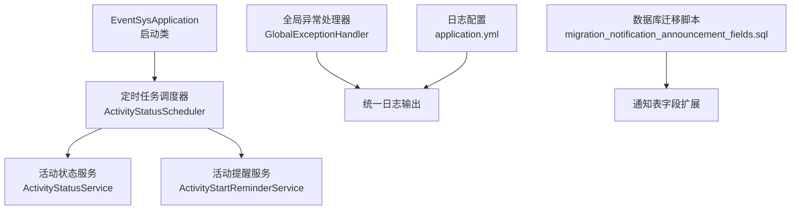
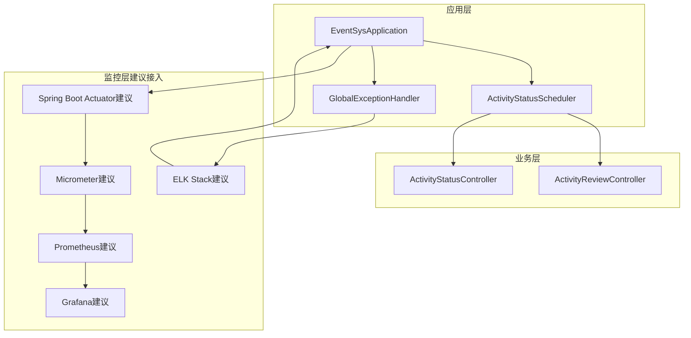
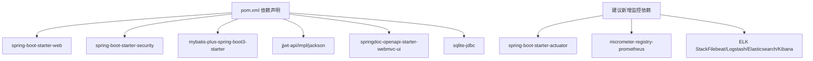

# 监控告警

<cite>
**本文引用的文件**
- [application.yml](file://src/main/resources/application.yml)
- [pom.xml](file://pom.xml)
- [EventSysApplication.java](file://src/main/java/com/campus/eventsys/EventSysApplication.java)
- [GlobalExceptionHandler.java](file://src/main/java/com/campus/eventsys/common/GlobalExceptionHandler.java)
- [ActivityStatusScheduler.java](file://src/main/java/com/campus/eventsys/scheduler/ActivityStatusScheduler.java)
- [TimeZoneConfig.java](file://src/main/java/com/campus/eventsys/config/TimeZoneConfig.java)
- [ActivityReviewController.java](file://src/main/java/com/campus/eventsys/controller/ActivityReviewController.java)
- [ActivityStatusController.java](file://src/main/java/com/campus/eventsys/controller/ActivityStatusController.java)
- [ActivityReviewServiceImpl.java](file://src/main/java/com/campus/eventsys/service/impl/ActivityReviewServiceImpl.java)
- [ActivityStatusScheduler.java](file://src/main/java/com/campus/eventsys/scheduler/ActivityStatusScheduler.java)
- [migration_notification_announcement_fields.sql](file://src/main/resources/db/migration_notification_announcement_fields.sql)
</cite>

## 目录
1. [简介](#简介)
2. [项目结构](#项目结构)
3. [核心组件](#核心组件)
4. [架构总览](#架构总览)
5. [详细组件分析](#详细组件分析)
6. [依赖分析](#依赖分析)
7. [性能考虑](#性能考虑)
8. [故障排查指南](#故障排查指南)
9. [结论](#结论)
10. [附录](#附录)

## 简介
本文件面向校园活动管理系统，提供一套完整的监控与告警方案，覆盖应用性能监控（Actuator端点、Micrometer指标、Prometheus）、日志监控（日志级别、ELK集成、日志轮转）、业务监控指标（活动参与率、用户活跃度、系统负载）、告警规则（阈值、级别、通知渠道）、监控仪表板配置、故障自愈机制与运维自动化脚本建议。由于当前仓库未包含Actuator/Micrometer/Prometheus/ELK等外部集成依赖与配置，本文在“现状”部分如实陈述，并在“建议”部分给出可落地的实施步骤与最佳实践。

## 项目结构
- 应用入口与调度：应用启动类启用调度能力，定时任务负责活动状态自动更新与提醒发送。
- 异常处理：全局异常处理器集中记录日志并返回统一响应，便于监控侧识别错误趋势。
- 日志配置：通过配置文件设置包级日志级别，便于在开发与生产环境间切换。
- 数据库迁移：通知表扩展字段用于公告发布范围、置顶、发布时间、状态与分类等，支撑业务监控与审计。

图表来源
- [EventSysApplication.java:1-17](file://src/main/java/com/campus/eventsys/EventSysApplication.java#L1-L17)
- [ActivityStatusScheduler.java:1-42](file://src/main/java/com/campus/eventsys/scheduler/ActivityStatusScheduler.java#L1-L42)
- [GlobalExceptionHandler.java:1-108](file://src/main/java/com/campus/eventsys/common/GlobalExceptionHandler.java#L1-L108)
- [application.yml:71-76](file://src/main/resources/application.yml#L71-L76)
- [migration_notification_announcement_fields.sql:1-21](file://src/main/resources/db/migration_notification_announcement_fields.sql#L1-L21)

章节来源
- [EventSysApplication.java:1-17](file://src/main/java/com/campus/eventsys/EventSysApplication.java#L1-L17)
- [application.yml:71-76](file://src/main/resources/application.yml#L71-L76)

## 核心组件
- 应用启动与调度
  - 启动类启用调度注解，使定时任务生效。
  - 定时任务每固定周期执行，检查并更新活动状态，同时发送开始前提醒。
- 全局异常处理
  - 统一捕获各类异常，记录日志并返回标准化错误响应，便于监控侧识别错误峰值与类型分布。
- 日志配置
  - 通过配置文件设置包级日志级别，便于在不同环境调整日志粒度。
- 数据库迁移
  - 通知表新增字段，支持公告发布范围、置顶、发布时间、状态与分类，为业务监控与审计提供数据基础。

章节来源
- [EventSysApplication.java:1-17](file://src/main/java/com/campus/eventsys/EventSysApplication.java#L1-L17)
- [ActivityStatusScheduler.java:1-42](file://src/main/java/com/campus/eventsys/scheduler/ActivityStatusScheduler.java#L1-L42)
- [GlobalExceptionHandler.java:1-108](file://src/main/java/com/campus/eventsys/common/GlobalExceptionHandler.java#L1-L108)
- [application.yml:71-76](file://src/main/resources/application.yml#L71-L76)
- [migration_notification_announcement_fields.sql:1-21](file://src/main/resources/db/migration_notification_announcement_fields.sql#L1-L21)

## 架构总览
下图展示了监控与告警在系统中的位置与交互关系。当前仓库未包含Actuator/Micrometer/Prometheus/ELK等外部集成，因此图中以“建议接入”标注。

图表来源
- [EventSysApplication.java:1-17](file://src/main/java/com/campus/eventsys/EventSysApplication.java#L1-L17)
- [ActivityStatusScheduler.java:1-42](file://src/main/java/com/campus/eventsys/scheduler/ActivityStatusScheduler.java#L1-L42)
- [GlobalExceptionHandler.java:1-108](file://src/main/java/com/campus/eventsys/common/GlobalExceptionHandler.java#L1-L108)
- [ActivityReviewController.java:218-253](file://src/main/java/com/campus/eventsys/controller/ActivityReviewController.java#L218-L253)
- [ActivityStatusController.java:61-88](file://src/main/java/com/campus/eventsys/controller/ActivityStatusController.java#L61-L88)

## 详细组件分析

### 应用性能监控（Actuator/Micrometer/Prometheus）
- 现状
  - 当前仓库未引入Actuator/Micrometer/Prometheus相关依赖与配置。
- 建议
  - 引入Actuator与Micrometer依赖，开启健康检查、指标暴露与JVM/业务指标采集。
  - 配置Prometheus抓取端点，建立Grafana仪表板，展示CPU、内存、请求延迟、错误率、线程池与数据库连接池等关键指标。
  - 对定时任务执行耗时、成功率进行指标埋点，结合告警规则实现异常自动通知。

章节来源
- [pom.xml:27-104](file://pom.xml#L27-L104)

### 日志监控方案（ELK与轮转）
- 现状
  - application.yml中设置了包级日志级别，便于在开发与生产环境间切换。
- 建议
  - 引入Logback或Log4j2与Elasticsearch/Filebeat/Logstash/Kibana集成，实现日志采集、索引与可视化。
  - 配置日志轮转策略（按大小/时间），保留周期与压缩策略，确保磁盘空间可控。
  - 将全局异常处理器输出的日志纳入ELK，建立错误趋势与热点接口的看板。

章节来源
- [application.yml:71-76](file://src/main/resources/application.yml#L71-L76)
- [GlobalExceptionHandler.java:1-108](file://src/main/java/com/campus/eventsys/common/GlobalExceptionHandler.java#L1-L108)

### 业务监控指标
- 活动参与率
  - 指标定义：实际签到人数 / 报名并通过审核的人数 × 100%。
  - 数据来源：签到记录与报名记录，结合活动状态控制器提供的状态信息。
- 用户活跃度
  - 指标定义：近N日登录次数、活动报名/签到/评价次数、评论与收藏行为。
  - 数据来源：用户行为日志与数据库统计，结合全局异常处理器识别异常波动。
- 系统负载监控
  - 指标定义：请求QPS、P95/P99延迟、错误率、线程池排队长度、数据库连接池使用率。
  - 数据来源：Micrometer指标与Prometheus抓取，结合Grafana仪表板实时观测。

章节来源
- [ActivityStatusController.java:61-88](file://src/main/java/com/campus/eventsys/controller/ActivityStatusController.java#L61-L88)
- [ActivityStatusScheduler.java:1-42](file://src/main/java/com/campus/eventsys/scheduler/ActivityStatusScheduler.java#L1-L42)
- [GlobalExceptionHandler.java:1-108](file://src/main/java/com/campus/eventsys/common/GlobalExceptionHandler.java#L1-L108)

### 告警规则配置
- 阈值设定
  - 错误率：连续5分钟内错误率超过阈值触发告警。
  - 延迟：P95/P99延迟超过阈值触发告警。
  - 负载：线程池排队长度、数据库连接池空闲率异常触发告警。
  - 业务异常：活动参与率异常下降、用户活跃度骤降触发告警。
- 告警级别
  - P1：系统不可用、核心接口延迟过高。
  - P2：错误率上升、数据库连接池耗尽。
  - P3：业务指标异常波动。
- 通知渠道
  - 邮件、企业微信/钉钉机器人、PagerDuty等，按级别路由至不同通道。

（本节为概念性说明，未直接分析具体源码）

### 监控仪表板配置
- 建议面板
  - 应用健康：存活探针、就绪探针、磁盘空间、JVM堆栈。
  - 性能指标：QPS、延迟、错误率、线程池、数据库连接池。
  - 业务指标：活动参与率、用户活跃度、通知发送成功率。
  - 日志与异常：ELK错误趋势、热点接口、异常类型分布。
- 仪表板联动
  - 将Prometheus告警与Grafana仪表板联动，点击面板可直达告警详情与日志。

（本节为概念性说明，未直接分析具体源码）

### 故障自愈机制与运维自动化
- 自愈机制
  - 进程重启：当应用长时间无响应或内存溢出时，通过进程管理器自动重启。
  - 数据库连接池熔断：连接池耗尽时触发快速失败与重试策略。
  - 定时任务补偿：若状态更新任务失败，记录失败队列并在下次周期重试。
- 运维自动化
  - Docker容器化部署，结合Kubernetes滚动更新与健康检查。
  - CI/CD流水线自动构建镜像、推送仓库、部署与回滚。
  - 告警自动工单：将告警事件转化为工单并通知责任人。

（本节为概念性说明，未直接分析具体源码）

## 依赖分析
- 项目依赖
  - Spring Boot Web、Security、Validation、MyBatis Plus、SQLite、JWT、OpenAPI等。
- 监控相关依赖（建议）
  - Spring Boot Actuator、Micrometer Prometheus Registry、Prometheus、Grafana、ELK Stack。
- 耦合与风险
  - 当前未引入监控依赖，短期内不影响运行，但缺乏可观测性，建议尽快补齐。

图表来源
- [pom.xml:27-104](file://pom.xml#L27-L104)

章节来源
- [pom.xml:27-104](file://pom.xml#L27-L104)

## 性能考虑
- 定时任务频率
  - 当前定时任务周期较短，建议根据数据库规模与硬件资源评估，避免高并发下的锁竞争与抖动。
- 日志级别
  - 生产环境建议提升至INFO或WARN，避免过多DEBUG日志影响I/O与GC。
- 数据库连接与事务
  - 合理配置连接池大小与超时时间，避免长事务与死锁。
- 缓存与限流
  - 对高频接口增加缓存与限流策略，降低数据库压力。

（本节为通用指导，未直接分析具体源码）

## 故障排查指南
- 常见问题
  - 定时任务未执行：确认启动类已启用调度注解，且任务方法具备正确注解。
  - 全局异常未记录：检查日志配置与异常处理器映射。
  - 通知表字段缺失：执行数据库迁移脚本，补齐公告相关字段。
- 排查步骤
  - 查看应用日志与异常处理器输出，定位错误类型与发生时间。
  - 结合业务控制器返回的状态码与消息，判断是参数校验、权限不足还是业务逻辑异常。
  - 核对数据库迁移脚本执行情况，确保通知表字段完整。

章节来源
- [EventSysApplication.java:1-17](file://src/main/java/com/campus/eventsys/EventSysApplication.java#L1-L17)
- [GlobalExceptionHandler.java:1-108](file://src/main/java/com/campus/eventsys/common/GlobalExceptionHandler.java#L1-L108)
- [migration_notification_announcement_fields.sql:1-21](file://src/main/resources/db/migration_notification_announcement_fields.sql#L1-L21)

## 结论
当前校园活动管理系统具备基础的异常处理与日志配置能力，但尚未集成Actuator/Micrometer/Prometheus与ELK等监控体系。建议优先引入监控与日志栈，建立业务指标看板与告警规则，配合故障自愈与自动化运维，形成闭环的可观测性体系，保障系统在高并发场景下的稳定性与可维护性。

## 附录
- 时区配置
  - 应用默认时区设置为UTC，便于统一时间戳与日志时间显示。
- 通知表扩展
  - 新增发布范围、置顶、发布时间、状态与分类字段，为业务监控与审计提供数据基础。

章节来源
- [TimeZoneConfig.java:1-33](file://src/main/java/com/campus/eventsys/config/TimeZoneConfig.java#L1-L33)
- [migration_notification_announcement_fields.sql:1-21](file://src/main/resources/db/migration_notification_announcement_fields.sql#L1-L21)