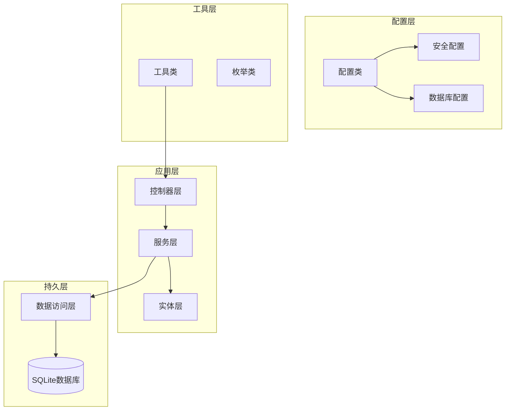
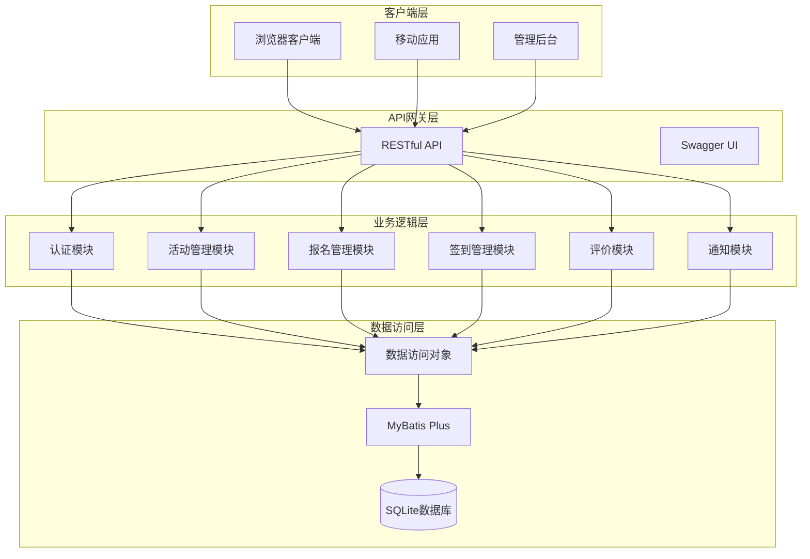
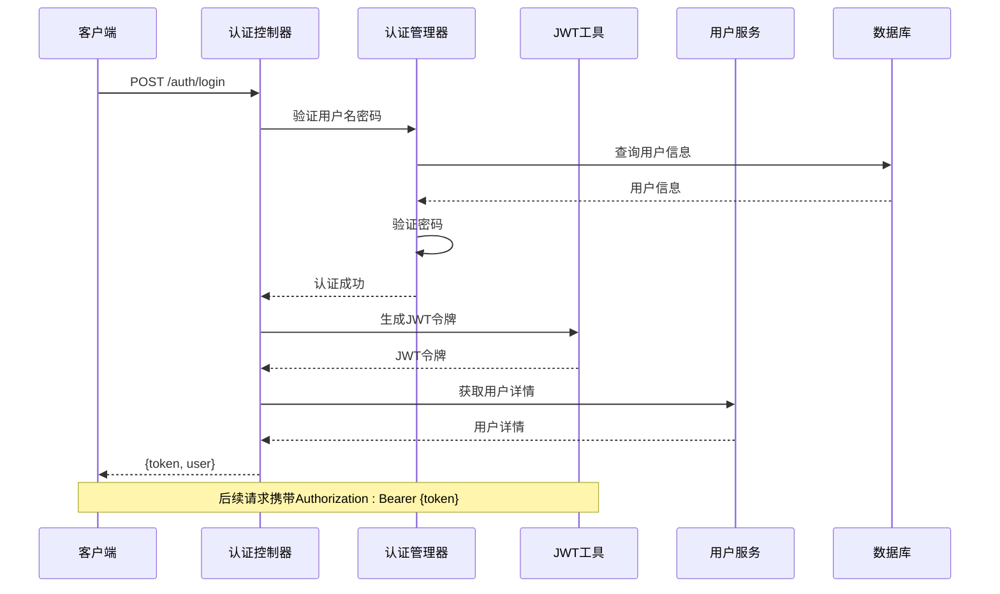
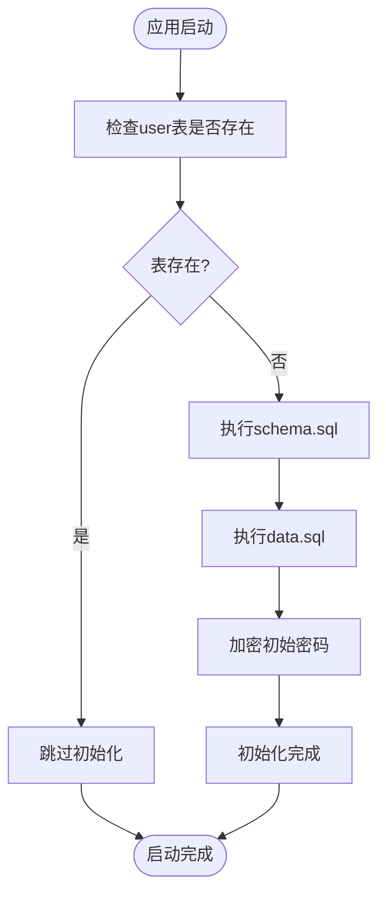
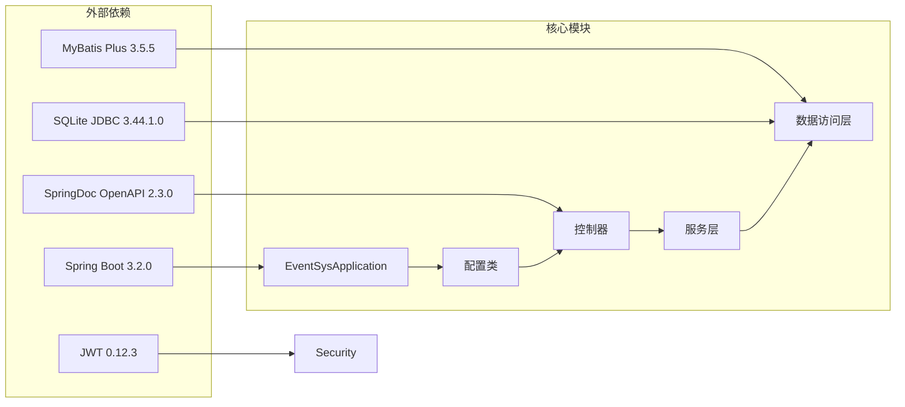

# 部署运维

<cite>
**本文档引用的文件**
- [pom.xml](file://pom.xml)
- [application.yml](file://src/main/resources/application.yml)
- [EventSysApplication.java](file://src/main/java/com/campus/eventsys/EventSysApplication.java)
- [SecurityConfig.java](file://src/main/java/com/campus/eventsys/config/SecurityConfig.java)
- [MyBatisPlusConfig.java](file://src/main/java/com/campus/eventsys/config/MyBatisPlusConfig.java)
- [DatabaseInitializer.java](file://src/main/java/com/campus/eventsys/config/DatabaseInitializer.java)
- [OpenApiConfig.java](file://src/main/java/com/campus/eventsys/config/OpenApiConfig.java)
- [schema.sql](file://src/main/resources/db/schema.sql)
- [data.sql](file://src/main/resources/db/data.sql)
- [AuthController.java](file://src/main/java/com/campus/eventsys/controller/AuthController.java)
- [JwtAuthenticationFilter.java](file://src/main/java/com/campus/eventsys/security/JwtAuthenticationFilter.java)
- [表设计.md](file://picture/表设计.md)
- [url.txt](file://url.txt)
</cite>

## 目录
1. [简介](#简介)
2. [项目结构](#项目结构)
3. [核心组件](#核心组件)
4. [架构概览](#架构概览)
5. [详细组件分析](#详细组件分析)
6. [依赖关系分析](#依赖关系分析)
7. [性能考虑](#性能考虑)
8. [故障排查指南](#故障排查指南)
9. [结论](#结论)
10. [附录](#附录)

## 简介

校园活动管理系统是一个基于Spring Boot开发的综合性校园活动管理平台，集成了用户认证、活动管理、报名系统、签到管理、成果展示、评价体系等功能模块。该系统采用SQLite数据库存储，支持JWT认证机制，提供了完整的RESTful API接口和Swagger UI文档。

## 项目结构

系统采用标准的Spring Boot项目结构，主要分为以下层次：



**图表来源**
- [EventSysApplication.java:1-17](file://src/main/java/com/campus/eventsys/EventSysApplication.java#L1-L17)
- [pom.xml:1-131](file://pom.xml#L1-L131)

**章节来源**
- [EventSysApplication.java:1-17](file://src/main/java/com/campus/eventsys/EventSysApplication.java#L1-L17)
- [pom.xml:1-131](file://pom.xml#L1-L131)

## 核心组件

### 应用配置组件

系统的核心配置集中在application.yml文件中，包含了服务器配置、数据库连接、文件上传、JWT认证、OpenAPI文档等关键配置项。

### 安全认证组件

系统实现了基于JWT的无状态认证机制，通过SecurityConfig配置HTTP安全策略，JwtAuthenticationFilter处理JWT令牌验证。

### 数据访问组件

采用MyBatis Plus框架，通过DatabaseInitializer实现数据库的自动初始化和数据迁移。

**章节来源**
- [application.yml:1-76](file://src/main/resources/application.yml#L1-L76)
- [SecurityConfig.java:1-100](file://src/main/java/com/campus/eventsys/config/SecurityConfig.java#L1-L100)
- [MyBatisPlusConfig.java:1-58](file://src/main/java/com/campus/eventsys/config/MyBatisPlusConfig.java#L1-L58)
- [DatabaseInitializer.java:1-115](file://src/main/java/com/campus/eventsys/config/DatabaseInitializer.java#L1-L115)

## 架构概览

系统采用分层架构设计，实现了关注点分离和模块化开发：



**图表来源**
- [AuthController.java:1-106](file://src/main/java/com/campus/eventsys/controller/AuthController.java#L1-L106)
- [SecurityConfig.java:35-71](file://src/main/java/com/campus/eventsys/config/SecurityConfig.java#L35-L71)

## 详细组件分析

### 数据库架构

系统使用SQLite作为数据存储引擎，支持完整的校园活动管理功能：

```mermaid
erDiagram
USER {
INTEGER id PK
VARCHAR username UK
VARCHAR password
VARCHAR nickname
VARCHAR avatar
VARCHAR email
VARCHAR phone
VARCHAR real_name
VARCHAR student_id
VARCHAR college
VARCHAR major
VARCHAR grade
INTEGER gender
TEXT bio
INTEGER role
INTEGER status
INTEGER organized_count
INTEGER participated_count
DATETIME create_time
DATETIME update_time
INTEGER deleted
}
CATEGORY {
INTEGER id PK
VARCHAR name
VARCHAR description
VARCHAR icon
INTEGER sort_order
INTEGER status
INTEGER activity_count
DATETIME create_time
DATETIME update_time
INTEGER deleted
}
ACTIVITY {
INTEGER id PK
VARCHAR title
TEXT description
VARCHAR cover_image
INTEGER organizer_id FK
VARCHAR location
DATETIME start_time
DATETIME end_time
DATETIME registration_start_time
DATETIME registration_end_time
INTEGER max_participants
INTEGER current_participants
VARCHAR tags
INTEGER status
INTEGER category_id FK
INTEGER need_review
INTEGER view_count
INTEGER favorite_count
INTEGER comment_count
DECIMAL avg_rating
INTEGER review_count
DATETIME create_time
DATETIME update_time
INTEGER deleted
}
ACTIVITY_REGISTRATION {
INTEGER id PK
INTEGER activity_id FK
INTEGER user_id FK
INTEGER role
INTEGER status
TEXT remark
TEXT images
INTEGER reviewer_id FK
DATETIME review_time
TEXT review_remark
DATETIME create_time
DATETIME update_time
INTEGER deleted
}
ACTIVITY_RESULT {
INTEGER id PK
INTEGER activity_id FK UK
VARCHAR title
TEXT content
TEXT images
INTEGER creator_id FK
INTEGER view_count
INTEGER comment_count
INTEGER status
DATETIME create_time
DATETIME update_time
INTEGER deleted
}
COMMENT {
INTEGER id PK
INTEGER target_id
INTEGER target_type
INTEGER user_id FK
TEXT content
INTEGER parent_id
INTEGER reply_to_user_id
DATETIME create_time
DATETIME update_time
INTEGER deleted
}
ACTIVITY_FAVORITE {
INTEGER id PK
INTEGER activity_id FK
INTEGER user_id FK
DATETIME create_time
INTEGER deleted
}
CHECK_IN_RECORD {
INTEGER id PK
INTEGER activity_id FK
INTEGER user_id FK
INTEGER registration_id FK
DATETIME check_in_time
INTEGER check_in_type
VARCHAR location
TEXT remark
DATETIME create_time
INTEGER deleted
}
NOTIFICATION {
INTEGER id PK
INTEGER user_id
VARCHAR title
TEXT content
INTEGER type
INTEGER activity_id FK
INTEGER is_read
DATETIME read_time
DATETIME create_time
INTEGER deleted
}
ACTIVITY_AUDIT {
INTEGER id PK
INTEGER activity_id FK
INTEGER audit_type
INTEGER status
INTEGER submitter_id FK
DATETIME submit_time
INTEGER auditor_id FK
DATETIME audit_time
TEXT audit_opinion
DATETIME create_time
DATETIME update_time
INTEGER deleted
}
ACTIVITY_REVIEW {
INTEGER id PK
INTEGER activity_id FK
INTEGER user_id FK
INTEGER rating
TEXT content
TEXT reply
DATETIME create_time
DATETIME update_time
INTEGER deleted
}
USER ||--o{ ACTIVITY : organizes
CATEGORY ||--o{ ACTIVITY : categorizes
USER ||--o{ ACTIVITY_REGISTRATION : registers
ACTIVITY ||--o{ ACTIVITY_REGISTRATION : has
USER ||--o{ ACTIVITY_RESULT : creates
ACTIVITY ||--|| ACTIVITY_RESULT : has
USER ||--o{ COMMENT : writes
ACTIVITY ||--o{ COMMENT : targets
USER ||--o{ ACTIVITY_FAVORITE : favorites
ACTIVITY ||--o{ ACTIVITY_FAVORITE : favorited
USER ||--o{ CHECK_IN_RECORD : checks_in
ACTIVITY ||--o{ CHECK_IN_RECORD : has
USER ||--o{ NOTIFICATION : receives
ACTIVITY ||--o{ NOTIFICATION : relates_to
USER ||--o{ ACTIVITY_AUDIT : submits
ACTIVITY ||--o{ ACTIVITY_AUDIT : audited
USER ||--o{ ACTIVITY_REVIEW : reviews
ACTIVITY ||--o{ ACTIVITY_REVIEW : reviewed
```

**图表来源**
- [schema.sql:6-295](file://src/main/resources/db/schema.sql#L6-L295)
- [表设计.md:2-206](file://picture/表设计.md#L2-L206)

### 安全认证流程

系统实现了完整的JWT认证流程，确保API调用的安全性：



**图表来源**
- [AuthController.java:57-73](file://src/main/java/com/campus/eventsys/controller/AuthController.java#L57-L73)
- [JwtAuthenticationFilter.java:26-48](file://src/main/java/com/campus/eventsys/security/JwtAuthenticationFilter.java#L26-L48)

### 数据库初始化流程

系统启动时自动执行数据库初始化，确保数据结构的一致性和完整性：



**图表来源**
- [DatabaseInitializer.java:34-53](file://src/main/java/com/campus/eventsys/config/DatabaseInitializer.java#L34-L53)
- [schema.sql:1-295](file://src/main/resources/db/schema.sql#L1-L295)
- [data.sql:1-335](file://src/main/resources/db/data.sql#L1-L335)

**章节来源**
- [schema.sql:1-295](file://src/main/resources/db/schema.sql#L1-L295)
- [data.sql:1-335](file://src/main/resources/db/data.sql#L1-L335)
- [DatabaseInitializer.java:1-115](file://src/main/java/com/campus/eventsys/config/DatabaseInitializer.java#L1-L115)
- [AuthController.java:1-106](file://src/main/java/com/campus/eventsys/controller/AuthController.java#L1-L106)
- [JwtAuthenticationFilter.java:1-58](file://src/main/java/com/campus/eventsys/security/JwtAuthenticationFilter.java#L1-L58)

## 依赖关系分析

系统依赖关系清晰，遵循单一职责原则：



**图表来源**
- [pom.xml:27-104](file://pom.xml#L27-L104)
- [EventSysApplication.java:3-10](file://src/main/java/com/campus/eventsys/EventSysApplication.java#L3-L10)

**章节来源**
- [pom.xml:1-131](file://pom.xml#L1-L131)

## 性能考虑

### 数据库性能优化

系统针对SQLite数据库进行了专门的性能优化：

1. **索引优化**：为常用查询字段建立了复合索引
2. **分页优化**：配置了SQLite专用的分页插件
3. **逻辑删除**：使用deleted字段实现软删除，避免物理删除影响性能

### 缓存策略

系统具备良好的缓存设计潜力：
- 用户认证信息可通过JWT实现无状态缓存
- 活动列表和分类信息可考虑Redis缓存
- 频繁访问的数据可采用本地缓存

### 监控指标

建议监控的关键指标：
- 数据库连接池使用率
- API响应时间分布
- 用户活跃度统计
- 文件上传成功率

## 故障排查指南

### 常见问题诊断

1. **数据库连接失败**
   - 检查SQLite驱动版本兼容性
   - 验证数据库文件权限
   - 确认数据库文件路径正确

2. **JWT认证失败**
   - 验证JWT密钥配置
   - 检查令牌过期时间设置
   - 确认请求头格式正确

3. **API接口异常**
   - 查看应用日志输出
   - 验证请求参数格式
   - 检查数据库连接状态

### 日志分析

系统日志配置位于application.yml中，建议重点关注：
- 应用启动和关闭日志
- 数据库操作日志
- 安全认证相关日志
- 异常堆栈信息

**章节来源**
- [application.yml:71-76](file://src/main/resources/application.yml#L71-L76)
- [DatabaseInitializer.java:50-52](file://src/main/java/com/campus/eventsys/config/DatabaseInitializer.java#L50-L52)

## 结论

校园活动管理系统是一个功能完整、架构清晰的Spring Boot应用。系统采用SQLite数据库，支持JWT认证，具备良好的扩展性和维护性。通过合理的配置管理和性能优化，能够满足校园活动管理的实际需求。

## 附录

### 部署环境要求

- Java版本：17+
- 内存：建议2GB以上
- 存储：至少500MB可用空间
- 网络：开放8080端口

### 配置文件说明

- application.yml：应用核心配置
- schema.sql：数据库结构定义
- data.sql：初始数据脚本

### API文档

系统提供了完整的API文档，可通过以下地址访问：
- Swagger UI：http://localhost:8080/api/swagger-ui.html
- OpenAPI JSON：http://localhost:8080/api/v3/api-docs