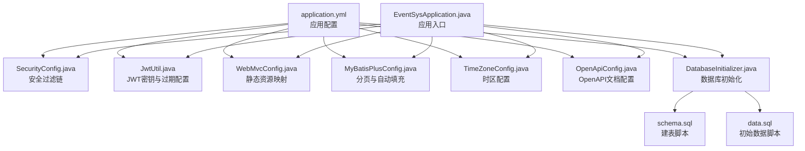
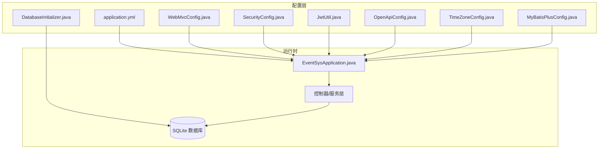
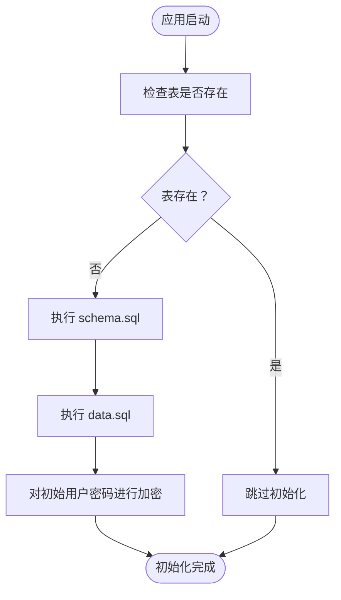
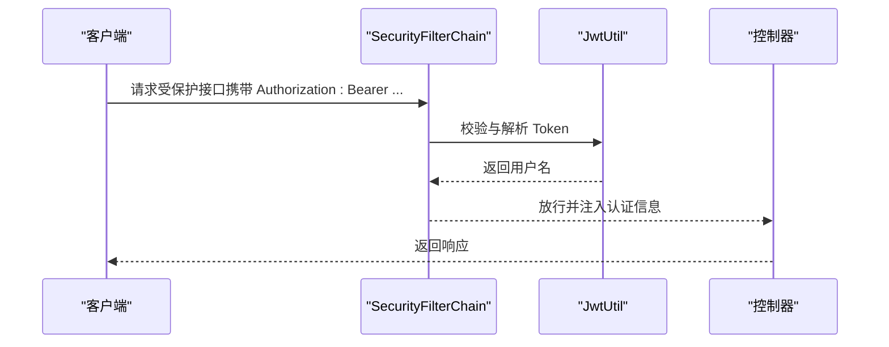
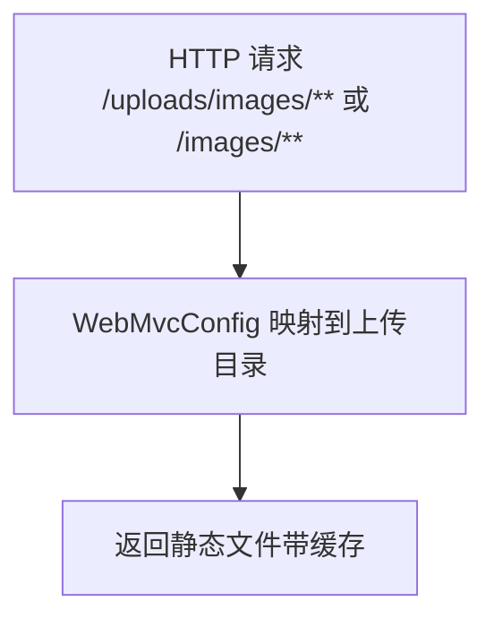
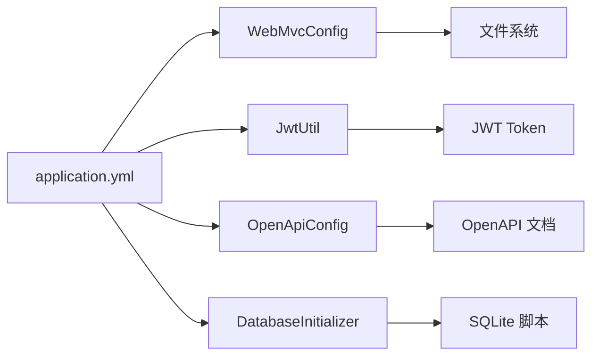

# 配置管理

<cite>
**本文引用的文件**
- [application.yml](file://src/main/resources/application.yml)
- [SecurityConfig.java](file://src/main/java/com/campus/eventsys/config/SecurityConfig.java)
- [JwtUtil.java](file://src/main/java/com/campus/eventsys/security/JwtUtil.java)
- [WebMvcConfig.java](file://src/main/java/com/campus/eventsys/config/WebMvcConfig.java)
- [MyBatisPlusConfig.java](file://src/main/java/com/campus/eventsys/config/MyBatisPlusConfig.java)
- [TimeZoneConfig.java](file://src/main/java/com/campus/eventsys/config/TimeZoneConfig.java)
- [OpenApiConfig.java](file://src/main/java/com/campus/eventsys/config/OpenApiConfig.java)
- [DatabaseInitializer.java](file://src/main/java/com/campus/eventsys/config/DatabaseInitializer.java)
- [schema.sql](file://src/main/resources/db/schema.sql)
- [data.sql](file://src/main/resources/db/data.sql)
- [EventSysApplication.java](file://src/main/java/com/campus/eventsys/EventSysApplication.java)
</cite>

## 目录
1. [简介](#简介)
2. [项目结构](#项目结构)
3. [核心组件](#核心组件)
4. [架构总览](#架构总览)
5. [详细组件分析](#详细组件分析)
6. [依赖分析](#依赖分析)
7. [性能考虑](#性能考虑)
8. [故障排查指南](#故障排查指南)
9. [结论](#结论)
10. [附录](#附录)

## 简介
本文件面向开发者与运维人员，系统化梳理本项目的配置管理策略与最佳实践，覆盖以下方面：
- application.yml 中的关键配置项：服务器、数据库、文件上传、JSON序列化、MyBatis-Plus、JWT、OpenAPI、日志等
- 配置加载顺序与优先级规则（基于 Spring Boot 的通用规则）
- 环境变量与外部化配置的最佳实践
- 默认值、可选值与配置示例
- 配置变更的热更新机制与配置验证方法

## 项目结构
项目采用 Spring Boot 标准布局，配置集中在 resources 目录下的 application.yml；安全、Web、MyBatis-Plus、时区与OpenAPI等配置分别由对应的 Java 配置类承载。

图表来源
- [application.yml:1-76](file://src/main/resources/application.yml#L1-L76)
- [SecurityConfig.java:1-100](file://src/main/java/com/campus/eventsys/config/SecurityConfig.java#L1-L100)
- [JwtUtil.java:1-71](file://src/main/java/com/campus/eventsys/security/JwtUtil.java#L1-L71)
- [WebMvcConfig.java:1-38](file://src/main/java/com/campus/eventsys/config/WebMvcConfig.java#L1-L38)
- [MyBatisPlusConfig.java:1-58](file://src/main/java/com/campus/eventsys/config/MyBatisPlusConfig.java#L1-L58)
- [TimeZoneConfig.java:1-34](file://src/main/java/com/campus/eventsys/config/TimeZoneConfig.java#L1-L34)
- [OpenApiConfig.java:1-52](file://src/main/java/com/campus/eventsys/config/OpenApiConfig.java#L1-L52)
- [DatabaseInitializer.java:1-115](file://src/main/java/com/campus/eventsys/config/DatabaseInitializer.java#L1-L115)
- [schema.sql:1-295](file://src/main/resources/db/schema.sql#L1-L295)
- [data.sql:1-335](file://src/main/resources/db/data.sql#L1-L335)
- [EventSysApplication.java:1-17](file://src/main/java/com/campus/eventsys/EventSysApplication.java#L1-L17)

章节来源
- [application.yml:1-76](file://src/main/resources/application.yml#L1-L76)
- [EventSysApplication.java:1-17](file://src/main/java/com/campus/eventsys/EventSysApplication.java#L1-L17)

## 核心组件
本节逐项解析 application.yml 中的关键配置，并结合相关配置类说明其作用与默认值。

- 服务器配置
  - 端口与上下文路径：server.port、server.servlet.context-path
  - 默认值：端口 8080，上下文路径 /api
  - 说明：应用监听端口与根路径，便于反向代理与多实例部署

- 数据源配置
  - 驱动与URL：spring.datasource.driver-class-name、spring.datasource.url
  - 用户名与密码：spring.datasource.username、spring.datasource.password
  - 默认值：驱动为 SQLite JDBC，URL 使用 ${user.dir} 指向当前工作目录下的 event_database.db；用户名与密码为空（SQLite 无需）
  - 说明：使用 SQLite 本地数据库，适合开发与演示环境

- SQL 初始化模式
  - spring.sql.init.mode：never
  - 说明：禁用 Spring Boot 默认初始化，改由自定义 DatabaseInitializer 执行 schema.sql 与 data.sql

- 文件上传配置
  - spring.servlet.multipart.enabled：true
  - spring.servlet.multipart.max-file-size：10MB
  - spring.servlet.multipart.max-request-size：20MB
  - 默认值：启用上传，单文件最大 10MB，请求总大小 20MB

- JSON 时间序列化
  - spring.jackson.date-format：yyyy-MM-dd HH:mm:ss
  - spring.jackson.time-zone：UTC
  - spring.jackson.serialization.write-dates-as-timestamps：false
  - 默认值：日期格式为字符串，时区为 UTC，不输出时间戳

- MyBatis-Plus 配置
  - mapper-locations：classpath*:/mapper/**/*.xml
  - type-aliases-package：com.campus.eventsys.entity
  - configuration.map-underscore-to-camel-case：true
  - configuration.log-impl：org.apache.ibatis.logging.stdout.StdOutImpl
  - global-config.db-config.id-type：input
  - global-config.db-config.logic-delete-field：deleted
  - global-config.db-config.logic-delete-value：1
  - global-config.db-config.logic-not-delete-value：0
  - 默认值：驼峰映射、标准输出日志、SQLite 主键输入策略、逻辑删除字段与值

- JWT 配置
  - jwt.secret：密钥字符串
  - jwt.expiration：毫秒数（示例为 24 小时）
  - 默认值：见 application.yml 中的默认值
  - 说明：用于生成与校验 JWT Token

- OpenAPI/Swagger 配置
  - springdoc.swagger-ui.path：/swagger-ui.html
  - springdoc.swagger-ui.tags-sorter：alpha
  - springdoc.swagger-ui.operations-sorter：alpha
  - springdoc.api-docs.path：/v3/api-docs
  - springdoc.show-actuator：false
  - 默认值：见 application.yml 中的默认值
  - 说明：控制 Swagger UI 与 OpenAPI 文档的访问路径与排序行为

- 文件访问路径
  - file.upload.path：uploads/images
  - file.access.url：/images/
  - 默认值：上传目录 uploads/images，对外访问路径 /images/

- 日志级别
  - logging.level.com.campus.eventsys：debug
  - logging.level.org.springframework.security：debug
  - 默认值：见 application.yml 中的默认值
  - 说明：便于开发调试阶段定位问题

章节来源
- [application.yml:1-76](file://src/main/resources/application.yml#L1-L76)
- [WebMvcConfig.java:18-36](file://src/main/java/com/campus/eventsys/config/WebMvcConfig.java#L18-L36)
- [JwtUtil.java:15-19](file://src/main/java/com/campus/eventsys/security/JwtUtil.java#L15-L19)
- [OpenApiConfig.java:24-50](file://src/main/java/com/campus/eventsys/config/OpenApiConfig.java#L24-L50)
- [MyBatisPlusConfig.java:25-56](file://src/main/java/com/campus/eventsys/config/MyBatisPlusConfig.java#L25-L56)
- [TimeZoneConfig.java:18-32](file://src/main/java/com/campus/eventsys/config/TimeZoneConfig.java#L18-L32)
- [SecurityConfig.java:36-71](file://src/main/java/com/campus/eventsys/config/SecurityConfig.java#L36-L71)

## 架构总览
下图展示了配置在系统中的作用范围与交互关系。

图表来源
- [application.yml:1-76](file://src/main/resources/application.yml#L1-L76)
- [EventSysApplication.java:1-17](file://src/main/java/com/campus/eventsys/EventSysApplication.java#L1-L17)
- [WebMvcConfig.java:1-38](file://src/main/java/com/campus/eventsys/config/WebMvcConfig.java#L1-L38)
- [SecurityConfig.java:1-100](file://src/main/java/com/campus/eventsys/config/SecurityConfig.java#L1-L100)
- [JwtUtil.java:1-71](file://src/main/java/com/campus/eventsys/security/JwtUtil.java#L1-L71)
- [OpenApiConfig.java:1-52](file://src/main/java/com/campus/eventsys/config/OpenApiConfig.java#L1-L52)
- [TimeZoneConfig.java:1-34](file://src/main/java/com/campus/eventsys/config/TimeZoneConfig.java#L1-L34)
- [MyBatisPlusConfig.java:1-58](file://src/main/java/com/campus/eventsys/config/MyBatisPlusConfig.java#L1-L58)
- [DatabaseInitializer.java:1-115](file://src/main/java/com/campus/eventsys/config/DatabaseInitializer.java#L1-L115)

## 详细组件分析

### 数据库连接与初始化
- 连接配置
  - 驱动与URL：使用 org.sqlite.JDBC 与 jdbc:sqlite:${user.dir}/event_database.db
  - 用户名与密码：空（SQLite 无需）
- 初始化策略
  - spring.sql.init.mode=never：禁用 Spring Boot 默认初始化
  - 自定义 DatabaseInitializer：启动时检测表是否存在，不存在则执行 schema.sql 与 data.sql，并对初始用户密码进行 BCrypt 加密
- MyBatis-Plus 配置
  - mapper-locations 与 type-aliases-package：扫描 XML 与实体包
  - 分页插件：针对 SQLite 的 PaginationInnerInterceptor，overflow=false，maxLimit=1000
  - 自动填充：插入与更新时自动填充 createTime、updateTime、deleted 字段，使用 UTC 时区

图表来源
- [DatabaseInitializer.java:34-53](file://src/main/java/com/campus/eventsys/config/DatabaseInitializer.java#L34-L53)
- [schema.sql:1-295](file://src/main/resources/db/schema.sql#L1-L295)
- [data.sql:1-335](file://src/main/resources/db/data.sql#L1-L335)

章节来源
- [application.yml:10-19](file://src/main/resources/application.yml#L10-L19)
- [DatabaseInitializer.java:34-78](file://src/main/java/com/campus/eventsys/config/DatabaseInitializer.java#L34-L78)
- [MyBatisPlusConfig.java:25-56](file://src/main/java/com/campus/eventsys/config/MyBatisPlusConfig.java#L25-L56)
- [schema.sql:1-295](file://src/main/resources/db/schema.sql#L1-L295)
- [data.sql:1-335](file://src/main/resources/db/data.sql#L1-L335)

### JWT 配置与安全过滤链
- JWT 配置
  - 从 application.yml 读取 jwt.secret 与 jwt.expiration
  - JwtUtil 使用 HMAC-SHA 签名生成与解析 Token，并提供校验与过期判断
- 安全过滤链
  - 关闭 CSRF，配置 CORS 放行所有来源并允许凭据
  - 无状态 Session（STATELESS）
  - 放行认证与公开接口，管理员接口需 ADMIN 角色，其余接口需登录
  - 在 UsernamePasswordAuthenticationFilter 之前添加 JWT 过滤器

图表来源
- [SecurityConfig.java:36-71](file://src/main/java/com/campus/eventsys/config/SecurityConfig.java#L36-L71)
- [JwtUtil.java:25-56](file://src/main/java/com/campus/eventsys/security/JwtUtil.java#L25-L56)

章节来源
- [application.yml:49-52](file://src/main/resources/application.yml#L49-L52)
- [JwtUtil.java:15-56](file://src/main/java/com/campus/eventsys/security/JwtUtil.java#L15-L56)
- [SecurityConfig.java:36-98](file://src/main/java/com/campus/eventsys/config/SecurityConfig.java#L36-L98)

### 文件上传与静态资源映射
- 上传配置
  - spring.servlet.multipart.*：限制单文件与请求总大小
- 访问路径
  - file.upload.path：默认 uploads/images
  - file.access.url：默认 /images/
- 静态资源映射
  - WebMvcConfig 将 /uploads/images/** 与 /images/** 映射到实际上传目录，并设置缓存

图表来源
- [application.yml:64-69](file://src/main/resources/application.yml#L64-L69)
- [WebMvcConfig.java:18-36](file://src/main/java/com/campus/eventsys/config/WebMvcConfig.java#L18-L36)

章节来源
- [application.yml:21-26](file://src/main/resources/application.yml#L21-L26)
- [application.yml:64-69](file://src/main/resources/application.yml#L64-L69)
- [WebMvcConfig.java:18-36](file://src/main/java/com/campus/eventsys/config/WebMvcConfig.java#L18-L36)

### OpenAPI/Swagger 与日志配置
- OpenAPI 配置
  - OpenApiConfig 定义 API 基本信息与 Bearer JWT 安全方案
  - application.yml 控制 swagger-ui 与 api-docs 的访问路径
- 日志配置
  - application.yml 设置包级别的日志级别，便于调试

章节来源
- [OpenApiConfig.java:24-50](file://src/main/java/com/campus/eventsys/config/OpenApiConfig.java#L24-L50)
- [application.yml:54-62](file://src/main/resources/application.yml#L54-L62)
- [application.yml:71-76](file://src/main/resources/application.yml#L71-L76)

## 依赖分析
- 配置耦合关系
  - WebMvcConfig 依赖 file.upload.path 与 file.access.url
  - JwtUtil 依赖 jwt.secret 与 jwt.expiration
  - SecurityConfig 依赖 JwtAuthenticationFilter（未在本文展开）与 UserDetailsService
  - MyBatisPlusConfig 依赖 DbType.SQLITE 与自动填充逻辑
  - DatabaseInitializer 依赖 schema.sql 与 data.sql
- 外部依赖
  - SQLite 驱动与 MyBatis-Plus 插件
  - Spring Security 与 SpringDoc OpenAPI

图表来源
- [application.yml:1-76](file://src/main/resources/application.yml#L1-L76)
- [WebMvcConfig.java:1-38](file://src/main/java/com/campus/eventsys/config/WebMvcConfig.java#L1-L38)
- [JwtUtil.java:1-71](file://src/main/java/com/campus/eventsys/security/JwtUtil.java#L1-L71)
- [OpenApiConfig.java:1-52](file://src/main/java/com/campus/eventsys/config/OpenApiConfig.java#L1-L52)
- [DatabaseInitializer.java:1-115](file://src/main/java/com/campus/eventsys/config/DatabaseInitializer.java#L1-L115)

章节来源
- [application.yml:1-76](file://src/main/resources/application.yml#L1-L76)
- [WebMvcConfig.java:1-38](file://src/main/java/com/campus/eventsys/config/WebMvcConfig.java#L1-L38)
- [JwtUtil.java:1-71](file://src/main/java/com/campus/eventsys/security/JwtUtil.java#L1-L71)
- [OpenApiConfig.java:1-52](file://src/main/java/com/campus/eventsys/config/OpenApiConfig.java#L1-L52)
- [DatabaseInitializer.java:1-115](file://src/main/java/com/campus/eventsys/config/DatabaseInitializer.java#L1-L115)

## 性能考虑
- 上传限制：合理设置 spring.servlet.multipart.max-file-size 与 max-request-size，避免内存溢出
- 分页与日志：MyBatis-Plus 分页插件设置合理的 maxLimit，日志输出仅在调试阶段开启
- 缓存：静态资源映射设置了缓存周期，减少重复请求
- 时区：统一使用 UTC，避免跨时区导致的时间计算偏差

## 故障排查指南
- 启动失败（数据库相关）
  - 症状：初始化失败或找不到表
  - 排查：确认 schema.sql 与 data.sql 是否存在，确认 spring.sql.init.mode=never 且 DatabaseInitializer 正常执行
- JWT 校验失败
  - 症状：Token 解析异常或过期
  - 排查：核对 jwt.secret 与 jwt.expiration，确保前后端一致
- 文件无法访问
  - 症状：/uploads/images/** 或 /images/** 返回 404
  - 排查：确认 file.upload.path 与 WebMvcConfig 的映射路径一致，确认上传目录存在且可读
- CORS 问题
  - 症状：前端跨域请求被拒绝
  - 排查：确认 SecurityConfig 中 CORS 配置允许来源与凭据

章节来源
- [DatabaseInitializer.java:34-53](file://src/main/java/com/campus/eventsys/config/DatabaseInitializer.java#L34-L53)
- [JwtUtil.java:46-69](file://src/main/java/com/campus/eventsys/security/JwtUtil.java#L46-L69)
- [WebMvcConfig.java:21-36](file://src/main/java/com/campus/eventsys/config/WebMvcConfig.java#L21-L36)
- [SecurityConfig.java:87-98](file://src/main/java/com/campus/eventsys/config/SecurityConfig.java#L87-L98)

## 结论
本项目的配置管理遵循“集中式 YAML + 显式 Java 配置”的原则，既满足开发调试需求，又便于生产环境的外部化与安全加固。通过明确的默认值、清晰的加载顺序与严格的验证流程，能够有效降低配置漂移带来的风险。

## 附录

### 配置加载顺序与优先级（Spring Boot 通用规则）
- 命令行参数
- OS 环境变量
- JAVA_OPTS 等环境变量
- application-{profile}.yml
- application.yml
- @PropertySource 注解
- 默认属性（如 application.yml 中的默认值）

说明：本项目中 application.yml 提供默认值，可通过环境变量或命令行覆盖。

### 环境变量与外部化配置最佳实践
- 使用环境变量覆盖敏感配置（如数据库 URL、JWT 密钥）
- 通过 profile 文件区分开发/测试/生产环境
- 将上传目录与访问路径通过环境变量或外部配置文件调整，避免硬编码

### 配置项默认值与可选值
- server.port：数值型，默认 8080
- server.servlet.context-path：字符串，默认 /api
- spring.datasource.driver-class-name：字符串，示例 org.sqlite.JDBC
- spring.datasource.url：字符串，示例 jdbc:sqlite:${user.dir}/event_database.db
- spring.sql.init.mode：字符串，枚举值 never/always/embedded
- spring.servlet.multipart.enabled：布尔值，默认 true
- spring.servlet.multipart.max-file-size：字节数/字符串，默认 10MB
- spring.servlet.multipart.max-request-size：字节数/字符串，默认 20MB
- spring.jackson.date-format：字符串，默认 yyyy-MM-dd HH:mm:ss
- spring.jackson.time-zone：字符串，默认 UTC
- spring.jackson.serialization.write-dates-as-timestamps：布尔值，默认 false
- mybatis-plus.mapper-locations：字符串，默认 classpath*:/mapper/**/*.xml
- mybatis-plus.type-aliases-package：字符串，默认 com.campus.eventsys.entity
- mybatis-plus.configuration.map-underscore-to-camel-case：布尔值，默认 true
- mybatis-plus.global-config.db-config.id-type：枚举值，示例 input
- mybatis-plus.global-config.db-config.logic-delete-field：字符串，默认 deleted
- mybatis-plus.global-config.db-config.logic-delete-value：整数，默认 1
- mybatis-plus.global-config.db-config.logic-not-delete-value：整数，默认 0
- jwt.secret：字符串（建议足够长度与复杂度）
- jwt.expiration：毫秒数（示例 86400000）
- springdoc.swagger-ui.path：字符串，默认 /swagger-ui.html
- springdoc.api-docs.path：字符串，默认 /v3/api-docs
- file.upload.path：字符串，默认 uploads/images
- file.access.url：字符串，默认 /images/
- logging.level.*：字符串，枚举值 debug/info/warn/error 等

### 配置变更的热更新机制与验证方法
- 热更新机制
  - Spring Boot Actuator 提供 /actuator/env 端点，可动态查看与刷新部分配置
  - 对于不支持热更新的配置（如数据库连接、JWT 密钥），建议通过重启生效
- 验证方法
  - 启动日志观察配置加载情况
  - 单元测试与集成测试覆盖关键配置（如文件上传、JWT 生成与校验、静态资源映射）
  - 使用 OpenAPI 文档验证接口访问路径与安全方案