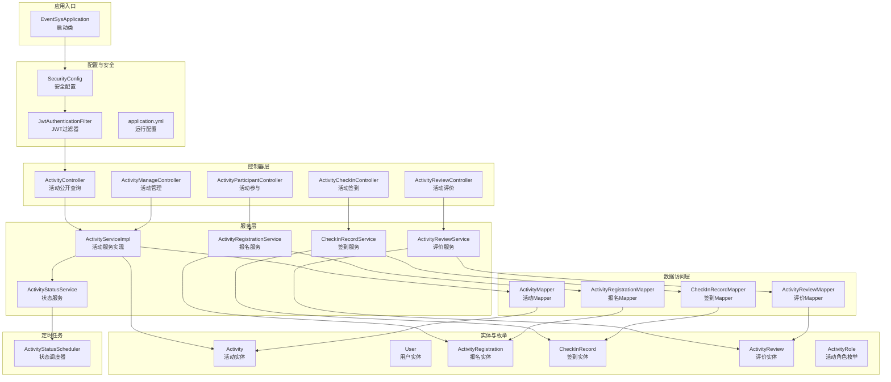
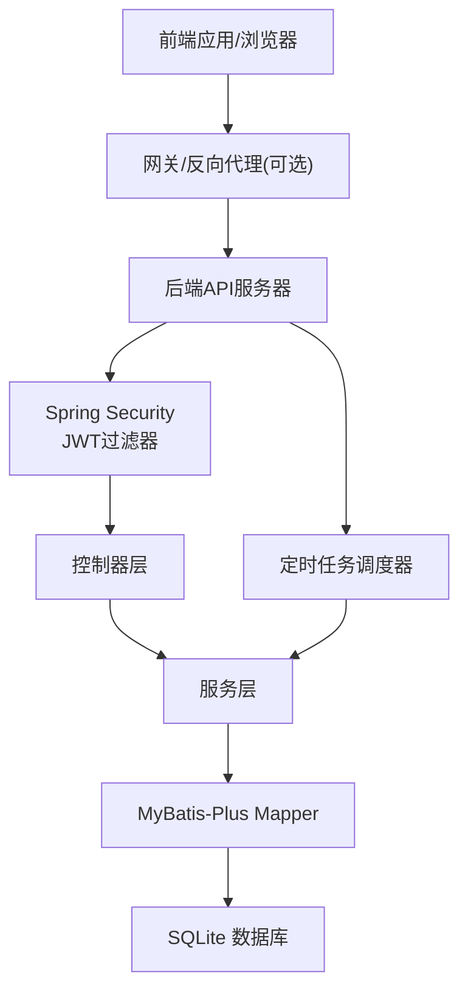
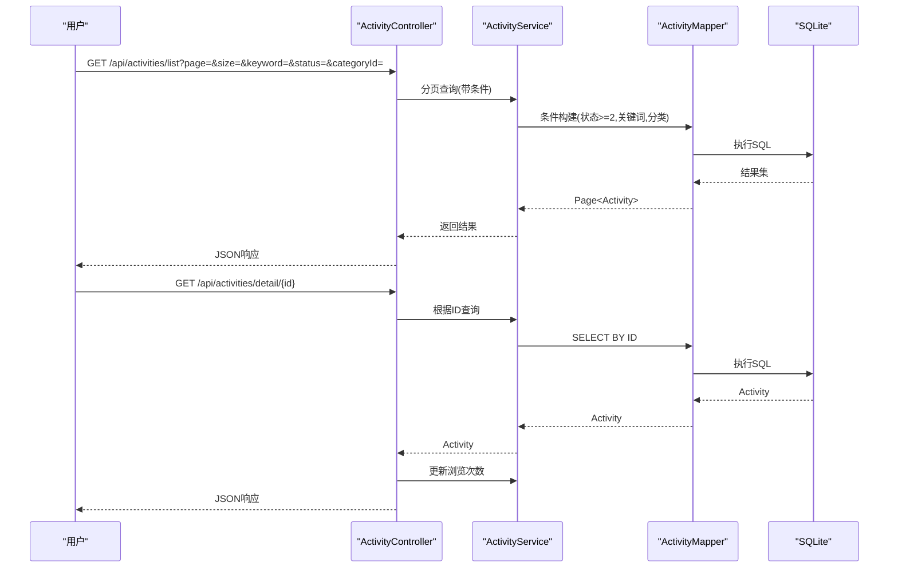
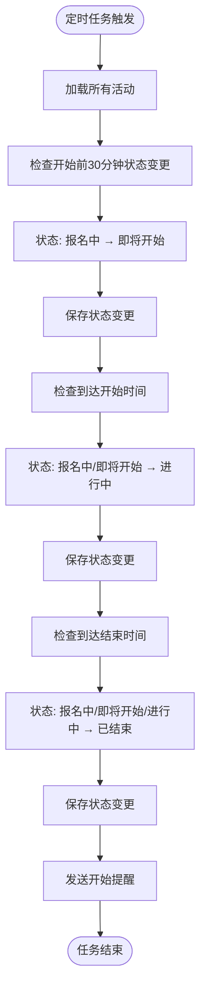
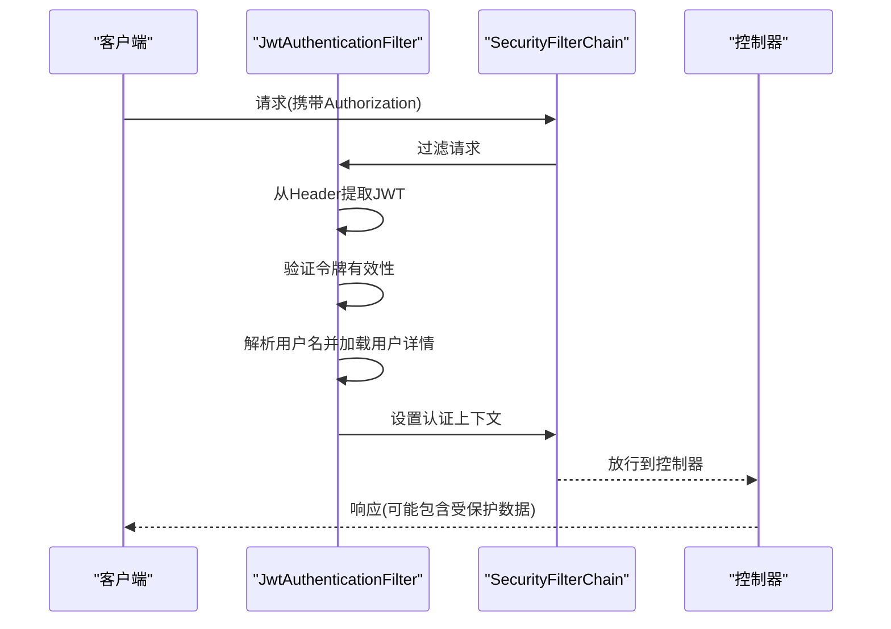
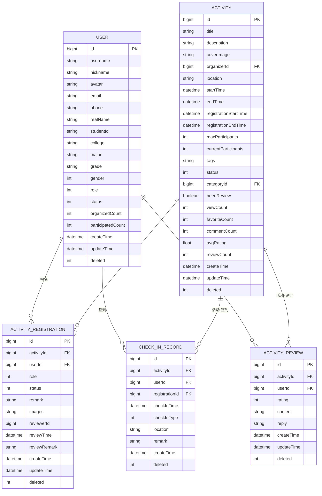
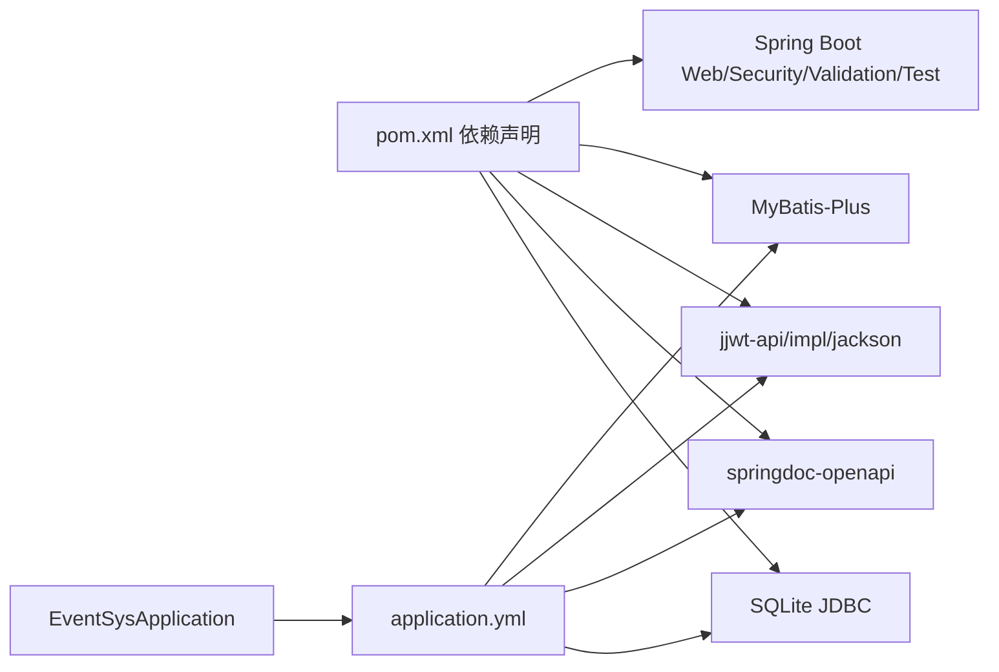

# 项目概述

<cite>
**本文引用的文件**
- [EventSysApplication.java](file://src/main/java/com/campus/eventsys/EventSysApplication.java)
- [pom.xml](file://pom.xml)
- [application.yml](file://src/main/resources/application.yml)
- [ActivityController.java](file://src/main/java/com/campus/eventsys/controller/ActivityController.java)
- [ActivityServiceImpl.java](file://src/main/java/com/campus/eventsys/service/impl/ActivityServiceImpl.java)
- [Activity.java](file://src/main/java/com/campus/eventsys/entity/Activity.java)
- [User.java](file://src/main/java/com/campus/eventsys/entity/User.java)
- [ActivityRegistration.java](file://src/main/java/com/campus/eventsys/entity/ActivityRegistration.java)
- [CheckInRecord.java](file://src/main/java/com/campus/eventsys/entity/CheckInRecord.java)
- [ActivityReview.java](file://src/main/java/com/campus/eventsys/entity/ActivityReview.java)
- [ActivityRole.java](file://src/main/java/com/campus/eventsys/enums/ActivityRole.java)
- [SecurityConfig.java](file://src/main/java/com/campus/eventsys/config/SecurityConfig.java)
- [JwtAuthenticationFilter.java](file://src/main/java/com/campus/eventsys/security/JwtAuthenticationFilter.java)
- [ActivityStatusScheduler.java](file://src/main/java/com/campus/eventsys/scheduler/ActivityStatusScheduler.java)
- [url.txt](file://url.txt)
</cite>

## 目录
1. [引言](#引言)
2. [项目结构](#项目结构)
3. [核心组件](#核心组件)
4. [架构总览](#架构总览)
5. [详细组件分析](#详细组件分析)
6. [依赖关系分析](#依赖关系分析)
7. [性能考虑](#性能考虑)
8. [故障排查指南](#故障排查指南)
9. [结论](#结论)
10. [附录](#附录)

## 引言
本项目“校园活动管理系统”旨在为高校提供一体化的活动全生命周期管理能力，覆盖活动创建、报名、审核、签到、评价等关键环节，并提供面向公众的活动浏览与查询能力。系统采用前后端分离架构，后端基于 Spring Boot 3 + MyBatis-Plus，使用 SQLite 作为本地数据库，结合 JWT 实现无状态认证，通过定时任务实现活动状态自动流转与提醒。

系统解决的实际问题包括：
- 活动信息透明化与标准化展示，降低信息不对称
- 规范化的报名与审核流程，提升组织效率
- 自动化的活动状态推进与提醒，减少人工干预
- 完整的签到与评价闭环，便于成果沉淀与改进

## 项目结构
后端采用标准的分层架构：控制器层（Controller）、服务层（Service）、数据访问层（Mapper/DAO）、实体层（Entity），配合配置类、安全过滤器、定时任务与工具类，形成清晰的职责边界。

图表来源
- [EventSysApplication.java:1-17](file://src/main/java/com/campus/eventsys/EventSysApplication.java#L1-L17)
- [SecurityConfig.java:1-100](file://src/main/java/com/campus/eventsys/config/SecurityConfig.java#L1-L100)
- [JwtAuthenticationFilter.java:1-58](file://src/main/java/com/campus/eventsys/security/JwtAuthenticationFilter.java#L1-L58)
- [ActivityController.java:1-111](file://src/main/java/com/campus/eventsys/controller/ActivityController.java#L1-L111)
- [ActivityServiceImpl.java:1-12](file://src/main/java/com/campus/eventsys/service/impl/ActivityServiceImpl.java#L1-L12)
- [Activity.java:1-95](file://src/main/java/com/campus/eventsys/entity/Activity.java#L1-L95)
- [User.java:1-85](file://src/main/java/com/campus/eventsys/entity/User.java#L1-L85)
- [ActivityRegistration.java:1-62](file://src/main/java/com/campus/eventsys/entity/ActivityRegistration.java#L1-L62)
- [CheckInRecord.java:1-59](file://src/main/java/com/campus/eventsys/entity/CheckInRecord.java#L1-L59)
- [ActivityReview.java:1-56](file://src/main/java/com/campus/eventsys/entity/ActivityReview.java#L1-L56)
- [ActivityRole.java:1-38](file://src/main/java/com/campus/eventsys/enums/ActivityRole.java#L1-L38)
- [ActivityStatusScheduler.java:1-42](file://src/main/java/com/campus/eventsys/scheduler/ActivityStatusScheduler.java#L1-L42)

章节来源
- [EventSysApplication.java:1-17](file://src/main/java/com/campus/eventsys/EventSysApplication.java#L1-L17)
- [pom.xml:1-131](file://pom.xml#L1-L131)
- [application.yml:1-76](file://src/main/resources/application.yml#L1-L76)

## 核心组件
- 应用启动与扫描
  - 启动类启用 Mapper 扫描与定时任务，确保服务层与定时器可用。
- 控制器层
  - 活动公开查询控制器提供无需登录的活动列表与详情接口，内置关键词、状态、分类筛选与分页。
- 服务层
  - 活动服务继承 MyBatis-Plus 的 ServiceImpl，提供基础 CRUD 与分页能力；其他业务服务负责报名、签到、评价与状态管理。
- 数据访问层
  - 基于 MyBatis-Plus 的 Mapper 接口，结合 XML 映射文件完成复杂查询与批量操作。
- 实体与枚举
  - 活动、用户、报名、签到、评价等核心实体映射数据库表；活动角色枚举定义参与者与组织者的权限边界。
- 安全与认证
  - 基于 Spring Security 的无状态认证，JWT 过滤器从请求头解析令牌并注入认证上下文；开放策略明确区分公开接口与受保护接口。
- 定时任务
  - 活动状态调度器周期性检查并更新活动状态，同时发送开始提醒，保障流程自动化。

章节来源
- [ActivityController.java:1-111](file://src/main/java/com/campus/eventsys/controller/ActivityController.java#L1-L111)
- [ActivityServiceImpl.java:1-12](file://src/main/java/com/campus/eventsys/service/impl/ActivityServiceImpl.java#L1-L12)
- [Activity.java:1-95](file://src/main/java/com/campus/eventsys/entity/Activity.java#L1-L95)
- [User.java:1-85](file://src/main/java/com/campus/eventsys/entity/User.java#L1-L85)
- [ActivityRegistration.java:1-62](file://src/main/java/com/campus/eventsys/entity/ActivityRegistration.java#L1-L62)
- [CheckInRecord.java:1-59](file://src/main/java/com/campus/eventsys/entity/CheckInRecord.java#L1-L59)
- [ActivityReview.java:1-56](file://src/main/java/com/campus/eventsys/entity/ActivityReview.java#L1-L56)
- [ActivityRole.java:1-38](file://src/main/java/com/campus/eventsys/enums/ActivityRole.java#L1-L38)
- [SecurityConfig.java:1-100](file://src/main/java/com/campus/eventsys/config/SecurityConfig.java#L1-L100)
- [JwtAuthenticationFilter.java:1-58](file://src/main/java/com/campus/eventsys/security/JwtAuthenticationFilter.java#L1-L58)
- [ActivityStatusScheduler.java:1-42](file://src/main/java/com/campus/eventsys/scheduler/ActivityStatusScheduler.java#L1-L42)

## 架构总览
系统采用前后端分离模式，后端提供 RESTful API，前端通过 Swagger UI 进行调试与联调。认证采用 JWT，跨域配置支持凭证传递。数据库使用 SQLite，MyBatis-Plus 提升开发效率。

图表来源
- [SecurityConfig.java:1-100](file://src/main/java/com/campus/eventsys/config/SecurityConfig.java#L1-L100)
- [JwtAuthenticationFilter.java:1-58](file://src/main/java/com/campus/eventsys/security/JwtAuthenticationFilter.java#L1-L58)
- [ActivityStatusScheduler.java:1-42](file://src/main/java/com/campus/eventsys/scheduler/ActivityStatusScheduler.java#L1-L42)
- [application.yml:1-76](file://src/main/resources/application.yml#L1-L76)

## 详细组件分析

### 活动公开查询模块
- 设计理念
  - 对外提供无需登录的活动浏览能力，降低用户门槛，提升曝光率。
- 关键接口
  - 分页列表：支持关键词、状态、分类筛选，按创建时间倒序。
  - 详情接口：返回活动详情并自动增加浏览次数。
- 处理逻辑
  - 查询条件动态拼装，仅返回已审核通过的活动（状态 ≥ 2）。
  - 详情访问后更新浏览计数，保证数据一致性。

图表来源
- [ActivityController.java:44-111](file://src/main/java/com/campus/eventsys/controller/ActivityController.java#L44-L111)
- [ActivityServiceImpl.java:1-12](file://src/main/java/com/campus/eventsys/service/impl/ActivityServiceImpl.java#L1-L12)
- [Activity.java:1-95](file://src/main/java/com/campus/eventsys/entity/Activity.java#L1-L95)

章节来源
- [ActivityController.java:1-111](file://src/main/java/com/campus/eventsys/controller/ActivityController.java#L1-L111)
- [ActivityServiceImpl.java:1-12](file://src/main/java/com/campus/eventsys/service/impl/ActivityServiceImpl.java#L1-L12)

### 活动状态自动流转与提醒
- 设计理念
  - 通过定时任务自动推进活动状态，减少人工维护成本；在活动开始前发送提醒，提升参与度。
- 关键机制
  - 固定周期检查所有活动，依据开始/结束时间更新状态。
  - 发送日历日提醒，帮助用户及时关注即将开始的活动。

图表来源
- [ActivityStatusScheduler.java:22-42](file://src/main/java/com/campus/eventsys/scheduler/ActivityStatusScheduler.java#L22-L42)

章节来源
- [ActivityStatusScheduler.java:1-42](file://src/main/java/com/campus/eventsys/scheduler/ActivityStatusScheduler.java#L1-L42)

### 安全与认证
- 设计理念
  - 无状态认证，支持跨域与凭证传递；公开接口与受保护接口严格区分。
- 关键点
  - JWT 过滤器从 Authorization 请求头提取令牌并验证，注入认证上下文。
  - 安全配置放行公开接口（如活动列表、详情、分类、成果、评论、评价、收藏统计、Swagger、静态图片），其余接口需登录。

图表来源
- [JwtAuthenticationFilter.java:26-58](file://src/main/java/com/campus/eventsys/security/JwtAuthenticationFilter.java#L26-L58)
- [SecurityConfig.java:41-71](file://src/main/java/com/campus/eventsys/config/SecurityConfig.java#L41-L71)

章节来源
- [SecurityConfig.java:1-100](file://src/main/java/com/campus/eventsys/config/SecurityConfig.java#L1-L100)
- [JwtAuthenticationFilter.java:1-58](file://src/main/java/com/campus/eventsys/security/JwtAuthenticationFilter.java#L1-L58)

### 数据模型与关系
系统围绕“用户—活动—报名—签到—评价”构建核心数据流，支持活动分类、收藏、通知等扩展能力。

图表来源
- [User.java:1-85](file://src/main/java/com/campus/eventsys/entity/User.java#L1-L85)
- [Activity.java:1-95](file://src/main/java/com/campus/eventsys/entity/Activity.java#L1-L95)
- [ActivityRegistration.java:1-62](file://src/main/java/com/campus/eventsys/entity/ActivityRegistration.java#L1-L62)
- [CheckInRecord.java:1-59](file://src/main/java/com/campus/eventsys/entity/CheckInRecord.java#L1-L59)
- [ActivityReview.java:1-56](file://src/main/java/com/campus/eventsys/entity/ActivityReview.java#L1-L56)

章节来源
- [User.java:1-85](file://src/main/java/com/campus/eventsys/entity/User.java#L1-L85)
- [Activity.java:1-95](file://src/main/java/com/campus/eventsys/entity/Activity.java#L1-L95)
- [ActivityRegistration.java:1-62](file://src/main/java/com/campus/eventsys/entity/ActivityRegistration.java#L1-L62)
- [CheckInRecord.java:1-59](file://src/main/java/com/campus/eventsys/entity/CheckInRecord.java#L1-L59)
- [ActivityReview.java:1-56](file://src/main/java/com/campus/eventsys/entity/ActivityReview.java#L1-L56)

## 依赖关系分析
- 技术栈选择
  - Spring Boot 3：现代化框架，提供自动配置与生产就绪特性。
  - MyBatis-Plus：简化 CRUD，提供分页、条件构造器与逻辑删除。
  - Spring Security + JWT：无状态认证，适合分布式与移动端场景。
  - SQLite：轻量级嵌入式数据库，适合中小规模与快速部署。
  - SpringDoc OpenAPI：自动生成接口文档，便于联调与测试。
- 依赖耦合
  - 控制器依赖服务接口；服务实现依赖 Mapper；实体与枚举被各层共享。
  - 安全配置与过滤器贯穿请求链路，确保接口访问控制。
- 外部集成
  - 文件上传与访问路径由配置统一管理，支持图片资源的读写。

图表来源
- [pom.xml:27-104](file://pom.xml#L27-L104)
- [application.yml:10-76](file://src/main/resources/application.yml#L10-L76)
- [EventSysApplication.java:8-16](file://src/main/java/com/campus/eventsys/EventSysApplication.java#L8-L16)

章节来源
- [pom.xml:1-131](file://pom.xml#L1-L131)
- [application.yml:1-76](file://src/main/resources/application.yml#L1-L76)

## 性能考虑
- 数据库层面
  - 使用逻辑删除字段避免物理删除，提升查询稳定性；MyBatis-Plus 配置驼峰映射与日志输出，便于调试。
  - SQLite 不支持自增主键回填，采用 INPUT 模式，需在业务侧确保主键唯一性。
- 缓存与热点
  - 活动详情访问后浏览计数自增，建议在业务层控制并发更新频率，必要时引入缓存或乐观锁。
- 定时任务
  - 状态更新任务固定周期执行，建议根据活动规模调整频率，避免高并发下的数据库压力。
- 文件存储
  - 图片上传大小与请求总量限制已在配置中设定，注意前端与 CDN 的协同优化。

## 故障排查指南
- 认证相关
  - 若出现“无法设置用户认证信息”，检查请求头是否包含有效的 Bearer 令牌，确认令牌未过期且签名正确。
- 接口访问
  - 公开接口（如活动列表、详情）无需登录；若返回 401，请确认请求头未携带无效令牌。
  - 受保护接口返回 403，请确认用户角色与权限范围。
- 数据一致性
  - 活动状态更新异常：检查定时任务是否正常运行，核对活动起止时间与状态流转规则。
- 文档与联调
  - Swagger UI 地址与后端 API 基础路径可在运行日志或配置中确认，确保端口与上下文路径一致。

章节来源
- [JwtAuthenticationFilter.java:30-48](file://src/main/java/com/campus/eventsys/security/JwtAuthenticationFilter.java#L30-L48)
- [SecurityConfig.java:41-71](file://src/main/java/com/campus/eventsys/config/SecurityConfig.java#L41-L71)
- [ActivityStatusScheduler.java:32-40](file://src/main/java/com/campus/eventsys/scheduler/ActivityStatusScheduler.java#L32-L40)
- [url.txt:1-9](file://url.txt#L1-L9)

## 结论
本项目以“易用、稳定、可扩展”为目标，构建了覆盖活动全生命周期的后端能力。通过清晰的分层设计、完善的认证与授权策略、自动化的状态流转与提醒机制，以及简洁直观的接口文档，既满足初学者快速上手的需求，也为有经验的开发者提供了良好的扩展空间。建议后续在高并发场景下引入缓存与限流策略，并完善监控与日志体系。

## 附录
- 快速开始
  - 后端启动后，可通过 Swagger UI 进行接口调试与联调。
  - 默认用户密码可在运行信息中查看，便于测试认证流程。
- 常用地址
  - Swagger UI：http://localhost:8080/api/swagger-ui.html
  - OpenAPI JSON：http://localhost:8080/api/v3/api-docs
  - 后端 API 基础路径：http://localhost:8080/api

章节来源
- [url.txt:1-9](file://url.txt#L1-L9)